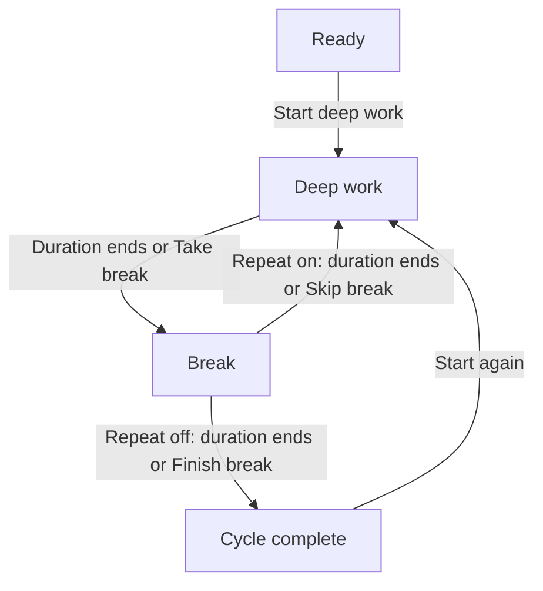

# Deep Work macOS implementation specification

**Document version:** 1.0 · **Baseline date:** October 17, 2026 · **Native implementation:** all checklist items begin at TODO.

Deep Work is a small macOS focus timer with three top-level views: **Focus**, **Journal**, and **Settings**. This specification captures the current three-view prototype at the level of individual controls, visible elements, states, validation rules, and data behavior. It is the implementation reference for a Swift app and the companion checklist.

The supplied app reference is an offline HTML prototype. This handoff contains requirements, tracking files, and reference code; it does not contain a compiled Mac app or an Xcode project. A working control in the prototype does not mean its Swift implementation is complete.

## Native product clarification — October 18, 2026

The user clarified the distinction between **Close** and **Quit**: **red close and Command-W only hide the main window.** A running focus or break continues, including phase transitions and background SQLite checkpoints; an already paused phase stays paused. Closing never pauses, ends, or resets the cycle, and slow or failed storage must not prevent hiding. Clicking the native menu-bar timer brings the existing window to the front on Focus without restarting it. Its running label is `MM:SS - Deep work` or `MM:SS - Break`, using the approved spelling **Break**.

**Only full Quit (Command-Q) pauses the phase, saves settings, configuration, saved schedule, journal records and the sealed checkpoint, drains queued writes, and exits.** Relaunch restores the unfinished phase paused until Resume. A failed Quit save offers Keep Open by default or explicit Quit Without Saving. Explicit Save Draft semantics remain unchanged. Force Quit/crash recovery uses the last committed checkpoint and never counts process downtime.

This clarification supersedes the earlier incorrect native close-and-pause amendment and restores the original G-006/AC-11 window behavior. The full menu-bar phase labels supersede the prototype's abbreviated G-004 labels below. `reference/` remains preserved as baseline evidence. The supplied Icon 1.0 artwork is the approved native application icon; its canonical source is `DeepWork/Resources/Assets.xcassets/AppIcon.appiconset` (see [icon provenance](docs/APP_ICON.md)). Native choices and verification are recorded in [NATIVE_DECISIONS.md](docs/NATIVE_DECISIONS.md) and [VERIFICATION.md](docs/VERIFICATION.md).

## Contents

**Core reference:** [Tracking](#how-to-use-this-handoff) · [Baseline and scope](#baseline-and-scope) · [Timer rules](#timer-and-session-rules) · [Journal and calendar](#journal-and-calendar-contract) · [CSV](#csv-output-contract) · [Swift components](#swift-implementation-map) · [Native decisions](#decisions-to-record-before-affected-native-work) · [Build order and acceptance](#implementation-order-and-release-checks).

**Element inventories:** [Shared shell](#shared-shell) · [Focus](#focus) · [Journal](#journal) · [Journal work schedule](#journal-work-schedule) · [Settings](#settings) · [Sources](#reference-sources).

## How to use this handoff

1. Open `reference/deep-work-preview.html` locally to inspect the current visual and interactive reference.
2. Use `IMPLEMENTATION_CHECKLIST.md` as the canonical manual progress tracker. Work under **view → feature → element** and keep the stable element IDs in commits, issues, and tests.
3. Look up an ID in the element inventory below for its use case, exact behavior, defaults, validation, suggested Swift ownership, and acceptance checks.
4. Use `implementation-tracker.json` as an initial import for a task system or coding tool. It is an export of this handoff, not an automatically synchronized second tracker. If you adopt an external tracker, explicitly make that the sole progress source.
5. Mark an item DONE only after implementing its native behavior and recording acceptance evidence. Additions and visual changes require an explicit product decision; this document does not authorize a redesign.

| Progress value | Meaning |
| --- | --- |
| TODO | Native work has not yet been accepted. |
| IN PROGRESS | Implementation is underway; acceptance checks remain. |
| BLOCKED | A concrete dependency or recorded product decision prevents completion. Record the reason. |
| DONE | Native behavior and relevant acceptance checks are complete, with a commit or verification note. |

The prototype column is separate: **Working** means the browser behavior exists, **Simulated** means a native/external effect is represented without performing it, and **Decorative** means a noninteractive visual element. These values never contribute to Swift completion. Multiple requirements may reference one control because its appearance, state, and underlying data contract need separate acceptance checks.

## Baseline and scope

The baseline is the current **three-view** `deep-work-preview.html`, following the explicit request to add Settings. The earlier frozen v1 is the two-view Focus/Journal checkpoint. Documentation does not alter either file.

| Reference | Bytes | SHA-256 |
| --- | ---: | --- |
| Current three-view prototype | 712,382 | `5980844ae41ae211db7747cc3b25d8f1b8375b810b340c32990e93b5e1301a3f` |
| Earlier frozen v1 | 693,591 | `1b53fda68d137435a814792fe5ae05b9c3d311f739f548dd773bd00c9342a132` |

The required experience is a lightweight utility: choose focus and break durations, run a repeating or single pair, see the remaining cycle in the menu bar, and inspect recorded focus in Journal. Settings contains the launch preference, CSV export, and a feedback form. **Work schedule remains a subview of Journal**, opened by Schedule; it is not a fourth top-level tab or a Settings section.

The current dashboard has three totals: **Focus time**, **Completed cycles**, and **Days with focus**. Its chart compares daily or weekly focus. There is no average metric or averaging denominator in this baseline. Goals, streaks, task management, website blocking, session editing/deletion, CSV import, sync, and additional dashboards are not defined by this version.

All app-visible strings are English. Preserve the current labels, including **Break**, **Launch at Login**, and the exact Slack status **❌ Deep WORK, DND**. Prototype-only explanatory text is identified in the inventory so its native replacement can be deliberate.

### Views and entry points

| View or surface | Entry | Main purpose | State retained when leaving |
| --- | --- | --- | --- |
| Focus | Focus tab; menu-bar timer; Journal empty-state action | Configure and control the timer; show Slack status preview | One shared timer, selected durations, repeat preference |
| Journal | Journal tab; initial app view in the prototype | Totals, activity chart, session history, date reports, work schedule | Current report period/date/range, grouping, sample mode, page within the open instance |
| Work schedule | Journal → Schedule | Edit the reporting calendar in a draft | Draft remains if switching tabs; Save commits, Cancel discards on reopening |
| Settings | Settings tab | Launch at Login, export scope, feedback draft and copy | Unsaved form edits remain within the open instance; explicit draft saves survive reload |
| Menu bar | Always available in the prototype shell | Display cycle countdown and reopen Focus | Closing the content window does not end the timer |

There are **no external navigation links** in the app. Blue text actions such as Today, View example, Show my journal, and End session are buttons. The download function creates a temporary CSV link internally. Copy Feedback uses the clipboard and does not navigate or send feedback.

## Timer and session rules

### Terms that affect accounting

| Term | Definition |
| --- | --- |
| Focus cycle | One configured period of deep work. It becomes complete only when the full configured active focus duration elapses. |
| Focus and break pair | One focus cycle followed by its break. This is the unit Repeat cycles schedules. |
| Session record | One focus cycle with original timestamps, planned duration, outcome, and active segments. Breaks are not separate journal rows. |
| Active segment | A period during which the focus timer is running. Paused time and break time have no focus segments. |
| Partial session | A focus cycle ended before its full active duration by Take break or End session. Positive time is retained; zero-time abandoned focus is not saved. |
| Live session | A temporary observation of the current focus cycle. It contributes elapsed focus time and zero completed cycles. A paused focus cycle remains a live record until finalized. |
| Reporting day | A local calendar day beginning at the configured cutoff, which defaults to 00:00. |

The app measures elapsed, unpaused timer time. It does not detect whether the person is actually concentrating or whether the Mac is idle.

### Normal phase flow

Pause and Resume apply to either running phase. **Take break** saves the focus as partial when used early. A naturally completed focus contributes one completed cycle. The label **Cycle complete** means the pair has finished; it can also follow an early-ended partial focus and therefore does not itself prove that a completed focus was recorded.

### Action and boundary contract

| Event | Required result |
| --- | --- |
| Start deep work | Require two valid durations; snapshot them for the session; start focus immediately; begin a new record; switch actual journal mode on. |
| Focus deadline | Finalize focus once as complete at the exact deadline; begin break at that deadline. |
| Break deadline, Repeat on | Begin a new focus cycle at the deadline with the same configured durations. |
| Break deadline, Repeat off | Stop in Cycle complete with 00:00; no new cycle starts. |
| Uncheck Repeat during focus | Finish the current focus and its upcoming break, then stop. |
| Uncheck Repeat during break | Finish that break, then stop. |
| Recheck Repeat after completion | Change the next session's preference only; wait for Start again. |
| Pause | Reconcile expired boundaries, store remaining time, seal the current focus segment, and stop counting elapsed time. |
| Resume | Keep the remaining duration, set a fresh deadline, and open a focus segment if the current phase is focus. |
| Take break | Reconcile first; if still in the requested focus phase, finalize positive focus time as partial and start the break immediately, even if previously paused. |
| Skip break | Available when Repeat is on; start focus immediately, even if the break was paused. |
| Finish break | Available when Repeat is off; end the pair immediately, including from a paused break. |
| End session | Reconcile, save any positive current focus as partial, and return to setup with duration choices retained. No confirmation dialog exists. |
| Start again | Reuse the preceding session's focus/break durations and current Repeat preference; create a fresh focus record. |
| Red close button | Hide the window and preserve state: a running timer continues, a paused timer stays paused, and the menu-bar entry remains available. |
| Menu-bar click | Show the window on Focus and focus the relevant setup or running control; do not restart or reset the timer. |
| Prototype document reopened after closing/reloading | Restore an unfinished checkpoint paused at its last saved point. Do not add time while the document was closed; resolve the corresponding native Quit/crash policy explicitly. |

Process elapsed phase boundaries before applying a user's action. For the manual next-phase button, the prototype ignores the click if reconciliation finishes the pair or leaves a different phase name. Its guard compares focus/break names, not cycle IDs: after a long delay that crosses a whole pair and returns to the same phase name, that click can still act on the newer cycle. Decide whether to preserve or tighten this behavior in Swift; do not assume an identity guard already exists. Pause and End session intentionally act on the state reached after reconciliation. When changing Repeat, reconcile using its previous value before replacing it.

The prototype repaints the timer every 250 ms and derives the display from a deadline, rounding remaining seconds upward. Minutes are not capped at two digits: 480 minutes appears as `480:00`. Timer progress describes the current phase only and restarts at zero for the next phase. The menu bar uses `MM:SS - deep` or `MM:SS - break`; it returns to Deep Work when idle or complete.

### Recovery, ownership, and persistence

The journal store uses `deep-work-journal-v1`; the separate settings store uses `deep-work-settings-v1`. Journal writes occur on relevant transitions/changes, visibility or page-hide events, and about every five seconds while running. At most the last uncheckpointed interval may be lost in an abrupt close. Recovery never invents focus for downtime.

One browser preview owns the timer through a Web Lock when that API is available. A second preview can browse but cannot start or control the timer. Its storage writes preserve the owner's active checkpoint. Records and live observations are deduplicated by ID. This is prototype coordination, not a required native browser mechanism: the Swift app should have one shared state owner independent of view lifetime.

Storage failure keeps the current in-memory session usable and exposes a warning. Journal CSV export remains available. CSV cannot restore individual active segments or preferences, so it is not a lossless backup. Native persistence must preserve raw records and report failures accurately.

## Journal and calendar contract

### Report bounds and metrics

Every report uses the half-open interval **[From, Until)**: From is included and Until is excluded. Day and Week bounds follow the saved local cutoff and first weekday. Range bounds are absolute local date/time selections and are not silently rewritten when a work schedule is saved.

For each active segment, time in range is the positive overlap between that segment and the report interval. Sum those overlaps to obtain Focus time. Count a completed cycle only when the record's completion timestamp is at or after From and strictly before Until. A row can appear with focus but no in-range completion, or with an in-range completion and zero focus in that interval.

| Output | Calculation or behavior |
| --- | --- |
| Focus time | Sum of clipped active focus segments; excludes pauses and breaks. Main metric shows seconds below one minute, otherwise whole minutes/hours; its tooltip retains precise whole seconds. |
| Completed cycles | Count complete focus records whose finish timestamp belongs to the range. Partial and live records do not count. |
| Partial-session helper | Count partial records with positive focus in the range. It excludes live records. |
| Days with focus | Number of reporting days with positive focus, divided by every reporting day overlapping the range. The denominator includes future and zero-focus dates within the selected report. |
| Scheduled days | Number of those report days matching the saved work pattern; a separate contextual count. Off-day work is always included in time and active-day totals. |
| Day/week chart | Sum the same day allocations, then group by saved week boundaries when needed. Changing grouping does not change totals or session membership. |
| Sessions | Rows with positive in-range focus or an in-range completion, ordered by original start newest first. Twelve rows per page. Export includes every matching row, not just the visible page. |

An invalid range shows the range error, zero/empty report content, and disabled export. Custom bounds must parse back to the entered local date/time, Until must exceed From, and elapsed duration must be at most **3,660 × 24 hours**. The UI calls this a 10-year range. A chart automatically switches to By week above **93 × 24 elapsed hours**; shortening the range does not automatically revert it to By day.

### Calendar examples

| Example | Expected result |
| --- | --- |
| A 60-minute focus runs 09:00–09:20, pauses 09:20–09:30, resumes 09:30–10:10 | Record starts 09:00 and ends 10:10; focus is 60 minutes; one completed cycle; the ten-minute pause is excluded. |
| A report ends exactly when that focus finishes at 10:10 | It can include all 60 focus minutes, but its completed-cycle count excludes the finish at the exclusive endpoint. |
| A following report starts exactly at 10:10 | It can include that completion with zero focus from the record, provided its Until is later. |
| Reporting day starts at 04:00 and focus runs 03:30–04:30 | Allocate 30 minutes to the prior reporting date and 30 to the next. A completion at 04:30 belongs to the new date. |
| A session occurs on a selected day off | Keep the focus and session; show off-day chart styling. Do not discard it or reduce its time. |
| A work pattern is 2 on / 2 off | Repeat using civil calendar-day offsets from First work day, including dates before the anchor; do not use elapsed 24-hour chunks. |

Use calendar date arithmetic for navigation and buckets. Daylight-saving transitions may make reporting days shorter or longer than 24 hours. The reference chooses the earlier repeated local cutoff and moves a nonexistent cutoff forward. Explicit custom date/time inputs reject a nonexistent local value and choose the earlier occurrence of an ambiguous one. There is no reporting-time-zone picker. The reference uses the device/browser's current local zone; a native policy for changing zones during a session must be recorded before changing that behavior.

### Work schedule and examples

Chosen weekdays starts with Monday–Friday; all seven checkboxes are independent, and selecting zero days is valid. Any day marks all dates available. Rotating shifts requires 1–31 whole workdays, 1–31 whole rest days, and a valid First work day. Week starts on defaults to Monday; Reporting day starts at defaults to 00:00. The next 14 reporting dates preview the unsaved draft. Only Save schedule commits it.

Changing the schedule reinterprets history with the current rules. It neither rewrites raw timestamps nor starts timers automatically. Unsaved schedule changes stay in the form if the user switches tabs; Cancel returns to the saved schedule, and reopening the editor loads the committed values.

Example records are generated for the most recent 35 local dates and remain separate from actual records. With an empty real journal and no active checkpoint, the preview opens Journal in example mode. The banner and export identify examples. Starting a real focus cycle turns example mode off. Settings → All Sessions always uses actual history, even when Journal shows examples.

## CSV output contract

Both export entry points use one serializer. Journal's **Export CSV** exports the selected report. Settings' **Export to CSV…** offers **All Sessions** and **Current Journal Report**. Export does not pause or prematurely finish a cycle; it reconciles any already-expired phase boundaries before taking the report snapshot.

| # | Exact column | Meaning |
| ---: | --- | --- |
| 1 | Data | Journal or Example |
| 2 | Report from | Inclusive local timestamp; blank for All Sessions |
| 3 | Report until (exclusive) | Exclusive local timestamp; blank for All Sessions |
| 4 | Reporting day starts | Current cutoff as HH:mm |
| 5 | Schedule | Current readable schedule summary |
| 6 | Session ID | Stable session identifier |
| 7 | Started | Original session start, including when outside the selected report |
| 8 | Ended / observed at | Original end for a finished record; observation time for a live record |
| 9 | Outcome | complete, partial, or live; paused current focus exports as live |
| 10 | Planned minutes | Configured focus minutes |
| 11 | Focus seconds in range | Active seconds clipped to the selected report; full active seconds for All Sessions |
| 12 | Total focus seconds | Full active duration of the record/observation |
| 13 | Completed cycle in range | 1 if completion belongs to the range, otherwise 0; All Sessions uses 1 for complete records |

Encode UTF-8 with a leading BOM, comma delimiters, CRLF row separators, and double quotes around every field. Double embedded quotes. Focus-second values are numeric, rounded to at most three fractional digits. Timestamps include local seconds and a numeric UTC offset; timestamp strings do not contain milliseconds. The export is a session summary, not the full segment store.

Current report filenames are `deep-work-YYYY-MM-DD-to-YYYY-MM-DD.csv`, adding `example-` after `deep-work-` for examples. The dates are the literal local dates of the inclusive start and exclusive end. All Sessions uses `deep-work-journal-all-sessions.csv`. Native Save must distinguish cancellation, write failure, and actual success; the prototype can only confirm download initiation.

## Swift implementation map

These file names and component boundaries are a proposed implementation structure. They do not add product controls. Keep the reference behavior in the model layer so opening, closing, and switching SwiftUI views cannot create a second timer or reset a report unexpectedly.

| Component | Suggested Swift location | Responsibility |
| --- | --- | --- |
| App entry and state ownership | `DeepWork/App/DeepWorkApp.swift`, `AppModel.swift` | One app-level state owner, three-view selection, dependency construction |
| Focus view | `DeepWork/Features/Focus/FocusView.swift` | Setup controls, running states, repeat, status display |
| Timer engine | `DeepWork/Core/TimerEngine.swift` | Phases, deadlines, pause/resume, boundary reconciliation, injected clock |
| Record types | `DeepWork/Core/SessionRecord.swift` | Stable IDs, planned duration, active segments, outcomes and live observations |
| Journal persistence | `DeepWork/Data/JournalStore.swift` | Validated local records, active checkpoint, recovery, serialized durable writes |
| Report calculation | `DeepWork/Reports/ReportEngine.swift` | Range clipping, completion attribution, calendar buckets, totals |
| Schedule model | `DeepWork/Reports/WorkSchedule.swift` | Weekdays, shifts, cutoff, local day/week rules |
| Journal and schedule views | `DeepWork/Features/Journal/JournalView.swift`, `WorkScheduleView.swift` | Filters, metrics, chart, table, pagination, draft editor |
| Shared CSV | `DeepWork/Reports/ReportCSVExporter.swift` | Shared dataset contract, quoting, encoding, save outcome |
| Settings view/store | `DeepWork/Features/Settings/SettingsView.swift`, `DeepWork/Data/SettingsStore.swift` | Launch state presentation, export scope, feedback fields, saved draft |
| Clipboard | `DeepWork/Services/FeedbackClipboard.swift` | Validate/format feedback, copy exact payload, expose failure |
| Window and status bar | `DeepWork/App/WindowController.swift`, `MenuBarController.swift` | Keep app/timer alive with no window; display timer; reopen Focus |
| Login item | `DeepWork/Services/LoginItemService.swift` | Read/register/unregister actual OS login-item state |
| Slack status | `DeepWork/Services/SlackStatusService.swift` | Authenticate, snapshot previous status, set/restore on phase transitions, reconcile failures |
| Verification | `DeepWorkTests`, `DeepWorkUITests` | Deterministic engine/report tests and meaningful native integration/UI checks |

### Native platform choices

Build an Xcode **macOS App** target with SwiftUI for the three views and AppKit where exact window/menu-bar behavior needs it. A proposed deployment floor is macOS 13 if the launch feature uses `SMAppService`; select the actual floor before choosing APIs. Apple documents `SMAppService.mainApp` for the main app's login registration on macOS 13 and later. The service exposes registration/authorization state, including approval requirements. A stored Boolean alone is not proof that login launch works. [A1] [A2]

Use a retained `NSStatusItem` and its button action for the direct click-to-reopen behavior. Its text is a projection of the same timer state as Focus. Handle last-window closure without terminating the app; an explicit Quit remains an actual process exit and requires the recovery/Slack policy below. Apple provides the status-item button and the application delegate's last-window termination decision. [A3] [A4]

For exports, `NSSavePanel` can collect the destination and `UTType.commaSeparatedText` identifies CSV. Write the bytes before displaying saved success. For feedback, use the general `NSPasteboard` for the documented text payload. These are native counterparts to existing controls. [A5] [A6] [A7]

Use a typed model and serialized writes. One suitable small-app approach is Codable records written atomically under the app's Application Support directory, with simple preferences and the feedback draft stored separately. Store original absolute timestamps and active segments; derive totals rather than persisting rounded UI numbers. Validate IDs, timestamps, segment order/non-overlap, and schema version at the storage boundary. Keep authentication secrets in Keychain. This storage design is a recommendation, not a claim that the HTML localStorage schema is already a native database.

The timer should use an injectable elapsed-time source plus wall-clock timestamps for journal records. Do not drive accounting by subtracting one second per UI tick. The prototype uses `Date.now()` and has wall-clock-change limitations; explicitly choose and test sleep and clock-change behavior before replacing its time semantics.

### Slack integration boundary

The current Slack section is display-only. The native requirement is to set the signed-in user's custom status to **❌ Deep WORK, DND** during focus and restore their prior status on break. Paused focus retains the focus status. The setup view shows the intended status without changing Slack. The text DND is part of the status; notification snoozing, presence changes, and macOS Focus are not implemented by this display.

Slack documents `users.profile.get` with `users.profile:read` for reading the previous custom status, and `users.profile.set` with a user token and `users.profile:write` for writing it. Preserve `status_text`, `status_emoji`, and `status_expiration`; the latter is Unix seconds, with zero meaning no expiration. The API emoji value must be a supported workspace emoji identifier, not a UI glyph assumption. [S1] [S2] [S3]

Apply network changes on meaningful state transitions, not on timer ticks. Keep local timing usable if Slack is unavailable. Authentication/account selection, expiry during an indefinitely paused focus, conflict handling when the user manually changes status, crash recovery, and end/quit restoration all need an intentional native policy. No Connect Slack button or authentication screen exists in this baseline, so its presentation is a recorded decision rather than an invented completed feature.

## Decisions to record before affected native work

These decisions identify gaps between a visual browser prototype and a shipping Mac utility. They do not block building unaffected views, models, or tests, and they do not authorize modifying the frozen appearance.

| Decision | Current evidence | Recommended starting point | Affected work |
| --- | --- | --- | --- |
| Minimum macOS version | No native deployment target exists. | Confirm the floor; macOS 13 is a candidate with the documented login API. | App target, native API selection |
| Window lifecycle and native menu commands | Red close hides; yellow/green and File/Window labels are decorative. There is no prototype Quit action. | Use real macOS chrome; keep the timer alive after close; document explicit Quit/checkpoint behavior. | Shared shell, recovery, Slack |
| Sleep and clock adjustments | Hidden/open elapsed time is reconciled; closed-file time is not counted. | Preserve ordinary background behavior; decide sleep and clock-change policy explicitly and test it. | Timer engine, journal timestamps |
| Manual action after a long delay | The next-phase button compares phase names after catch-up, not session identity. | Record whether a stale click may act on a later cycle with the same phase name; add an identity guard only as an explicit correction. | Take break, Skip break, Finish break |
| Slack authentication and ownership | No real connection controls or tokens exist. | Resolve account flow and conditional restore when a user changes status manually. | Slack integration |
| Slack expiry and exit restoration | Preview says restored on break/completion but cannot enforce it remotely. End returns to prospective setup text. | Choose expiry/recovery rules and restore behavior for End session, Quit, and failures. | Slack integration, end/quit |
| Native login state and failure copy | Preference saves; macOS registration is not performed. | Reflect actual registration, system approval, external revocation, and failures truthfully. | Launch at Login |
| Feedback delivery | Save Draft and Copy Feedback exist; no Send, destination, or endpoint exists. | Implement the existing local actions. Adding delivery requires a separate product choice. | Feedback |
| Native validation parity | JavaScript length counts UTF-16 units; normal Swift `String.count` counts user-perceived characters. | Preserve the 5–5,000 rule intentionally; record counting, trimming, and email rules and cover emoji input. | Feedback validation |
| Calendar normalization and timezone changes | Local Date rules differ between cutoff creation and Range input validation. | Match the documented DST policy; decide how a timezone change affects a running session and existing reports. | Calendar/report engine |
| Save and copy wording | Some prototype success strings assume initiation; clipboard failure says below although the field is above. | Replace prototype-specific promises with native result states when implementing those services. | CSV, settings, schedule, clipboard |
| Minor report label limitations | Range title omits years; weekly Today styling checks the week's first date; Cycle complete can follow a partial focus. | Preserve as baseline unless a specific detail change is approved; keep metric math unambiguous. | Journal and Focus presentation |

## Implementation order and release checks

| Stage | Work | Exit condition |
| --- | --- | --- |
| 1. App and durable model | Xcode target, shared state, record/schedule/settings types, single-owner lifecycle, store/versioning | App opens all three views; stored model round-trips without replacing real history with examples. |
| 2. Focus | Duration validation, phase engine, repeat, pause/resume, manual transitions, checkpoint/recovery, Focus UI | Deterministic timer cases pass; no duplicate or paused/break time in journal records. |
| 3. Journal | Report engine, schedule drafts/calendar rules, totals, chart, table, pagination, actual/example modes | The same dataset gives consistent table, chart, metric, and CSV totals across date/DST boundaries. |
| 4. Settings and export | Shared CSV serializer/save operation, feedback validation/draft/clipboard, settings persistence | Native file save/cancel/failure and clipboard/draft behavior match their contracts. |
| 5. macOS and Slack services | Menu-bar text, close/reopen behavior, real Launch at Login, resolved Slack integration | Validate on a Mac, including actual login, phase transitions, pause, break, and restore/failure behavior. |
| 6. Native acceptance | Keyboard/VoiceOver, light/dark, window sizing, background/recovery, regression cases below | Every delivered item has acceptance evidence; unresolved items are explicitly BLOCKED or TODO. |

### Cross-feature acceptance scenarios

The item inventory supplies local checks. Use these integration scenarios for the behaviors most likely to diverge during a Swift port. Durations can be advanced with an injected test clock; real users should not have to wait an hour to test a transition.

| Case | Scenario | Expected result |
| --- | --- | --- |
| AC-01 | Fresh data, first open | Journal opens with clearly marked examples; Focus durations show placeholders; Repeat is on; launch is off; feedback type is General feedback. |
| AC-02 | Custom durations blank, fractional, 0, 481; then 1 and 480 | Invalid values show errors and prevent Start; both integer endpoints are accepted. |
| AC-03 | Run 60 focus / 10 break with Repeat on | One full focus record at 60 minutes; break records no focus; next focus starts at 70 minutes. |
| AC-04 | Uncheck Repeat during focus or during break | Finish the current pair and stop; do not abandon its focus or start another pair. |
| AC-05 | Recheck Repeat in Cycle complete | Timer remains stopped until Start again; next session uses the preference. |
| AC-06 | Pause a focus cycle for 10 minutes, then Resume | Remaining time and focus total do not change during pause; final focus duration still equals the plan. |
| AC-07 | Take break during a paused partial focus | Positive focused time is saved as partial; break begins immediately and is unpaused. |
| AC-08 | Skip/Finish a paused break | Repeat on starts a fresh focus; Repeat off completes the pair. |
| AC-09 | Trigger an action exactly at a phase deadline | Reconcile once without duplicate completion. Ignore the manual next-phase click when the resulting phase name differs; Pause/End act on the reconciled state. Cover a multi-boundary delay returning to the same phase under the recorded native policy. |
| AC-10 | Delay refresh across several phase boundaries | Reconcile each elapsed phase once under the agreed background/sleep policy. |
| AC-11 | Hide from Settings, then click the menu timer | Countdown continues; window opens on Focus with the same remaining session. |
| AC-12 | Close/reload the prototype with an unfinished checkpoint | Reference behavior restores paused at the saved remaining duration and creates no focus for downtime. Verify the recorded native Quit/crash/relaunch policy against this recovery baseline. |
| AC-13 | End after positive focus; end immediately at zero | Positive time creates one partial record; zero-time abandonment creates none. |
| AC-14 | Segment crosses local midnight or a 04:00 cutoff | Split time into correct reporting days while counting the completion at its finish timestamp. |
| AC-15 | Completion timestamp equals Until | Exclude completion from that range; include it in a following range that begins at that instant. |
| AC-16 | Kyiv spring/fall DST boundary and shift dates before anchor | Calendar buckets are correct for short/long days; civil-day work/rest rotation remains consistent. |
| AC-17 | Zero selected weekdays, then Any day, then rotating shifts | All patterns save when valid; off-day focus remains recorded; reports reinterpret history without editing timestamps. |
| AC-18 | Save schedule, Cancel draft, or switch tabs with a draft | Save applies; Cancel returns to committed values; tab navigation alone does not commit. |
| AC-19 | Chart selection and more than 12 session rows | Click day/week to drill in; pagination affects visible rows only; totals and export cover the full report. |
| AC-20 | Invalid, 93-day, over-93-day, 3,660-day, and over-limit ranges | Invalid report is empty; strict grouping and maximum-span thresholds behave as documented. |
| AC-21 | Export examples and All Sessions while a real focus runs | Current report follows sample/filter mode; All Sessions contains only actual records, including a live observation without completion. |
| AC-22 | CSV session crosses range boundary and contains quoted cells | Correct clipped/full values, offsets, quoting, BOM, CRLF, column order, and completion flags. |
| AC-23 | Native save success, cancellation, and write failure | Only a successful write claims saved; cancellation changes no history; failure is visible. |
| AC-24 | Invalid email + short message, then corrected values | Email error takes priority; focus moves to the invalid field; valid retry can save/copy. |
| AC-25 | Save draft A, edit to B, Copy B, reload | Clipboard contains B; saved draft remains A until Save Draft is used again. |
| AC-26 | Switch Launch at Login with unsaved feedback edits | Launch state changes without overwriting or implicitly saving the current form edits. Native login is verified with an actual login cycle. |
| AC-27 | Storage unavailable | Timer and in-memory UI remain usable; persistence warning is truthful; CSV and clipboard remain available. |
| AC-28 | Slack transitions and external failures | Set focus status after successful authorization, retain on pause, restore according to the resolved break/end/quit policy; local timer stays usable when Slack fails. |
| AC-29 | Keyboard and VoiceOver, light/dark, narrow window | Controls are labelled and operable; errors/status are announced; changing tabs doesn't restart work; no clipped essential controls. |

### Definition of done

Each native item needs implemented behavior, matching visible state and wording, valid input/error handling, and acceptance evidence appropriate to its risk. A screenshot is sufficient only for a static visual item. Time, reporting, persistence, CSV, clipboard, login, and Slack require behavior evidence. The Swift app must be built and exercised on macOS; the HTML prototype and its JavaScript tests cannot establish that native integrations work.

## Element inventory

The sections below enumerate every visible control, element group, helper, status, and output behavior, including conditional and generated elements. Static headings/icons can share a task when they form one visual unit. Work schedule entries use the **W** prefix while remaining under Journal. DOM selectors identify the exact prototype reference; they are not required Swift identifiers.

### Inventory coverage

| Area | Implementation items | Native accepted |
| --- | ---: | ---: |
| Shared shell | 14 | 0 |
| Focus | 29 | 0 |
| Journal | 54 | 0 |
| Journal work schedule | 19 | 0 |
| Settings | 21 | 0 |
| **Total** | **137** | **0** |

Source coverage: **122/122 static DOM IDs**, **54/54 static interactive controls**, all **10 controls without IDs** (three period buttons and seven weekday checkboxes), and all **four visible generated UI patterns**. The internal temporary CSV anchor and clipboard textarea are covered by their output requirements. This is documentation coverage, not a claim that native tests passed.

The behavior acceptance bullets below describe the baseline. For a Swift port, use native equivalents: relaunch for browser reload, app storage for localStorage, native clipboard for the browser copy APIs, and one app state owner for browser-lock coordination. The separate **Swift completion check** makes the native outcome explicit.

### Shared shell

#### Shared shell / Window chrome

##### G-001

**Deep Work window and title**

**Type:** Window surface and static title · **Prototype:** Simulated · **Native:** TODO · **Build stage:** 1

**Use case.** Recognize the application and keep the three views inside one compact window.

**Expected behavior.** The prototype depicts a macOS window titled Deep Work. It contains one selected view at a time. The surrounding preview background and title-bar spacers are decorative. Journal uses the wider window class, Settings uses its own 560px width class, and Focus uses the compact base width. This is an HTML depiction, not an operating-system window; native dragging, resizing, window restoration and title-bar conventions remain native implementation decisions.

**Defaults and validation.** The depicted window is visible on first load. Width remains constrained by the available preview width. Product colors follow the existing light/dark variables.

**Behavior acceptance:**

- The window title reads Deep Work in every view.
- Only the selected view is visible.
- The window and controls fit a 320px preview without clipping.
- Native window behavior is implemented and reviewed separately from the HTML window depiction.

**Swift completion check.** Verify the window behavior on macOS; an HTML traffic light or screenshot is not sufficient.

**Implementation.** Use real macOS window chrome. Preserve running/paused state on close. Resolve minimize, zoom, resizing and explicit Quit behavior deliberately.

**Suggested Swift files:** `DeepWork/App/WindowController.swift`, `DeepWork/App/AppModel.swift`.

**Dependencies:** App state owner; TimerEngine for close/reopen.

**Prototype source:** `#deep-work-repaired-concept`, `#dw-window`, `.dw-titlebar`, `.dw-window-title`, `.dw-stage`. [P1] [P2]

##### G-006

**Red close button: hide window**

**Type:** Button · **Prototype:** Working · **Native:** TODO · **Build stage:** 1

**Use case.** Remove the main window from view while continuing the existing timer.

**Expected behavior.** The red button reconciles and saves the current state, hides the entire depicted window, sets the menu button's aria-expanded to false and moves keyboard focus there. It does not end, pause, resume or reset a session. An already paused session stays paused. Hovering the traffic-light group or keyboard-focusing the red button reveals its x glyph. This action differs from closing the actual browser preview.

**Defaults and validation.** The accessible label is Close window and keep timer running. The data-tooltip copy is Hide window · keep timer running; tooltip presentation is not wired in the standalone. There is no confirmation dialog.

**Behavior acceptance:**

- Closing during focus leaves the menu-bar countdown advancing.
- Closing during pause preserves the frozen remaining time.
- The window can be reopened using the menu item.
- Closing does not add a partial session or clear the Repeat choice.
- The red button remains keyboard operable.

**Swift completion check.** Verify the window behavior on macOS; an HTML traffic light or screenshot is not sufficient.

**Implementation.** Use real macOS window chrome. Preserve running/paused state on close. Resolve minimize, zoom, resizing and explicit Quit behavior deliberately.

**Suggested Swift files:** `DeepWork/App/WindowController.swift`, `DeepWork/App/AppModel.swift`.

**Dependencies:** App state owner; TimerEngine for close/reopen.

**Prototype source:** `#dw-close`, `#dw-window`, `.dw-traffic`, `#dw-menu-status`. [P1] [P2]

##### G-007

**Yellow minimize traffic light**

**Type:** Decorative window control · **Prototype:** Decorative · **Native:** TODO · **Build stage:** 1

**Use case.** Depict familiar macOS window chrome.

**Expected behavior.** The yellow circle is an aria-hidden span. It has no handler, keyboard focus or minimize behavior. A real minimize action is a native implementation decision, not completed prototype functionality.

**Defaults and validation.** Always displayed while the depicted window is visible.

**Behavior acceptance:**

- The yellow traffic light is visible beside the red button.
- The prototype does not treat it as a working button.
- Native minimize behavior is explicitly implemented or intentionally excluded before completion.

**Swift completion check.** Verify the window behavior on macOS; an HTML traffic light or screenshot is not sufficient.

**Implementation.** Use real macOS window chrome. Preserve running/paused state on close. Resolve minimize, zoom, resizing and explicit Quit behavior deliberately.

**Suggested Swift files:** `DeepWork/App/WindowController.swift`, `DeepWork/App/AppModel.swift`.

**Dependencies:** App state owner; TimerEngine for close/reopen.

**Prototype source:** `.dw-traffic .dw-minimize`. [P1] [P2]

##### G-008

**Green zoom traffic light**

**Type:** Decorative window control · **Prototype:** Decorative · **Native:** TODO · **Build stage:** 1

**Use case.** Depict familiar macOS window chrome.

**Expected behavior.** The green circle is an aria-hidden span. It has no handler, keyboard focus, zoom or full-screen behavior. The native app's resizability and full-screen policy remain undecided.

**Defaults and validation.** Always displayed while the depicted window is visible.

**Behavior acceptance:**

- The green traffic light is visible beside the yellow one.
- Clicking it does not change the prototype window.
- Native zoom and full-screen behavior are resolved explicitly.

**Swift completion check.** Verify the window behavior on macOS; an HTML traffic light or screenshot is not sufficient.

**Implementation.** Use real macOS window chrome. Preserve running/paused state on close. Resolve minimize, zoom, resizing and explicit Quit behavior deliberately.

**Suggested Swift files:** `DeepWork/App/WindowController.swift`, `DeepWork/App/AppModel.swift`.

**Dependencies:** App state owner; TimerEngine for close/reopen.

**Prototype source:** `.dw-traffic .dw-zoom`. [P1] [P2]

#### Shared shell / Menu bar

##### G-002

**Deep Work, File and Window menu labels**

**Type:** Decorative menu labels · **Prototype:** Decorative · **Native:** TODO · **Build stage:** 5

**Use case.** Show the intended macOS menu-bar context around the timer item.

**Expected behavior.** Deep Work, File and Window are static text. They do not open menus and have no commands, links or click handlers. File and Window are hidden at the compact responsive breakpoint; Deep Work remains visible. Native application, File and Window menus have not been specified by this prototype.

**Defaults and validation.** Deep Work is the emphasized application label. File and Window carry aria-hidden in the prototype and are presentation only.

**Behavior acceptance:**

- The three labels match the source copy.
- Clicking a label does not perform a prototype action.
- File and Window disappear in the narrow layout.
- Native menu commands are explicitly inventoried before this row is marked implemented.

**Swift completion check.** Verify the real menu-bar display and direct Focus reopen action with the content window closed; record native menu decisions.

**Implementation.** Use one retained native status item driven by shared timer state. The depicted File/Window labels do not define custom commands.

**Suggested Swift files:** `DeepWork/App/MenuBarController.swift`, `DeepWork/App/DeepWorkApp.swift`.

**Dependencies:** TimerEngine; WindowController.

**Prototype source:** `.dw-menubar`, `.dw-menu-left`, `#dw-menu-app`, `.dw-menu-context`. [P1] [P2]

##### G-003

**Menu-bar timer item and reopen action**

**Type:** Button · **Prototype:** Working · **Native:** TODO · **Build stage:** 5

**Use case.** Return to the timer after hiding the application window.

**Expected behavior.** Activating the item reconciles elapsed time, shows the depicted window, sets aria-expanded to true and selects Focus. It always selects Focus, including when the window was already visible or was hidden from Journal or Settings. In setup it focuses the focus-duration selector; during a session or completion it focuses the primary session action. The item is a working prototype button, but is not a real macOS status item.

**Defaults and validation.** The button is available while the depicted window is hidden. Its accessible label incorporates the current timer state and Show Deep Work window. The data-tooltip text is Show Deep Work; the standalone does not itself initialize a tooltip renderer.

**Behavior acceptance:**

- After hiding the window, activating the menu item shows Focus.
- Reopening does not reset elapsed time or start a second timer.
- Reopening a paused session preserves its remaining time and paused state.
- Activating the item while Journal is visible switches to Focus.

**Swift completion check.** Verify the real menu-bar display and direct Focus reopen action with the content window closed; record native menu decisions.

**Implementation.** Use one retained native status item driven by shared timer state. The depicted File/Window labels do not define custom commands.

**Suggested Swift files:** `DeepWork/App/MenuBarController.swift`, `DeepWork/App/DeepWorkApp.swift`.

**Dependencies:** TimerEngine; WindowController.

**Prototype source:** `#dw-menu-status`, `#dw-window`, `#dw-focus-panel`. [P1] [P2]

##### G-004

**Menu-bar countdown and phase text**

**Type:** Dynamic status text · **Prototype:** Working · **Native:** TODO · **Build stage:** 5

**Use case.** See remaining time and the current phase without reopening the main window.

**Expected behavior.** Idle and completed states show Deep Work. Active focus shows MM:SS - deep; active break shows MM:SS - break. A paused session retains its phase text and frozen time. Display seconds are rounded up from remaining milliseconds, and durations longer than 99 minutes expand the minute field rather than switching to hours. In a read-only second preview, this item stays idle rather than mirroring the owning preview's countdown.

**Defaults and validation.** Initial text is Deep Work. The displayed value is clamped at zero and uses tabular numerals. The active owner updates through the timer loop; hiding the depicted window does not suspend it.

**Behavior acceptance:**

- A newly started 60-minute focus initially reads 60:00 - deep.
- After one elapsed second it reads 59:59 - deep.
- A 10-minute break initially reads 10:00 - break.
- Completing the final break returns the label to Deep Work.
- Pausing freezes the text until Resume or a phase-changing action.

**Swift completion check.** Verify the real menu-bar display and direct Focus reopen action with the content window closed; record native menu decisions.

**Implementation.** Use one retained native status item driven by shared timer state. The depicted File/Window labels do not define custom commands.

**Suggested Swift files:** `DeepWork/App/MenuBarController.swift`, `DeepWork/App/DeepWorkApp.swift`.

**Dependencies:** TimerEngine; WindowController.

**Prototype source:** `#dw-menu-text`, `#dw-menu-status`. [P1] [P2]

##### G-005

**Timer and paused menu-bar icons**

**Type:** State-dependent icon pair · **Prototype:** Working · **Native:** TODO · **Build stage:** 5

**Use case.** Distinguish an active countdown from a paused session at a glance.

**Expected behavior.** The timer icon appears during setup, normal running and completion. The pause icon replaces it only for an active paused session. The icons themselves are not separate controls. The containing button's accessible label begins with Paused when appropriate.

**Defaults and validation.** Both icon containers are aria-hidden. The prototype uses Lucide timer and pause glyphs; native symbol choices are not yet implemented.

**Behavior acceptance:**

- Exactly one menu-bar icon is visible in every state.
- Pause shows the pause icon and an accessible paused description.
- Resume restores the timer icon.
- An idle or completed session does not show the pause icon.

**Swift completion check.** Verify the real menu-bar display and direct Focus reopen action with the content window closed; record native menu decisions.

**Implementation.** Use one retained native status item driven by shared timer state. The depicted File/Window labels do not define custom commands.

**Suggested Swift files:** `DeepWork/App/MenuBarController.swift`, `DeepWork/App/DeepWorkApp.swift`.

**Dependencies:** TimerEngine; WindowController.

**Prototype source:** `#dw-menu-timer-icon`, `#dw-menu-pause-icon`, `#dw-menu-status`. [P1] [P2]

#### Shared shell / View navigation

##### G-009

**Focus tab**

**Type:** Tab button · **Prototype:** Working · **Native:** TODO · **Build stage:** 1

**Use case.** Configure or control the current focus/break session.

**Expected behavior.** Selecting Focus reconciles elapsed time, shows the existing Focus state, hides Journal and Settings and applies the compact window width. It does not reset the timer or its inputs. The tab includes a decorative timer icon and has a matching tabpanel.

**Defaults and validation.** Focus is initially unselected. The active tab has aria-selected true and tabIndex 0; inactive tabs have aria-selected false and tabIndex -1.

**Behavior acceptance:**

- Selecting Focus shows setup when idle and the session controls when active or complete.
- Switching to Focus preserves paused and Repeat states.
- Only Focus has selected styling after activation.

**Swift completion check.** Navigate all three native views by mouse and keyboard without creating another timer or losing in-memory edits.

**Implementation.** Bind the three-view selector to one app-level selection. Preserve child state and the timer across navigation.

**Suggested Swift files:** `DeepWork/App/RootView.swift`, `DeepWork/App/AppModel.swift`.

**Dependencies:** App state owner.

**Prototype source:** `#dw-tab-focus`, `#dw-focus-panel`, `.dw-viewbar`, `.dw-viewbar [role='tablist']`. [P1] [P2]

##### G-010

**Journal tab and initial landing view**

**Type:** Tab button · **Prototype:** Working · **Native:** TODO · **Build stage:** 1

**Use case.** Review recorded sessions and reporting views without interrupting the timer.

**Expected behavior.** Selecting Journal reconciles and persists crossed timer boundaries, shows Journal and widens the depicted window. Journal is selected on every fresh document load, including a load that restores an unfinished session paused. Journal content is documented in its own view inventory. The tab includes a decorative book icon.

**Defaults and validation.** Journal is the initial selected tab; there is no persisted last-selected-view preference. An active timer continues while Journal is visible.

**Behavior acceptance:**

- A fresh load opens Journal.
- Selecting Journal does not pause a running session.
- Switching views at a timer boundary updates the menu item and saves the transition.
- Journal has the selected accessibility state while its panel is shown.

**Swift completion check.** Navigate all three native views by mouse and keyboard without creating another timer or losing in-memory edits.

**Implementation.** Bind the three-view selector to one app-level selection. Preserve child state and the timer across navigation.

**Suggested Swift files:** `DeepWork/App/RootView.swift`, `DeepWork/App/AppModel.swift`.

**Dependencies:** App state owner.

**Prototype source:** `#dw-tab-journal`, `#dw-journal-panel`, `.dw-viewbar [role='tablist']`. [P1] [P2]

##### G-011

**Settings tab**

**Type:** Tab button · **Prototype:** Working · **Native:** TODO · **Build stage:** 1

**Use case.** Open general preferences, export and feedback without interrupting focus.

**Expected behavior.** Selecting Settings reconciles timer state, shows Settings and applies the settings-window width. It hides Focus and Journal while retaining their state. Its contents are documented in the Settings inventory. The tab includes a decorative settings icon.

**Defaults and validation.** Settings is initially unselected. A running or paused timer keeps its existing state while Settings is visible.

**Behavior acceptance:**

- The third tab is labeled Settings.
- Selecting it displays Settings alone.
- A running timer continues to update the shared menu item.
- All three tabs remain visible and operable at the narrow supported width.

**Swift completion check.** Navigate all three native views by mouse and keyboard without creating another timer or losing in-memory edits.

**Implementation.** Bind the three-view selector to one app-level selection. Preserve child state and the timer across navigation.

**Suggested Swift files:** `DeepWork/App/RootView.swift`, `DeepWork/App/AppModel.swift`.

**Dependencies:** App state owner.

**Prototype source:** `#dw-tab-settings`, `#dw-settings-panel`, `.dw-viewbar [role='tablist']`. [P1] [P2]

##### G-012

**Keyboard navigation across the three tabs**

**Type:** Keyboard interaction · **Prototype:** Working · **Native:** TODO · **Build stage:** 1

**Use case.** Move between views without using a pointer.

**Expected behavior.** Left and Right arrows wrap through Focus, Journal and Settings. Home selects Focus; End selects Settings. These keys activate the target view and move keyboard focus to its tab. The selected tab is the single tab-list entry in normal Tab navigation. No application-wide pause, start, close or quit shortcuts are implemented by this script.

**Defaults and validation.** Order is Focus, Journal, Settings. The handlers apply when a tab owns keyboard focus; they do not intercept typing in fields.

**Behavior acceptance:**

- Right from Settings selects and focuses Focus.
- Left from Focus selects and focuses Settings.
- Home selects Focus and End selects Settings.
- Changing view with the keyboard preserves timer and form state.

**Swift completion check.** Navigate all three native views by mouse and keyboard without creating another timer or losing in-memory edits.

**Implementation.** Bind the three-view selector to one app-level selection. Preserve child state and the timer across navigation.

**Suggested Swift files:** `DeepWork/App/RootView.swift`, `DeepWork/App/AppModel.swift`.

**Dependencies:** App state owner.

**Prototype source:** `#dw-tab-focus`, `#dw-tab-journal`, `#dw-tab-settings`, `.dw-viewbar [role='tablist']`. [P1] [P2]

#### Shared shell / Accessibility feedback

##### G-013

**Shared action announcements**

**Type:** Screen-reader status region · **Prototype:** Working · **Native:** TODO · **Build stage:** 6

**Use case.** Receive confirmation of session, navigation, export and preference actions without relying on visual changes.

**Expected behavior.** The visually hidden polite status region is updated by action handlers. Focus-related announcements cover start, pause/resume, repeat changes, completed boundaries, ending, hiding/reopening and restored sessions. It replaces its previous message rather than accumulating a log. The countdown is not announced on every tick.

**Defaults and validation.** The region has role status and aria-live polite, begins empty and remains available when the depicted window is hidden. Other views also use this shared region.

**Behavior acceptance:**

- Starting and pausing a session each update the status region.
- Hiding the window announces how to reopen it.
- A passive second window cannot announce a successful timer start through the disabled UI.
- Routine countdown updates do not flood the region.

**Swift completion check.** Check VoiceOver announcements and ensure any retained disclosure describes the functionality actually delivered.

**Implementation.** Use meaningful accessibility announcements without speaking every timer tick. Treat browser-only preview disclosure as a deliberate native copy decision.

**Suggested Swift files:** `DeepWork/App/RootView.swift`, `DeepWork/Accessibility/Announcements.swift`.

**Dependencies:** Shared presentation; Native service states.

**Prototype source:** `#dw-announcement`. [P1] [P2]

#### Shared shell / Prototype disclosure

##### G-014

**Standalone preview explanation**

**Type:** Static explanatory text · **Prototype:** Decorative · **Native:** TODO · **Build stage:** 6

**Use case.** Understand which parts are simulated and distinguish hiding the window from closing the browser preview.

**Expected behavior.** The footer states: Interactive macOS app concept. Menu bar and Slack are simulated. Your journal is saved in this browser. Closing this preview pauses an unfinished session at its last saved point; the red window button keeps it running. It is ordinary text with no link or action. It describes the browser prototype and must not be copied into the native app as a claim about native storage or startup behavior.

**Defaults and validation.** The footer sits outside the depicted window and remains visible after the red close button hides that window. Recovery depends on local storage being available.

**Behavior acceptance:**

- The footer clearly labels menu-bar and Slack behavior as simulated.
- The footer distinguishes the two kinds of closing.
- No external navigation is triggered by this text.
- Native help or onboarding copy is reviewed against the implemented native lifecycle.

**Swift completion check.** Check VoiceOver announcements and ensure any retained disclosure describes the functionality actually delivered.

**Implementation.** Use meaningful accessibility announcements without speaking every timer tick. Treat browser-only preview disclosure as a deliberate native copy decision.

**Suggested Swift files:** `DeepWork/App/RootView.swift`, `DeepWork/Accessibility/Announcements.swift`.

**Dependencies:** Shared presentation; Native service states.

**Prototype source:** `.preview-note`. [P1] [P2]

### Focus

#### Focus / Session setup

##### F-001

**Set your rhythm heading and setup group**

**Type:** Static heading and content group · **Prototype:** Decorative · **Native:** TODO · **Build stage:** 2

**Use case.** Recognize that the timer is ready for duration selection.

**Expected behavior.** The heading reads Set your rhythm. and appears with the two duration fields only in setup. Running, paused and completed sessions show the session display instead. The setup group is also shown with disabled timer fields in a read-only second copy.

**Defaults and validation.** The heading is non-interactive. A fresh document initially opens Journal, so the setup heading becomes visible after selecting Focus.

**Behavior acceptance:**

- Idle Focus shows Set your rhythm.
- Starting a session hides the setup heading and fields.
- End session restores the setup group with the previous choices retained.

**Swift completion check.** Verify all preset/custom inputs, disabled Start and inline errors in the native app, including stored choice restoration.

**Implementation.** Use native pickers and numeric fields with the exact placeholders, options, defaults and integer limits. Snapshot valid choices when starting.

**Suggested Swift files:** `DeepWork/Features/Focus/FocusView.swift`, `DeepWork/Core/FocusConfiguration.swift`, `DeepWork/Data/JournalStore.swift`.

**Dependencies:** App state owner; Configuration validation; TimerEngine for Start.

**Prototype source:** `#dw-setup`, `#dw-setup .dw-heading`, `#dw-focus-panel`. [P1] [P2]

##### F-002

**Deep work duration selector**

**Type:** Select field and preset options · **Prototype:** Working · **Native:** TODO · **Build stage:** 2

**Use case.** Choose a 60-minute, 90-minute or custom focus period.

**Expected behavior.** The visible label is Deep work and the initial placeholder is Deep work cycle. Options are 60 minutes, 90 minutes and Custom…. Choosing Custom reveals the numeric field and focuses/selects its value. Choosing a preset hides and disables the custom field while retaining its underlying value. Changes update the summary and save valid preferences; selection alone does not start a session.

**Defaults and validation.** There is no selected duration on first use despite an internal 60-minute timer fallback. The placeholder is disabled and the selector is required. A saved valid choice is restored. The selector is disabled in a read-only second preview.

**Behavior acceptance:**

- First-use Focus displays the placeholder.
- Both specified preset durations are selectable.
- Custom reveals its numeric field and unit label.
- Selecting 60 or 90 hides the custom field.
- A selected value survives End session and a normal reload when storage succeeds.

**Swift completion check.** Verify all preset/custom inputs, disabled Start and inline errors in the native app, including stored choice restoration.

**Implementation.** Use native pickers and numeric fields with the exact placeholders, options, defaults and integer limits. Snapshot valid choices when starting.

**Suggested Swift files:** `DeepWork/Features/Focus/FocusView.swift`, `DeepWork/Core/FocusConfiguration.swift`, `DeepWork/Data/JournalStore.swift`.

**Dependencies:** App state owner; Configuration validation; TimerEngine for Start.

**Prototype source:** `#dw-focus-select`, `#dw-focus-select option`, `label[for='dw-focus-select']`, `#dw-focus-select + .dw-select-arrow`. [P1] [P2]

##### F-003

**Custom deep work minutes**

**Type:** Numeric field and unit label · **Prototype:** Working · **Native:** TODO · **Build stage:** 2

**Use case.** Set a focus duration outside the two presets.

**Expected behavior.** The numeric input is shown only when Custom is selected. Its adjacent unit is minutes. Input updates validation and the setup summary without starting or changing an already running session. Native numeric-input affordances are browser-provided in the prototype.

**Defaults and validation.** Default value is 75. Valid values are whole numbers from 1 through 480 inclusive, step 1. Empty, fractional and out-of-range values are invalid. A saved valid custom value replaces the default on load. The field is disabled unless Custom is active and this copy owns timer control.

**Behavior acceptance:**

- 1 and 480 are accepted.
- 0, 481, an empty value and a fractional value disable Start deep work.
- The minutes label is associated with the input.
- The custom value remains available when switching away from and back to Custom.

**Swift completion check.** Verify all preset/custom inputs, disabled Start and inline errors in the native app, including stored choice restoration.

**Implementation.** Use native pickers and numeric fields with the exact placeholders, options, defaults and integer limits. Snapshot valid choices when starting.

**Suggested Swift files:** `DeepWork/Features/Focus/FocusView.swift`, `DeepWork/Core/FocusConfiguration.swift`, `DeepWork/Data/JournalStore.swift`.

**Dependencies:** App state owner; Configuration validation; TimerEngine for Start.

**Prototype source:** `#dw-focus-custom-row`, `#dw-focus-custom`, `label[for='dw-focus-custom']`. [P1] [P2]

##### F-005

**Break duration selector**

**Type:** Select field and preset options · **Prototype:** Working · **Native:** TODO · **Build stage:** 2

**Use case.** Choose a 10-minute, 20-minute or custom break after focus.

**Expected behavior.** The visible label is Break and the placeholder is Break cycle. Options are 10 minutes, 20 minutes and Custom…. Custom reveals, focuses and selects the numeric break value. A preset hides and disables that custom field. Changes update the summary and saved preferences without starting a timer.

**Defaults and validation.** The initial selection is empty. The placeholder is disabled and the selector is required. A saved valid choice is restored. The selector is disabled in a read-only second preview.

**Behavior acceptance:**

- Both 10-minute and 20-minute presets are available.
- Custom reveals the break minutes input.
- Leaving the break unselected keeps Start deep work disabled.
- A saved valid break choice is restored.

**Swift completion check.** Verify all preset/custom inputs, disabled Start and inline errors in the native app, including stored choice restoration.

**Implementation.** Use native pickers and numeric fields with the exact placeholders, options, defaults and integer limits. Snapshot valid choices when starting.

**Suggested Swift files:** `DeepWork/Features/Focus/FocusView.swift`, `DeepWork/Core/FocusConfiguration.swift`, `DeepWork/Data/JournalStore.swift`.

**Dependencies:** App state owner; Configuration validation; TimerEngine for Start.

**Prototype source:** `#dw-break-select`, `#dw-break-select option`, `label[for='dw-break-select']`, `#dw-break-select + .dw-select-arrow`. [P1] [P2]

##### F-006

**Custom break minutes**

**Type:** Numeric field and unit label · **Prototype:** Working · **Native:** TODO · **Build stage:** 2

**Use case.** Set a break duration outside the two presets.

**Expected behavior.** The numeric field and minutes label are shown only for a custom break. Editing revalidates both setup choices and refreshes the duration summary.

**Defaults and validation.** Default value is 15. Accepted values are whole numbers 1–480 inclusive, step 1. A saved valid value replaces the default. Hidden custom inputs and all timer inputs in a passive copy are disabled.

**Behavior acceptance:**

- 1 and 480 are accepted.
- Empty, fractional and out-of-range break values prevent starting.
- Preset changes do not erase the custom break value.

**Swift completion check.** Verify all preset/custom inputs, disabled Start and inline errors in the native app, including stored choice restoration.

**Implementation.** Use native pickers and numeric fields with the exact placeholders, options, defaults and integer limits. Snapshot valid choices when starting.

**Suggested Swift files:** `DeepWork/Features/Focus/FocusView.swift`, `DeepWork/Core/FocusConfiguration.swift`, `DeepWork/Data/JournalStore.swift`.

**Dependencies:** App state owner; Configuration validation; TimerEngine for Start.

**Prototype source:** `#dw-break-custom-row`, `#dw-break-custom`, `label[for='dw-break-custom']`. [P1] [P2]

##### F-008

**Selected duration summary**

**Type:** Dynamic helper text · **Prototype:** Working · **Native:** TODO · **Build stage:** 2

**Use case.** Check the focus and break durations together before starting.

**Expected behavior.** With two valid choices the summary reads, for example, 60 min deep → 10 min break. If either choice is missing or invalid it reads Choose both durations to begin. It is visible only with setup actions and updates as choices change.

**Defaults and validation.** Initial copy is Choose both durations to begin. The element uses aria-live polite. It reflects field values rather than the internal timer defaults.

**Behavior acceptance:**

- Selecting 90 and 20 displays both corresponding durations.
- Invalidating either custom field restores the choose-both message.
- The summary does not remain visible over the running timer.

**Swift completion check.** Verify all preset/custom inputs, disabled Start and inline errors in the native app, including stored choice restoration.

**Implementation.** Use native pickers and numeric fields with the exact placeholders, options, defaults and integer limits. Snapshot valid choices when starting.

**Suggested Swift files:** `DeepWork/Features/Focus/FocusView.swift`, `DeepWork/Core/FocusConfiguration.swift`, `DeepWork/Data/JournalStore.swift`.

**Dependencies:** App state owner; Configuration validation; TimerEngine for Start.

**Prototype source:** `#dw-summary`, `#dw-setup-actions`. [P1] [P2]

##### F-009

**Start deep work**

**Type:** Primary button · **Prototype:** Working · **Native:** TODO · **Build stage:** 2

**Use case.** Begin a real local timer and record focus time in the journal.

**Expected behavior.** The button reads both validated durations, begins focus at the current time, creates a new focus record, hides setup and shows session controls. It exits example-data mode, saves state, starts the countdown and moves focus to Pause when Focus is visible. It does not call Slack or change system notification settings.

**Defaults and validation.** Initially disabled. Enabled only when both durations are valid and the preview owns timer control. Revalidation also runs in the click handler. No session begins merely from choosing valid fields.

**Behavior acceptance:**

- The button remains disabled until both durations are valid.
- Starting displays the selected full focus duration.
- Exactly one active focus record and one ticker are created.
- The initial session is Live and adds time without adding a completed cycle.
- The previous Repeat choice is used.

**Swift completion check.** Verify all preset/custom inputs, disabled Start and inline errors in the native app, including stored choice restoration.

**Implementation.** Use native pickers and numeric fields with the exact placeholders, options, defaults and integer limits. Snapshot valid choices when starting.

**Suggested Swift files:** `DeepWork/Features/Focus/FocusView.swift`, `DeepWork/Core/FocusConfiguration.swift`, `DeepWork/Data/JournalStore.swift`.

**Dependencies:** App state owner; Configuration validation; TimerEngine for Start.

**Prototype source:** `#dw-start`, `#dw-setup-actions`, `#dw-running-actions`. [P1] [P2]

#### Focus / Duration validation

##### F-004

**Custom deep work validation message**

**Type:** Inline error message · **Prototype:** Working · **Native:** TODO · **Build stage:** 2

**Use case.** Understand why a custom focus duration cannot start.

**Expected behavior.** Invalid custom focus input shows Choose a whole number from 1 to 480. The input receives aria-invalid true and references this error. Correcting the value or selecting a preset hides the error. An unselected initial preset field does not show this custom-input error.

**Defaults and validation.** The message is initially hidden and has role alert. It is shown only when the focus selector is Custom and the numeric value is invalid.

**Behavior acceptance:**

- An invalid custom value exposes the exact error copy.
- A valid replacement hides the error and clears the invalid state.
- Selecting a preset hides a stale custom error.

**Swift completion check.** Verify all preset/custom inputs, disabled Start and inline errors in the native app, including stored choice restoration.

**Implementation.** Use native pickers and numeric fields with the exact placeholders, options, defaults and integer limits. Snapshot valid choices when starting.

**Suggested Swift files:** `DeepWork/Features/Focus/FocusView.swift`, `DeepWork/Core/FocusConfiguration.swift`, `DeepWork/Data/JournalStore.swift`.

**Dependencies:** App state owner; Configuration validation; TimerEngine for Start.

**Prototype source:** `#dw-focus-error`, `#dw-focus-custom`. [P1] [P2]

##### F-007

**Custom break validation message**

**Type:** Inline error message · **Prototype:** Working · **Native:** TODO · **Build stage:** 2

**Use case.** Correct an invalid custom break duration.

**Expected behavior.** Invalid custom break input shows Choose a whole number from 1 to 480., marks the input invalid and keeps Start disabled. A valid value or preset selection clears this error.

**Defaults and validation.** The error has role alert and is initially hidden. It is not used for an untouched empty preset selector.

**Behavior acceptance:**

- A custom value outside 1–480 displays the error.
- Correcting the value hides it.
- The error is associated with the break input for assistive technology.

**Swift completion check.** Verify all preset/custom inputs, disabled Start and inline errors in the native app, including stored choice restoration.

**Implementation.** Use native pickers and numeric fields with the exact placeholders, options, defaults and integer limits. Snapshot valid choices when starting.

**Suggested Swift files:** `DeepWork/Features/Focus/FocusView.swift`, `DeepWork/Core/FocusConfiguration.swift`, `DeepWork/Data/JournalStore.swift`.

**Dependencies:** App state owner; Configuration validation; TimerEngine for Start.

**Prototype source:** `#dw-break-error`, `#dw-break-custom`. [P1] [P2]

#### Focus / Repeat behavior

##### F-010

**Repeat cycles checkbox**

**Type:** Checkbox with label and decorative icon · **Prototype:** Working · **Native:** TODO · **Build stage:** 2

**Use case.** Choose one focus/break pair or repeat pairs automatically.

**Expected behavior.** Checked Repeat cycles starts another focus period after each break. Unchecking during focus allows the remaining focus and its break to finish; unchecking during break finishes that break and stops. Rechecking before completion enables the next focus. Changing Repeat while paused does not resume. Changing it after completion only configures the next session. Elapsed time is reconciled using the previous choice before applying a change.

**Defaults and validation.** Checked on first use and restored from saved preferences. The control remains visible in setup, focus, break, pause and completion. It is disabled in a read-only second preview. The decorative repeat icon is not a separate button.

**Behavior acceptance:**

- Unchecked before Start runs one focus plus one break.
- Unchecking during focus stops only after its associated break.
- Unchecking during break prevents the next focus.
- Rechecking before the final break ends re-enables repetition.
- Toggling Repeat on a paused or completed session does not start the timer.
- A delayed callback does not cause the old Repeat value to be applied retroactively.

**Swift completion check.** Verify focus, break, paused and complete states, including the menu-bar projection and finish-the-current-pair repeat behavior.

**Implementation.** Project one engine state into the repeat helper, phase title, countdown, next-phase caption and progress. UI refresh cadence must not define elapsed time.

**Suggested Swift files:** `DeepWork/Features/Focus/FocusView.swift`, `DeepWork/Core/TimerEngine.swift`.

**Dependencies:** TimerEngine; Saved repeat preference.

**Prototype source:** `#dw-repeat`, `.dw-repeat-row`, `.dw-repeat-label`, `.dw-repeat-label [data-lucide='repeat-2']`. [P1] [P2]

##### F-011

**Repeat and stop-timing helper**

**Type:** Dynamic helper text · **Prototype:** Working · **Native:** TODO · **Build stage:** 2

**Use case.** Understand when a session will stop after changing Repeat.

**Expected behavior.** Checked setup/running states say Deep work, then break. Repeat until unchecked. Unchecked setup says One deep work cycle and one break, then stop. Unchecked focus says Stops after your upcoming break.; unchecked break says Stops after this break. At completion, checked says Your next session will repeat. and unchecked says Session complete. Repeat is off.

**Defaults and validation.** The helper is always shown with Repeat and uses aria-live polite. Paused states retain the helper for their underlying focus or break phase.

**Behavior acceptance:**

- Unchecking focus displays the upcoming-break wording.
- Unchecking break displays the this-break wording.
- Completion shows the appropriate next-session or repeat-off wording.

**Swift completion check.** Verify focus, break, paused and complete states, including the menu-bar projection and finish-the-current-pair repeat behavior.

**Implementation.** Project one engine state into the repeat helper, phase title, countdown, next-phase caption and progress. UI refresh cadence must not define elapsed time.

**Suggested Swift files:** `DeepWork/Features/Focus/FocusView.swift`, `DeepWork/Core/TimerEngine.swift`.

**Dependencies:** TimerEngine; Saved repeat preference.

**Prototype source:** `#dw-repeat-note`. [P1] [P2]

#### Focus / Session display

##### F-012

**Phase heading and focus/break icons**

**Type:** Dynamic heading and icon pair · **Prototype:** Working · **Native:** TODO · **Build stage:** 2

**Use case.** Identify whether the app is focusing, resting, paused or complete.

**Expected behavior.** The heading is Deep work during focus, Take a break during break, Deep work paused or Break paused during pause, and Cycle complete after the final break. The focus icon is shown for focus; the coffee icon is shown for break and the completed state. Cycle complete describes the finished pair and can follow a partial, manually ended focus period; it does not itself mean the journal counted a completed focus cycle.

**Defaults and validation.** The running group is hidden during setup. Icon containers are aria-hidden, and the text carries the state meaning. The completed state retains the break phase internally.

**Behavior acceptance:**

- Each running and paused phase has its corresponding exact heading.
- Only the appropriate phase icon is visible.
- The final break produces Cycle complete.
- A partial-focus pair may finish without increasing completed focus-cycle count.

**Swift completion check.** Verify focus, break, paused and complete states, including the menu-bar projection and finish-the-current-pair repeat behavior.

**Implementation.** Project one engine state into the repeat helper, phase title, countdown, next-phase caption and progress. UI refresh cadence must not define elapsed time.

**Suggested Swift files:** `DeepWork/Features/Focus/FocusView.swift`, `DeepWork/Core/TimerEngine.swift`.

**Dependencies:** TimerEngine; Saved repeat preference.

**Prototype source:** `#dw-running`, `#dw-phase-name`, `#dw-focus-icon`, `#dw-break-icon`, `.dw-phase`. [P1] [P2]

##### F-013

**Large remaining-time display**

**Type:** Countdown · **Prototype:** Working · **Native:** TODO · **Build stage:** 2

**Use case.** See the exact remaining time in the current phase.

**Expected behavior.** The display counts down the current focus or break duration. It uses minutes and two-digit seconds, rounded up from milliseconds and clamped at zero. Pause freezes it; Resume continues from the remainder. Each automatic or manual phase start resets it to that phase's chosen duration. Completion leaves 00:00 visible until Start again or End session.

**Defaults and validation.** The hidden markup initially contains 60:00, but runtime state determines visible values. Maximum selectable duration is 480 minutes. The element has role timer, Time remaining as its accessible name and aria-live off.

**Behavior acceptance:**

- The countdown and menu item show the same remaining time.
- Pause excludes elapsed paused time.
- Delayed callbacks reconcile rather than decrementing once per callback.
- No negative value is displayed.
- A completed pair shows 00:00.

**Swift completion check.** Verify focus, break, paused and complete states, including the menu-bar projection and finish-the-current-pair repeat behavior.

**Implementation.** Project one engine state into the repeat helper, phase title, countdown, next-phase caption and progress. UI refresh cadence must not define elapsed time.

**Suggested Swift files:** `DeepWork/Features/Focus/FocusView.swift`, `DeepWork/Core/TimerEngine.swift`.

**Dependencies:** TimerEngine; Saved repeat preference.

**Prototype source:** `#dw-timer`. [P1] [P2]

##### F-014

**Next-phase and journal caption**

**Type:** Dynamic caption · **Prototype:** Working · **Native:** TODO · **Build stage:** 2

**Use case.** Know what follows the current phase and whether paused time is recorded.

**Expected behavior.** Focus displays the chosen N-minute break next. A repeating break displays N-minute deep work next; a nonrepeating break says Your final break. Either paused phase says Paused time is excluded from your journal. Completion says Saved to your journal.

**Defaults and validation.** Durations are taken from the active session, not edited setup defaults. The caption is hidden with the running group during setup.

**Behavior acceptance:**

- The focus caption reflects the chosen break duration.
- Toggling Repeat during break changes its next-step caption.
- Pause replaces next-step copy with the exclusion notice.
- Completion shows the saved-to-journal caption.

**Swift completion check.** Verify focus, break, paused and complete states, including the menu-bar projection and finish-the-current-pair repeat behavior.

**Implementation.** Project one engine state into the repeat helper, phase title, countdown, next-phase caption and progress. UI refresh cadence must not define elapsed time.

**Suggested Swift files:** `DeepWork/Features/Focus/FocusView.swift`, `DeepWork/Core/TimerEngine.swift`.

**Dependencies:** TimerEngine; Saved repeat preference.

**Prototype source:** `#dw-run-caption`. [P1] [P2]

##### F-015

**Current-phase progress bar**

**Type:** Progress indicator · **Prototype:** Working · **Native:** TODO · **Build stage:** 2

**Use case.** Estimate how much of the current focus or break has elapsed.

**Expected behavior.** The fill represents one minus remaining time divided by the current phase duration. It starts at zero for a new phase, stops advancing during pause and reaches 100 percent at completion. It tracks the current phase rather than an entire repeated session or the journal's completion count. Normal visual interpolation is disabled when reduced motion is requested.

**Defaults and validation.** Values are clamped to 0–100. The progressbar's accessible label is Cycle progress and aria-valuenow is the rounded percentage.

**Behavior acceptance:**

- Half of an unpaused phase yields approximately 50 percent.
- A new break starts its own progress from zero.
- Pause freezes the progress value.
- The accessible percentage matches the visual fill.
- Reduced-motion preference removes the fill transition.

**Swift completion check.** Verify focus, break, paused and complete states, including the menu-bar projection and finish-the-current-pair repeat behavior.

**Implementation.** Project one engine state into the repeat helper, phase title, countdown, next-phase caption and progress. UI refresh cadence must not define elapsed time.

**Suggested Swift files:** `DeepWork/Features/Focus/FocusView.swift`, `DeepWork/Core/TimerEngine.swift`.

**Dependencies:** TimerEngine; Saved repeat preference.

**Prototype source:** `#dw-progress`, `#dw-progress-fill`. [P1] [P2]

#### Focus / Session controls

##### F-016

**Pause current phase**

**Type:** Primary button state · **Prototype:** Working · **Native:** TODO · **Build stage:** 2

**Use case.** Interrupt a focus or break without losing the remaining duration.

**Expected behavior.** While running, the primary button reads Pause. It first reconciles elapsed time, saves the remainder, closes an open focus-time segment, clears the ticker and changes to Resume. Paused time is excluded from focus totals. If reconciliation finishes the final break before the click is handled, the completed state is painted and saved without starting a new session.

**Defaults and validation.** Available during focus and break in the owning preview. A paused focus keeps the Slack preview's focus status. No separate paused-break accounting segment is recorded.

**Behavior acceptance:**

- Pause freezes the main countdown, menu text and progress.
- Focus time stops increasing while paused.
- Pausing a break adds no focus time.
- Clicking a stale Pause at final completion does not act as Start again.

**Swift completion check.** Use deterministic transition tests to verify active segments, partial/complete outcomes, paused actions and exactly-once completion.

**Implementation.** Implement the phase/action contract in the engine, then bind button titles and visibility to its state. Record the stale same-phase action decision.

**Suggested Swift files:** `DeepWork/Core/TimerEngine.swift`, `DeepWork/Core/SessionRecord.swift`, `DeepWork/Features/Focus/FocusView.swift`.

**Dependencies:** Validated focus configuration; JournalStore; Injected clock.

**Prototype source:** `#dw-pause`, `#dw-running-actions`, `.dw-run-actions`. [P1] [P2]

##### F-017

**Resume paused phase**

**Type:** Primary button state · **Prototype:** Working · **Native:** TODO · **Build stage:** 2

**Use case.** Continue a manually paused or recovered session.

**Expected behavior.** Resume starts a new deadline from the saved remaining duration, resumes ticking and clears the recovery notice. For focus it opens a new active-time segment in the same focus record; the paused interval is not included. Resume does not create a second focus cycle or discard already recorded segments.

**Defaults and validation.** The primary button reads Resume only when paused. Recovered sessions start paused and require this explicit action. The selected Repeat value still applies.

**Behavior acceptance:**

- Resume continues from the frozen remainder.
- A 30-minute focus, 10-minute pause and 30-minute focus totals 60 focused minutes.
- Resuming a recovered focus retains its record ID and previous segments.
- The recovery notice disappears after Resume.

**Swift completion check.** Use deterministic transition tests to verify active segments, partial/complete outcomes, paused actions and exactly-once completion.

**Implementation.** Implement the phase/action contract in the engine, then bind button titles and visibility to its state. Record the stale same-phase action decision.

**Suggested Swift files:** `DeepWork/Core/TimerEngine.swift`, `DeepWork/Core/SessionRecord.swift`, `DeepWork/Features/Focus/FocusView.swift`.

**Dependencies:** Validated focus configuration; JournalStore; Injected clock.

**Prototype source:** `#dw-pause`, `#dw-recovery-note`. [P1] [P2]

##### F-018

**Start again after completion**

**Type:** Primary button state · **Prototype:** Working · **Native:** TODO · **Build stage:** 2

**Use case.** Begin another session with the same durations after a final break.

**Expected behavior.** After completion the primary button reads Start again. Activating it creates a fresh focus cycle using the existing focus and break durations and the current Repeat setting. It resets the countdown and begins recording immediately, without reopening setup. The secondary next-phase button remains hidden until the new session starts.

**Defaults and validation.** Available only in the completed view. To change durations first, use End session to return to setup. Toggling Repeat alone at completion does not invoke this action.

**Behavior acceptance:**

- Completion changes the button label to Start again.
- Activation creates a new focus record and a full focus countdown.
- Previous history remains unchanged.
- Current Repeat preference is retained.

**Swift completion check.** Use deterministic transition tests to verify active segments, partial/complete outcomes, paused actions and exactly-once completion.

**Implementation.** Implement the phase/action contract in the engine, then bind button titles and visibility to its state. Record the stale same-phase action decision.

**Suggested Swift files:** `DeepWork/Core/TimerEngine.swift`, `DeepWork/Core/SessionRecord.swift`, `DeepWork/Features/Focus/FocusView.swift`.

**Dependencies:** Validated focus configuration; JournalStore; Injected clock.

**Prototype source:** `#dw-pause`, `#dw-next`, `#dw-phase-name`. [P1] [P2]

##### F-019

**Take break before focus finishes**

**Type:** Secondary button state · **Prototype:** Working · **Native:** TODO · **Build stage:** 2

**Use case.** Stop the current focus early and begin its break immediately.

**Expected behavior.** During focus the secondary button reads Take break. It reconciles elapsed time, ends the current focus as Partial and starts a full break at the click time. Existing focused time remains in the journal, but this early finish does not add a completed cycle. The action also works from paused focus and starts the break running. If reconciliation changes the phase type before the action, the first click only refreshes the new state and does not immediately skip its break.

**Defaults and validation.** There is no confirmation dialog. A zero-duration focus produces no persisted record. The guard checks phase type, not focus-record identity; see audit notes for long-delay same-phase behavior.

**Behavior acceptance:**

- Taking a break after 17 focused seconds records 17 seconds and zero completed cycles.
- The break starts with its full configured duration.
- Using Take break from a paused focus starts an unpaused break.
- A click whose reconciliation changes focus to break does not also skip that break.

**Swift completion check.** Use deterministic transition tests to verify active segments, partial/complete outcomes, paused actions and exactly-once completion.

**Implementation.** Implement the phase/action contract in the engine, then bind button titles and visibility to its state. Record the stale same-phase action decision.

**Suggested Swift files:** `DeepWork/Core/TimerEngine.swift`, `DeepWork/Core/SessionRecord.swift`, `DeepWork/Features/Focus/FocusView.swift`.

**Dependencies:** Validated focus configuration; JournalStore; Injected clock.

**Prototype source:** `#dw-next`. [P1] [P2]

##### F-020

**Skip break when Repeat is enabled**

**Type:** Secondary button state · **Prototype:** Working · **Native:** TODO · **Build stage:** 2

**Use case.** Start the next focus cycle before the current break ends.

**Expected behavior.** During a repeating break the secondary button reads Skip break. It begins a fresh full focus period immediately and creates a new focus record. Skipping a paused break also starts focus running. Existing completed or partial records are retained, and skipping the break does not itself increase completion count.

**Defaults and validation.** Shown only for break with Repeat enabled; hidden after pair completion. The same phase-type reconciliation guard as Take break applies.

**Behavior acceptance:**

- A repeating break displays Skip break.
- Activation replaces the break with the full focus duration.
- A skipped break contributes no focus minutes or completed-cycle increment.
- A paused break can be skipped into a running focus.

**Swift completion check.** Use deterministic transition tests to verify active segments, partial/complete outcomes, paused actions and exactly-once completion.

**Implementation.** Implement the phase/action contract in the engine, then bind button titles and visibility to its state. Record the stale same-phase action decision.

**Suggested Swift files:** `DeepWork/Core/TimerEngine.swift`, `DeepWork/Core/SessionRecord.swift`, `DeepWork/Features/Focus/FocusView.swift`.

**Dependencies:** Validated focus configuration; JournalStore; Injected clock.

**Prototype source:** `#dw-next`, `#dw-repeat`. [P1] [P2]

##### F-021

**Finish break when Repeat is disabled**

**Type:** Secondary button state · **Prototype:** Working · **Native:** TODO · **Build stage:** 2

**Use case.** End the final break early without starting another focus cycle.

**Expected behavior.** During a nonrepeating break the secondary button reads Finish break. Activating it immediately completes the pair, stops ticking, shows Cycle complete and Start again, hides the secondary button and returns the menu item to its idle label. This is an explicit early-end action; simply unchecking Repeat continues the remaining break.

**Defaults and validation.** Available during running or paused break when Repeat is off. It does not alter the prior focus record's completion or partial status.

**Behavior acceptance:**

- Turning Repeat off during break changes Skip break to Finish break.
- Finish break stops immediately without starting focus.
- The previously recorded focus time and cycle count are unchanged.
- The completed view exposes Start again and End session.

**Swift completion check.** Use deterministic transition tests to verify active segments, partial/complete outcomes, paused actions and exactly-once completion.

**Implementation.** Implement the phase/action contract in the engine, then bind button titles and visibility to its state. Record the stale same-phase action decision.

**Suggested Swift files:** `DeepWork/Core/TimerEngine.swift`, `DeepWork/Core/SessionRecord.swift`, `DeepWork/Features/Focus/FocusView.swift`.

**Dependencies:** Validated focus configuration; JournalStore; Injected clock.

**Prototype source:** `#dw-next`, `#dw-repeat`. [P1] [P2]

##### F-022

**End session and return to setup**

**Type:** Secondary text button · **Prototype:** Working · **Native:** TODO · **Build stage:** 2

**Use case.** Stop immediately or leave the completed view to choose different durations.

**Expected behavior.** End session reconciles elapsed time, saves any current focus as Partial, stops the ticker and returns to setup. It clears active/recovery/completed state, resets the visible timer state and focuses Start deep work. Completed records are preserved. If the session is already in break or complete, no new focus record is created. Durations and Repeat preference are retained. There is no confirmation dialog.

**Defaults and validation.** Visible in running, paused and completed states; absent from setup. Unchecking Repeat is a different operation that waits for the pair to finish.

**Behavior acceptance:**

- Ending partial focus preserves its active time and does not count a completed cycle.
- Ending a break creates no extra focus record.
- The menu item becomes Deep Work.
- Setup restores the user's existing duration selections.
- Completed history is not erased.

**Swift completion check.** Use deterministic transition tests to verify active segments, partial/complete outcomes, paused actions and exactly-once completion.

**Implementation.** Implement the phase/action contract in the engine, then bind button titles and visibility to its state. Record the stale same-phase action decision.

**Suggested Swift files:** `DeepWork/Core/TimerEngine.swift`, `DeepWork/Core/SessionRecord.swift`, `DeepWork/Features/Focus/FocusView.swift`.

**Dependencies:** Validated focus configuration; JournalStore; Injected clock.

**Prototype source:** `#dw-end`, `#dw-running-actions`, `#dw-setup-actions`. [P1] [P2]

#### Focus / Automatic phase transitions

##### F-023

**Focus deadline: record completion and start break**

**Type:** Automatic state transition · **Prototype:** Working · **Native:** TODO · **Build stage:** 2

**Use case.** Finish the planned focus period without having to press a button.

**Expected behavior.** At the focus deadline the app closes the active focus segment at that exact deadline, finalizes the focus record as Complete and starts the chosen break. Completion count increases when focus completes, not when its break completes. Pauses are represented by separate active segments and add no focused time. Visible phase controls, captions, progress, menu item and Slack preview update together.

**Defaults and validation.** Only reaching the complete focus duration through normal timer progression sets Complete. Manual Take break or End session yields Partial. Completed records are identified independently so repeated callbacks do not append another copy.

**Behavior acceptance:**

- Reaching a full focus duration adds one completed cycle.
- The break begins automatically with the chosen duration.
- Break time does not add to focused time.
- A paused focus can complete with the correct sum of active segments.
- Repeated reconciliation does not duplicate the completed record.

**Swift completion check.** Use deterministic transition tests to verify active segments, partial/complete outcomes, paused actions and exactly-once completion.

**Implementation.** Implement the phase/action contract in the engine, then bind button titles and visibility to its state. Record the stale same-phase action decision.

**Suggested Swift files:** `DeepWork/Core/TimerEngine.swift`, `DeepWork/Core/SessionRecord.swift`, `DeepWork/Features/Focus/FocusView.swift`.

**Dependencies:** Validated focus configuration; JournalStore; Injected clock.

**Prototype source:** `#dw-timer`, `#dw-phase-name`, `#dw-run-caption`, `#dw-next`, `#dw-slack-text`. [P1] [P2]

##### F-024

**Break deadline, repeat progression and delayed callbacks**

**Type:** Automatic state transition · **Prototype:** Working · **Native:** TODO · **Build stage:** 2

**Use case.** Continue or finish a session correctly even while the window is hidden or callbacks are delayed.

**Expected behavior.** At a break deadline, enabled Repeat starts another focus at that deadline; disabled Repeat finishes the pair. Reconciliation walks through every elapsed boundary in order, recording each fully elapsed focus once and leaving the current phase at its actual remainder. Hiding the depicted window leaves this behavior active. The current prototype uses wall-clock timestamps; sleep and system-clock-change policy for the native app must be decided explicitly.

**Defaults and validation.** A new phase uses the previously selected durations. A paused phase does not reconcile forward until resumed. Browser-preview restart instead uses paused checkpoint recovery and does not generate cycles for the closed interval.

**Behavior acceptance:**

- A repeating break starts the next focus automatically.
- A nonrepeating break ends in Cycle complete with no active ticker.
- A delayed callback spanning several pairs records every crossed full focus once.
- Unchecking Repeat after a delayed callback applies to the currently active pair.
- A hidden window can pass through both focus and break boundaries.

**Swift completion check.** Use deterministic transition tests to verify active segments, partial/complete outcomes, paused actions and exactly-once completion.

**Implementation.** Implement the phase/action contract in the engine, then bind button titles and visibility to its state. Record the stale same-phase action decision.

**Suggested Swift files:** `DeepWork/Core/TimerEngine.swift`, `DeepWork/Core/SessionRecord.swift`, `DeepWork/Features/Focus/FocusView.swift`.

**Dependencies:** Validated focus configuration; JournalStore; Injected clock.

**Prototype source:** `#dw-timer`, `#dw-phase-name`, `#dw-repeat`, `#dw-pause`, `#dw-menu-text`. [P1] [P2]

#### Focus / Recovery and ownership

##### F-025

**Recovered-session notice**

**Type:** Conditional informational notice · **Prototype:** Working · **Native:** TODO · **Build stage:** 2

**Use case.** Resume an unfinished focus or break after reopening the browser preview.

**Expected behavior.** A valid saved active session is restored paused at its last saved remainder. The notice reads Your unfinished session is paused at its last saved point. Resume when you’re ready. Focus records retain saved active segments; time while the document was closed is excluded. Resume, a new phase or End session clears the notice. The document still lands on Journal, so this notice is visible after navigating to Focus.

**Defaults and validation.** The notice is normally hidden. Active session checkpoints are saved during actions and approximately every five seconds while running. Recovery accepts valid focus/break durations in 1–480 minutes and a positive remaining duration; a focus recovery also requires a valid non-duplicated saved focus record. Storage failure prevents a guarantee of recovery.

**Behavior acceptance:**

- Reloading a saved unfinished focus restores it paused rather than running.
- The saved focus record and active time are retained.
- The closed interval does not add focus time.
- Resume continues from the saved remainder and hides the notice.
- A saved unfinished break is recoverable as a paused break.

**Swift completion check.** Verify native relaunch and one-owner behavior without duplicate focus records or invented closed-process time, under the recorded Quit/crash policy.

**Implementation.** Restore from durable checkpoints and require explicit Resume. Use native state ownership rather than recreating browser Web Locks.

**Suggested Swift files:** `DeepWork/Core/TimerEngine.swift`, `DeepWork/Data/JournalStore.swift`, `DeepWork/App/AppModel.swift`.

**Dependencies:** Typed active checkpoint; Serialized persistence; One native state owner.

**Prototype source:** `#dw-recovery-note`, `#dw-pause`, `#dw-focus-panel`. [P1] [P2]

##### F-026

**Other-window timer ownership notice and disabled controls**

**Type:** Conditional notice and read-only timer state · **Prototype:** Working · **Native:** TODO · **Build stage:** 2

**Use case.** Inspect the journal in a second preview without starting or overwriting another timer.

**Expected behavior.** When the browser lock is held by another same-origin preview, this copy shows The timer is open in another preview. You can browse the journal here. Close the other preview and reload this one to use the timer here. Timer setup and Repeat are disabled, and this copy does not restore an active controllable timer. Journal can show the owner's saved live checkpoint, and passive saves preserve the owner's active checkpoint. The lock is held by the first open copy even when its timer is idle.

**Defaults and validation.** This protection uses navigator.locks when supported. The fallback initializes a normal copy; equivalent ownership protection is not guaranteed there. Ownership transfer requires closing the owner and reloading the passive copy. Settings and journal browsing remain available.

**Behavior acceptance:**

- A second supported-browser copy displays the other-window notice.
- Its duration fields, Start and Repeat controls are disabled.
- It cannot end the owner's current focus through the UI.
- Both journals show one record for the same live cycle, without duplicate time.
- After the owner closes and the second copy reloads, the saved session can be controlled and resumes only on request.

**Swift completion check.** Verify native relaunch and one-owner behavior without duplicate focus records or invented closed-process time, under the recorded Quit/crash policy.

**Implementation.** Restore from durable checkpoints and require explicit Resume. Use native state ownership rather than recreating browser Web Locks.

**Suggested Swift files:** `DeepWork/Core/TimerEngine.swift`, `DeepWork/Data/JournalStore.swift`, `DeepWork/App/AppModel.swift`.

**Dependencies:** Typed active checkpoint; Serialized persistence; One native state owner.

**Prototype source:** `#dw-recovery-note`, `#dw-focus-select`, `#dw-break-select`, `#dw-focus-custom`, `#dw-break-custom`, `#dw-repeat`, `#dw-start`, `#dw-running-actions`. [P1] [P2]

#### Focus / Slack status preview

##### F-027

**Slack status heading, icon and Preview label**

**Type:** Simulated integration group · **Prototype:** Simulated · **Native:** TODO · **Build stage:** 5

**Use case.** See the intended focus-status integration while recognizing that the prototype does not connect to Slack.

**Expected behavior.** The section is labeled Slack status and always shows the small Preview label. Its message-square icon is decorative. The section remains present in setup, focus, break, pause and completion. There is no connection button, workspace selector, permission flow, link or Slack action in this group.

**Defaults and validation.** The section's accessible name is Slack status preview. No Slack account or token is required for the local prototype. Native authorization and integration behavior are not implemented.

**Behavior acceptance:**

- Slack status and Preview remain visible throughout the Focus view.
- The heading icon is not presented as a separate action.
- Using the prototype does not imply that Slack is connected.
- Native integration success or failure is not represented as completed merely because this preview renders.

**Swift completion check.** Verify authorized status changes and restoration with the connected account; retain truthful error/unconnected state when the service cannot apply them.

**Implementation.** Keep display-only preview state separate from confirmed Slack results. Implement the exact focus status and resolved restoration behavior; do not infer notification DND.

**Suggested Swift files:** `DeepWork/Features/Focus/FocusView.swift`, `DeepWork/Services/SlackStatusService.swift`.

**Dependencies:** TimerEngine transition events; Resolved Slack authentication and restore policy.

**Prototype source:** `.dw-slack`, `.dw-slack-heading`, `.dw-slack-heading-label`, `.dw-slack-heading-label [data-lucide='message-square']`, `.dw-slack .dw-preview-label`. [P1] [P2]

##### F-028

**Focus status text and restored-status placeholder**

**Type:** State-dependent simulated status · **Prototype:** Simulated · **Native:** TODO · **Build stage:** 5

**Use case.** Preview the status wording intended for focus and the planned restoration state for breaks.

**Expected behavior.** Setup, running focus and paused focus display the red cross emoji and the exact text Deep WORK, DND. Break and completion display a restore icon and Previous status restored. That restoration wording is a placeholder; no previous Slack status was read or restored. There is no Copy button for this status. The text DND does not represent an implemented Slack notification or macOS Focus action.

**Defaults and validation.** The initial status preview is already visible before any session starts. Icon containers are aria-hidden. No external status request is made. Real status expiration, previous-status handling and notification DND require explicit native integration design and implementation.

**Behavior acceptance:**

- Focus uses the exact red-cross emoji and Deep WORK, DND wording.
- Pause during focus retains that preview.
- Break and completion show the restoration placeholder.
- No fictitious Slack connection, delivery confirmation or notification-silencing claim is introduced.
- A native build reports actual integration state only after its integration is implemented.

**Swift completion check.** Verify authorized status changes and restoration with the connected account; retain truthful error/unconnected state when the service cannot apply them.

**Implementation.** Keep display-only preview state separate from confirmed Slack results. Implement the exact focus status and resolved restoration behavior; do not infer notification DND.

**Suggested Swift files:** `DeepWork/Features/Focus/FocusView.swift`, `DeepWork/Services/SlackStatusService.swift`.

**Dependencies:** TimerEngine transition events; Resolved Slack authentication and restore policy.

**Prototype source:** `.dw-slack-status`, `#dw-status-cross`, `#dw-status-restored`, `#dw-slack-text`. [P1] [P2]

##### F-029

**Slack helper copy by session state**

**Type:** Dynamic simulated-integration helper · **Prototype:** Simulated · **Native:** TODO · **Build stage:** 5

**Use case.** Understand the intended status lifetime while moving through focus, pause, break and completion.

**Expected behavior.** Setup says Set during focus. Previous status restored on break. Running focus says Focus status clears when your focus cycle ends. Paused focus says Focus status stays in place while the timer is paused. A repeating break says Deep work status returns with the next focus cycle.; a final break says Your previous status stays in place after this break. Completion says Session finished. Your previous status is restored. All of these statements describe the preview's intended behavior, not confirmed external changes.

**Defaults and validation.** The helper is visible throughout the Focus view and updates with phase and Repeat changes. The use of clears during focus versus restored elsewhere is a copy ambiguity retained from the source.

**Behavior acceptance:**

- Each phase displays its matching helper copy.
- Changing Repeat during break changes the helper's next-cycle wording.
- Paused focus retains the stays-in-place wording.
- Native clear-versus-restore semantics are resolved before treating this text as an integration contract.

**Swift completion check.** Verify authorized status changes and restoration with the connected account; retain truthful error/unconnected state when the service cannot apply them.

**Implementation.** Keep display-only preview state separate from confirmed Slack results. Implement the exact focus status and resolved restoration behavior; do not infer notification DND.

**Suggested Swift files:** `DeepWork/Features/Focus/FocusView.swift`, `DeepWork/Services/SlackStatusService.swift`.

**Dependencies:** TimerEngine transition events; Resolved Slack authentication and restore policy.

**Prototype source:** `#dw-slack-note`. [P1] [P2]

### Journal

#### Journal / Navigation

##### J-001

**Journal tab and initial view**

**Type:** Navigation · **Prototype:** Working · **Native:** TODO · **Build stage:** 1

**Use case.** Open reports without interrupting the focus timer.

**Expected behavior.** Journal is one of the Focus / Journal / Settings tabs and is the initial view on every prototype load. Selecting it shows the Journal panel, updates selected-tab accessibility state, and widens the utility window.

**Defaults and validation.** Initial view is Journal, initial period is Week, selected date is the current reporting day. The tab participates in Left/Right/Home/End keyboard navigation.

**Behavior acceptance:**

- Journal opens on first load and reload.
- Switching tabs preserves an active timer and in-memory report selections.
- The selected tab is exposed to accessibility and can be reached with the keyboard.

**Swift completion check.** Verify native navigation, view sizing and preservation of the shared timer and report state.

**Implementation.** Keep Journal as the current baseline initial view and retain the nested schedule draft when switching tabs.

**Suggested Swift files:** `DeepWork/Features/Journal/JournalView.swift`, `DeepWork/App/AppModel.swift`.

**Dependencies:** App state owner.

**Prototype source:** `#dw-tab-journal`, `#dw-tab-focus`, `#dw-tab-settings`, `#dw-journal-panel`, `.dw-viewbar`, `.dw-segmented[role="tablist"]`. [P1] [P2]

#### Journal / Layout

##### J-002

**Journal window and section structure**

**Type:** Layout · **Prototype:** Decorative · **Native:** TODO · **Build stage:** 1

**Use case.** Read the report in the same restrained macOS utility-window style as Focus.

**Expected behavior.** Arrange the heading and Schedule action, period controls, selected-date context, optional example banner, three totals, activity chart, sessions, and footer vertically. The Journal window targets 696 px and remains constrained to the available width.

**Defaults and validation.** System font, neutral surfaces, fine borders, blue accent, tabular numbers, light/dark appearance. Narrow layouts wrap navigation, range fields, metrics, and schedule preview without losing controls.

**Behavior acceptance:**

- All listed sections appear in the documented order.
- Light and dark appearances retain readable text, selected controls, and status distinctions.
- Narrow widths retain access to every control; wide tables and charts can scroll.

**Swift completion check.** Verify native navigation, view sizing and preservation of the shared timer and report state.

**Implementation.** Keep Journal as the current baseline initial view and retain the nested schedule draft when switching tabs.

**Suggested Swift files:** `DeepWork/Features/Journal/JournalView.swift`, `DeepWork/App/AppModel.swift`.

**Dependencies:** App state owner.

**Prototype source:** `#dw-window.dw-wide`, `#dw-journal-panel`, `#dw-journal-report`, `.dw-journal-content`, `.dw-journal-heading`, `.dw-report-toolbar`, `.dw-report-context`, `.dw-metrics`, `.dw-activity`, `.dw-sessions`, `.dw-journal-footer`. [P1] [P2]

#### Journal / Report context

##### J-003

**Focus journal heading and saved-schedule summary**

**Type:** Header / status · **Prototype:** Working · **Native:** TODO · **Build stage:** 3

**Use case.** Know which work pattern and reporting boundaries apply to the displayed history.

**Expected behavior.** Show “Focus journal” and a summary of the saved schedule: Monday–Friday, named chosen weekdays, Every day, Any day, a work/rest shift ratio, or No fixed workdays. Append the week-start weekday and append day-start time only when it is not midnight.

**Defaults and validation.** Default summary is “Monday–Friday · Week starts Monday”. Seven chosen weekdays display Every day; zero chosen weekdays display No fixed workdays.

**Behavior acceptance:**

- Saving each schedule mode changes the summary immediately.
- A non-midnight cutoff appears as HH:mm.
- The summary uses the saved schedule while a separate unsaved draft is edited.

**Swift completion check.** Verify native report outputs against the reference cases for cutoff/DST, empty/invalid ranges and day/week totals.

**Implementation.** Use the documented half-open range, completion timestamps, active-day denominator and exact elapsed-span validation thresholds.

**Suggested Swift files:** `DeepWork/Features/Journal/JournalView.swift`, `DeepWork/Reports/ReportEngine.swift`, `DeepWork/Reports/WorkSchedule.swift`.

**Dependencies:** SessionRecord segments; Calendar policy; Report selection state.

**Prototype source:** `#dw-journal-report .dw-journal-heading h2`, `#dw-schedule-summary`. [P1] [P2]

##### J-015

**Selected period title**

**Type:** Header · **Prototype:** Working · **Native:** TODO · **Build stage:** 3

**Use case.** Confirm the actual period being viewed.

**Expected behavior.** Day titles include weekday, month, date, and year, with Today when applicable. Week titles show first/last reporting dates and an ending year, with This week when applicable. Range titles display start/end month, date, and HH:mm.

**Defaults and validation.** Today and This week are computed with the saved cutoff and week start. Custom-range title currently omits year; the date/time inputs preserve it.

**Behavior acceptance:**

- Day and week headings change with navigation and schedule settings.
- Today/This week prefixes appear only for matching reporting periods.
- Invalid bounds show Choose a valid range.

**Swift completion check.** Verify native report outputs against the reference cases for cutoff/DST, empty/invalid ranges and day/week totals.

**Implementation.** Use the documented half-open range, completion timestamps, active-day denominator and exact elapsed-span validation thresholds.

**Suggested Swift files:** `DeepWork/Features/Journal/JournalView.swift`, `DeepWork/Reports/ReportEngine.swift`, `DeepWork/Reports/WorkSchedule.swift`.

**Dependencies:** SessionRecord segments; Calendar policy; Report selection state.

**Prototype source:** `#dw-period-title`, `.dw-report-context`. [P1] [P2]

#### Journal / Work schedule access

##### J-004

**Schedule button**

**Type:** Button · **Prototype:** Working · **Native:** TODO · **Build stage:** 3

**Use case.** Adjust workdays and overnight reporting without leaving Journal.

**Expected behavior.** The calendar icon and Schedule label open the nested Work schedule subview, replace the report body, copy the saved settings into a draft, and focus Reporting days.

**Defaults and validation.** Schedule is a Journal subview, distinct from the top-level Settings tab.

**Behavior acceptance:**

- Clicking Schedule opens the Work schedule panel and hides the report body.
- The draft initially matches the saved schedule.
- The running timer continues while the schedule is open.

**Swift completion check.** Open and leave the native schedule editor without changing the timer or committing a cancelled draft.

**Implementation.** Keep Work schedule inside Journal and restore control focus on exit.

**Suggested Swift files:** `DeepWork/Features/Journal/JournalView.swift`, `DeepWork/Features/Journal/WorkScheduleView.swift`.

**Dependencies:** WorkSchedule model; Draft schedule state.

**Prototype source:** `#dw-open-schedule`, `#dw-journal-report`, `#dw-schedule-panel`, `#dw-schedule-mode`. [P1] [P2]

#### Journal / Period selection

##### J-005

**Day segment**

**Type:** Button · **Prototype:** Working · **Native:** TODO · **Build stage:** 3

**Use case.** Inspect one reporting day.

**Expected behavior.** Select Day, expose the date picker and previous/next controls, hide custom range fields, and rebuild totals, chart, and sessions for the selected date from its cutoff to the following date’s cutoff.

**Defaults and validation.** Uses the currently selected report date, saved day cutoff, and selected chart grouping. Resets the session page to the first page.

**Behavior acceptance:**

- Only Day is visually selected after activation.
- With a 04:00 cutoff, the day spans 04:00 to the following day’s 04:00.
- Switching to Day resets pagination without changing stored history.

**Swift completion check.** Verify native report outputs against the reference cases for cutoff/DST, empty/invalid ranges and day/week totals.

**Implementation.** Use the documented half-open range, completion timestamps, active-day denominator and exact elapsed-span validation thresholds.

**Suggested Swift files:** `DeepWork/Features/Journal/JournalView.swift`, `DeepWork/Reports/ReportEngine.swift`, `DeepWork/Reports/WorkSchedule.swift`.

**Dependencies:** SessionRecord segments; Calendar policy; Report selection state.

**Prototype source:** `[data-period="day"]`, `#dw-date-navigation`, `#dw-custom-range`. [P1] [P2]

##### J-006

**Week segment**

**Type:** Button · **Prototype:** Working · **Native:** TODO · **Build stage:** 3

**Use case.** Inspect a week defined by the user’s chosen first weekday.

**Expected behavior.** Select Week and report the seven reporting dates in the week containing the selected date, using saved week start and day cutoff.

**Defaults and validation.** Week is the initial period. Resets pagination. Week length follows calendar boundaries and can differ from 168 elapsed hours at DST changes.

**Behavior acceptance:**

- Changing week start changes the week containing a fixed selected date.
- A weekly report includes seven reporting dates, including zero and future dates within that week.
- Only Week is selected after activation.

**Swift completion check.** Verify native report outputs against the reference cases for cutoff/DST, empty/invalid ranges and day/week totals.

**Implementation.** Use the documented half-open range, completion timestamps, active-day denominator and exact elapsed-span validation thresholds.

**Suggested Swift files:** `DeepWork/Features/Journal/JournalView.swift`, `DeepWork/Reports/ReportEngine.swift`, `DeepWork/Reports/WorkSchedule.swift`.

**Dependencies:** SessionRecord segments; Calendar policy; Report selection state.

**Prototype source:** `[data-period="week"]`, `#dw-date-navigation`, `#dw-custom-range`. [P1] [P2]

##### J-007

**Range segment**

**Type:** Button · **Prototype:** Working · **Native:** TODO · **Build stage:** 3

**Use case.** Report an exact date-and-time interval.

**Expected behavior.** Select Range, show From and Until date/time fields, and hide the previous/date/next navigation group. Use the retained range field values to calculate the report.

**Defaults and validation.** On initialization the range fields contain the current reporting week’s cutoff boundaries. Later Day/Week navigation does not automatically overwrite these fields.

**Behavior acceptance:**

- Range exposes both date and time for both endpoints.
- Switching away and back retains the in-memory range values.
- Selecting Range resets the session page to the first page.

**Swift completion check.** Verify native report outputs against the reference cases for cutoff/DST, empty/invalid ranges and day/week totals.

**Implementation.** Use the documented half-open range, completion timestamps, active-day denominator and exact elapsed-span validation thresholds.

**Suggested Swift files:** `DeepWork/Features/Journal/JournalView.swift`, `DeepWork/Reports/ReportEngine.swift`, `DeepWork/Reports/WorkSchedule.swift`.

**Dependencies:** SessionRecord segments; Calendar policy; Report selection state.

**Prototype source:** `[data-period="range"]`, `#dw-custom-range`, `#dw-date-navigation`, `#dw-range-from`, `#dw-range-to`. [P1] [P2]

#### Journal / Date navigation

##### J-008

**Report date picker**

**Type:** Date field · **Prototype:** Working · **Native:** TODO · **Build stage:** 3

**Use case.** Jump directly to a day or the week that contains it.

**Expected behavior.** Changing a nonempty valid date updates the selected report date and refreshes the current Day or Week report. In Week mode the input can show any selected day in the displayed week.

**Defaults and validation.** Defaults to the current reporting day. There are no past/future navigation restrictions. A cleared input does not replace the last selected date in the prototype.

**Behavior acceptance:**

- Selecting a Wednesday in Week mode opens its configured week.
- Selecting a date in Day mode reports that date.
- A valid change returns sessions to page one.

**Swift completion check.** Verify native report outputs against the reference cases for cutoff/DST, empty/invalid ranges and day/week totals.

**Implementation.** Use the documented half-open range, completion timestamps, active-day denominator and exact elapsed-span validation thresholds.

**Suggested Swift files:** `DeepWork/Features/Journal/JournalView.swift`, `DeepWork/Reports/ReportEngine.swift`, `DeepWork/Reports/WorkSchedule.swift`.

**Dependencies:** SessionRecord segments; Calendar policy; Report selection state.

**Prototype source:** `#dw-report-date`, `#dw-date-navigation`. [P1] [P2]

##### J-009

**Previous period button**

**Type:** Button · **Prototype:** Working · **Native:** TODO · **Build stage:** 3

**Use case.** Move backward through adjacent reports.

**Expected behavior.** Move the selected report date back one calendar day in Day mode or seven calendar days in Week mode, then rebuild the report.

**Defaults and validation.** Hidden as part of the navigation group in Range mode. Accessible label is Previous day or Previous week. Resets pagination.

**Behavior acceptance:**

- Day navigation moves exactly one calendar date.
- Week navigation moves exactly seven calendar dates through DST boundaries.
- The accessible label matches the active period.

**Swift completion check.** Verify native report outputs against the reference cases for cutoff/DST, empty/invalid ranges and day/week totals.

**Implementation.** Use the documented half-open range, completion timestamps, active-day denominator and exact elapsed-span validation thresholds.

**Suggested Swift files:** `DeepWork/Features/Journal/JournalView.swift`, `DeepWork/Reports/ReportEngine.swift`, `DeepWork/Reports/WorkSchedule.swift`.

**Dependencies:** SessionRecord segments; Calendar policy; Report selection state.

**Prototype source:** `#dw-previous-period`, `#dw-report-date`. [P1] [P2]

##### J-010

**Next period button**

**Type:** Button · **Prototype:** Working · **Native:** TODO · **Build stage:** 3

**Use case.** Move forward through adjacent reports.

**Expected behavior.** Move the selected report date forward one calendar day in Day mode or seven in Week mode, including future dates.

**Defaults and validation.** Hidden in Range mode. Accessible label is Next day or Next week. There is no today-based disabling rule. Resets pagination.

**Behavior acceptance:**

- Next opens the immediately adjacent day or week.
- Future periods remain available and can show zero totals.
- The accessible label matches the active period.

**Swift completion check.** Verify native report outputs against the reference cases for cutoff/DST, empty/invalid ranges and day/week totals.

**Implementation.** Use the documented half-open range, completion timestamps, active-day denominator and exact elapsed-span validation thresholds.

**Suggested Swift files:** `DeepWork/Features/Journal/JournalView.swift`, `DeepWork/Reports/ReportEngine.swift`, `DeepWork/Reports/WorkSchedule.swift`.

**Dependencies:** SessionRecord segments; Calendar policy; Report selection state.

**Prototype source:** `#dw-next-period`, `#dw-report-date`. [P1] [P2]

##### J-016

**Today button**

**Type:** Button · **Prototype:** Working · **Native:** TODO · **Build stage:** 3

**Use case.** Return to current reporting time after browsing history.

**Expected behavior.** Set the selected report date to the current reporting day. Keep Day or Week mode; when currently in Range, switch to Day.

**Defaults and validation.** Always available, including an invalid custom range. Resets pagination. Does not overwrite the saved custom From/Until inputs.

**Behavior acceptance:**

- From a past week, Today opens the current configured week.
- From Range, Today opens the current reporting day.
- With an overnight cutoff, Today uses the reporting day rather than unconditionally using the calendar date.

**Swift completion check.** Verify native report outputs against the reference cases for cutoff/DST, empty/invalid ranges and day/week totals.

**Implementation.** Use the documented half-open range, completion timestamps, active-day denominator and exact elapsed-span validation thresholds.

**Suggested Swift files:** `DeepWork/Features/Journal/JournalView.swift`, `DeepWork/Reports/ReportEngine.swift`, `DeepWork/Reports/WorkSchedule.swift`.

**Dependencies:** SessionRecord segments; Calendar policy; Report selection state.

**Prototype source:** `#dw-today`, `#dw-report-date`, `[data-period="day"]`, `[data-period="week"]`. [P1] [P2]

#### Journal / Custom range

##### J-011

**From endpoint**

**Type:** Date/time field · **Prototype:** Working · **Native:** TODO · **Build stage:** 3

**Use case.** Choose the first included instant of a custom report.

**Expected behavior.** Interpret the From value as local date and time at minute precision. Include active focus from this instant and completions occurring exactly at this instant.

**Defaults and validation.** Required for Range. Prototype verifies that the parsed local timestamp round-trips to the entered value; nonexistent local times fail validation. A committed change refreshes the report and resets pagination.

**Behavior acceptance:**

- Focus before From is excluded even when the session starts earlier.
- A completion exactly at From is counted.
- Blank or nonexistent local date/time produces the range error.

**Swift completion check.** Verify native report outputs against the reference cases for cutoff/DST, empty/invalid ranges and day/week totals.

**Implementation.** Use the documented half-open range, completion timestamps, active-day denominator and exact elapsed-span validation thresholds.

**Suggested Swift files:** `DeepWork/Features/Journal/JournalView.swift`, `DeepWork/Reports/ReportEngine.swift`, `DeepWork/Reports/WorkSchedule.swift`.

**Dependencies:** SessionRecord segments; Calendar policy; Report selection state.

**Prototype source:** `#dw-range-from`, `#dw-custom-range label:first-child`. [P1] [P2]

##### J-012

**Until endpoint**

**Type:** Date/time field · **Prototype:** Working · **Native:** TODO · **Build stage:** 3

**Use case.** Choose the first excluded instant of a custom report.

**Expected behavior.** Interpret Until as a local date/time and use an exclusive endpoint: active focus is clipped at it and completions at that exact timestamp are excluded.

**Defaults and validation.** Must be after From and within the allowed elapsed-duration limit. Minute-level input; original session timestamps retain finer precision.

**Behavior acceptance:**

- A segment crossing Until contributes only time before Until.
- A cycle finishing exactly at Until does not count in this range.
- Equal or reversed endpoints invalidate the report.

**Swift completion check.** Verify native report outputs against the reference cases for cutoff/DST, empty/invalid ranges and day/week totals.

**Implementation.** Use the documented half-open range, completion timestamps, active-day denominator and exact elapsed-span validation thresholds.

**Suggested Swift files:** `DeepWork/Features/Journal/JournalView.swift`, `DeepWork/Reports/ReportEngine.swift`, `DeepWork/Reports/WorkSchedule.swift`.

**Dependencies:** SessionRecord segments; Calendar policy; Report selection state.

**Prototype source:** `#dw-range-to`, `#dw-custom-range label:nth-child(2)`. [P1] [P2]

##### J-013

**Range explanation**

**Type:** Helper · **Prototype:** Decorative · **Native:** TODO · **Build stage:** 3

**Use case.** Understand endpoint and timezone semantics before interpreting the report.

**Expected behavior.** Display “Includes the start; stops at the end time. Dates use your local time zone.” beneath the two range inputs.

**Defaults and validation.** Visible with Range fields; static explanatory copy.

**Behavior acceptance:**

- The helper remains associated with the From/Until fields.
- Its meaning matches the implemented inclusive-start, exclusive-end calculation.

**Swift completion check.** Verify native report outputs against the reference cases for cutoff/DST, empty/invalid ranges and day/week totals.

**Implementation.** Use the documented half-open range, completion timestamps, active-day denominator and exact elapsed-span validation thresholds.

**Suggested Swift files:** `DeepWork/Features/Journal/JournalView.swift`, `DeepWork/Reports/ReportEngine.swift`, `DeepWork/Reports/WorkSchedule.swift`.

**Dependencies:** SessionRecord segments; Calendar policy; Report selection state.

**Prototype source:** `.dw-range-hint`. [P1] [P2]

##### J-014

**Range validation and error state**

**Type:** Validation / status · **Prototype:** Working · **Native:** TODO · **Build stage:** 3

**Use case.** Recognize an incomplete or unsupported interval without reading misleading totals.

**Expected behavior.** Reject missing/unparseable local values, an end at or before the start, or elapsed ranges longer than 3,660 × 24 hours. Show “Choose valid local dates and an end time after the start, within a 10-year range.”, mark both fields invalid, show Choose a valid range, and render an empty report.

**Defaults and validation.** The advertised 10-year limit is implemented as 3,660 elapsed days, not calendar-year arithmetic. Error is a role=alert. Export is disabled because the invalid report has no rows.

**Behavior acceptance:**

- A 3,660-day interval is accepted and a longer interval is rejected.
- Invalid inputs show zero totals and no session rows rather than a stale prior report.
- Correcting the range clears the alert and invalid field state.

**Swift completion check.** Verify native report outputs against the reference cases for cutoff/DST, empty/invalid ranges and day/week totals.

**Implementation.** Use the documented half-open range, completion timestamps, active-day denominator and exact elapsed-span validation thresholds.

**Suggested Swift files:** `DeepWork/Features/Journal/JournalView.swift`, `DeepWork/Reports/ReportEngine.swift`, `DeepWork/Reports/WorkSchedule.swift`.

**Dependencies:** SessionRecord segments; Calendar policy; Report selection state.

**Prototype source:** `#dw-range-error`, `#dw-range-from`, `#dw-range-to`, `#dw-period-title`, `#dw-export`. [P1] [P2]

#### Journal / Example data

##### J-017

**Example banner**

**Type:** Status / disclosure · **Prototype:** Working · **Native:** TODO · **Build stage:** 3

**Use case.** Distinguish illustrative sessions from the user’s records.

**Expected behavior.** When example mode is active, show Example data and “A preview, separate from your journal.” above the totals. Hide the banner for actual history.

**Defaults and validation.** The supplemental sentence is hidden in the prototype at viewport widths of 580 px or less, while the Example data label remains.

**Behavior acceptance:**

- Example totals always have a visible Example data disclosure.
- Switching to actual history hides the banner.
- Narrow layouts retain an unambiguous example label.

**Swift completion check.** Verify examples never enter the actual store or All Sessions export, and starting real focus selects actual history.

**Implementation.** Generate clearly marked sample records independently of durable actual history. Preserve first-use and export-source rules.

**Suggested Swift files:** `DeepWork/Reports/ExampleData.swift`, `DeepWork/Features/Journal/JournalView.swift`.

**Dependencies:** SessionRecord; ReportEngine; Actual/example source selection.

**Prototype source:** `#dw-sample-banner`, `#dw-sample-banner strong`, `.dw-sample-detail`. [P1] [P2]

##### J-018

**Footer View example / Show my journal button**

**Type:** Button · **Prototype:** Working · **Native:** TODO · **Build stage:** 3

**Use case.** Compare the populated visual example with actual history.

**Expected behavior.** Toggle the report’s data source between separate generated sample records and actual records. The button reads View example for actual history and Show my journal for sample data.

**Defaults and validation.** Keeps date, period, grouping, and range values; resets pagination. Does not copy sample records into history or affect the timer.

**Behavior acceptance:**

- Toggling twice restores the same actual records.
- Totals and rows use only the chosen data source.
- The button label reflects the available action.

**Swift completion check.** Verify examples never enter the actual store or All Sessions export, and starting real focus selects actual history.

**Implementation.** Generate clearly marked sample records independently of durable actual history. Preserve first-use and export-source rules.

**Suggested Swift files:** `DeepWork/Reports/ExampleData.swift`, `DeepWork/Features/Journal/JournalView.swift`.

**Dependencies:** SessionRecord; ReportEngine; Actual/example source selection.

**Prototype source:** `#dw-toggle-sample`. [P1] [P2]

##### J-019

**Banner Show my journal button**

**Type:** Button · **Prototype:** Working · **Native:** TODO · **Build stage:** 3

**Use case.** Leave the example directly from its disclosure.

**Expected behavior.** Switch from the visible example report to actual history and reset pagination.

**Defaults and validation.** Present only while the example banner is shown.

**Behavior acceptance:**

- Clicking it hides the example banner and displays actual history.
- No sample session appears in actual history or full-history export.

**Swift completion check.** Verify examples never enter the actual store or All Sessions export, and starting real focus selects actual history.

**Implementation.** Generate clearly marked sample records independently of durable actual history. Preserve first-use and export-source rules.

**Suggested Swift files:** `DeepWork/Reports/ExampleData.swift`, `DeepWork/Features/Journal/JournalView.swift`.

**Dependencies:** SessionRecord; ReportEngine; Actual/example source selection.

**Prototype source:** `#dw-show-own`, `#dw-sample-banner`. [P1] [P2]

##### J-020

**Generated example scope and initial mode**

**Type:** Data fixture · **Prototype:** Simulated · **Native:** TODO · **Build stage:** 3

**Use case.** Visualize realistic complete, partial, paused, and off-day work before recording sessions.

**Expected behavior.** Generate examples once per load for the local calendar date today and 34 preceding dates. Sunday has 0 sessions, Monday 3, Tuesday 2, Wednesday 4, Thursday 3, Friday 2, and Saturday 1. Start at 09:10, alternate 60/90-minute planned cycles, add a 10-minute pause to the second session and 20-minute gaps. Tuesday’s last session is 25 minutes partial and Saturday’s is 35 minutes partial. Include only sessions whose end is not in the future.

**Defaults and validation.** Example mode defaults on only when there are no saved actual records and no saved active session. The selection is not persisted. Starting a focus cycle selects actual history. Examples are not regenerated when changing schedule.

**Behavior acceptance:**

- A fresh empty prototype opens a clearly labelled example week.
- Example generation never creates a future-ended session.
- Starting focus switches to actual journal data and does not save example records.

**Swift completion check.** Verify examples never enter the actual store or All Sessions export, and starting real focus selects actual history.

**Implementation.** Generate clearly marked sample records independently of durable actual history. Preserve first-use and export-source rules.

**Suggested Swift files:** `DeepWork/Reports/ExampleData.swift`, `DeepWork/Features/Journal/JournalView.swift`.

**Dependencies:** SessionRecord; ReportEngine; Actual/example source selection.

**Prototype source:** `#dw-sample-banner`, `#dw-toggle-sample`, `#dw-chart`, `#dw-session-rows`. [P1] [P2]

#### Journal / Report totals

##### J-021

**Three-metric summary layout**

**Type:** Layout · **Prototype:** Decorative · **Native:** TODO · **Build stage:** 3

**Use case.** Read the period’s essential totals at a glance.

**Expected behavior.** Show exactly three metrics: Focus time, Completed cycles, and Days with focus. Use large tabular values, small explanatory text, and dividers in one restrained card.

**Defaults and validation.** There is no average/day, productivity score, goal, streak, worked-scheduled-days metric, or completion percentage in the current UI.

**Behavior acceptance:**

- The three documented metrics appear together.
- No unimplemented average or target is implied by the denominator or schedule helper.
- On narrow layouts, the third metric can occupy a separate row.

**Swift completion check.** Verify native report outputs against the reference cases for cutoff/DST, empty/invalid ranges and day/week totals.

**Implementation.** Use the documented half-open range, completion timestamps, active-day denominator and exact elapsed-span validation thresholds.

**Suggested Swift files:** `DeepWork/Features/Journal/JournalView.swift`, `DeepWork/Reports/ReportEngine.swift`, `DeepWork/Reports/WorkSchedule.swift`.

**Dependencies:** SessionRecord segments; Calendar policy; Report selection state.

**Prototype source:** `.dw-metrics`, `.dw-metric`, `.dw-metric > span`, `.dw-metric > strong`, `.dw-metric > small`. [P1] [P2]

##### J-022

**Focus time metric**

**Type:** Metric · **Prototype:** Working · **Native:** TODO · **Build stage:** 3

**Use case.** See actual focused time accumulated inside the selected interval.

**Expected behavior.** Sum active focus segments clipped to the report bounds. Exclude pauses and breaks; include complete, partial, and live focus. Show compact hours/minutes or seconds below one minute, with a precise whole-second duration in the tooltip.

**Defaults and validation.** Zero displays 0m. Compact values omit seconds once there is a whole minute; detailed values floor elapsed milliseconds to whole seconds.

**Behavior acceptance:**

- A 60-minute cycle with a 10-minute pause contributes 60 minutes, not 70.
- A partial 25-minute session contributes 25 minutes.
- A segment crossing a range endpoint contributes only its overlap.

**Swift completion check.** Verify native report outputs against the reference cases for cutoff/DST, empty/invalid ranges and day/week totals.

**Implementation.** Use the documented half-open range, completion timestamps, active-day denominator and exact elapsed-span validation thresholds.

**Suggested Swift files:** `DeepWork/Features/Journal/JournalView.swift`, `DeepWork/Reports/ReportEngine.swift`, `DeepWork/Reports/WorkSchedule.swift`.

**Dependencies:** SessionRecord segments; Calendar policy; Report selection state.

**Prototype source:** `#dw-stat-time`, `.dw-metric:first-child > span`, `.dw-metric:first-child > small`. [P1] [P2]

##### J-023

**Completed cycles metric and partial-session helper**

**Type:** Metric · **Prototype:** Working · **Native:** TODO · **Build stage:** 3

**Use case.** Separate finished focus cycles from interrupted focus time.

**Expected behavior.** Count records marked complete whose finish timestamp falls in [from, until). Under the total, show the number of partial rows with positive focus inside the current interval, with singular/plural session wording.

**Defaults and validation.** Break completion is not a focus-cycle count. Live and paused sessions do not count as complete. A partial row may appear in multiple overlapping reports but remains one record.

**Behavior acceptance:**

- An early-ended focus session increases time and the partial helper, not completed cycles.
- A completion at Until is excluded and at From is included.
- The helper displays 0 partial sessions when there are none.

**Swift completion check.** Verify native report outputs against the reference cases for cutoff/DST, empty/invalid ranges and day/week totals.

**Implementation.** Use the documented half-open range, completion timestamps, active-day denominator and exact elapsed-span validation thresholds.

**Suggested Swift files:** `DeepWork/Features/Journal/JournalView.swift`, `DeepWork/Reports/ReportEngine.swift`, `DeepWork/Reports/WorkSchedule.swift`.

**Dependencies:** SessionRecord segments; Calendar policy; Report selection state.

**Prototype source:** `#dw-stat-cycles`, `#dw-stat-cycle-note`, `.dw-metric:nth-child(2) > span`. [P1] [P2]

##### J-024

**Days with focus and scheduled-days helper**

**Type:** Metric · **Prototype:** Working · **Native:** TODO · **Build stage:** 3

**Use case.** Compare active dates with the dates covered by the report and understand the schedule context.

**Expected behavior.** Show reporting days with positive focus / all reporting days overlapping the selected range. Separately show how many of those dates are scheduled workdays.

**Defaults and validation.** The denominator includes zero-focus and future dates inside the report, and can include two reporting dates for a custom interval crossing the cutoff. Off-day focus increases the numerator. This is not a scheduled-days adherence ratio.

**Behavior acceptance:**

- A seven-date week uses / 7 even if only three dates have elapsed.
- Working on an off day increases Days with focus.
- Zero selected weekdays yields 0 scheduled days without removing focus totals.

**Swift completion check.** Verify native report outputs against the reference cases for cutoff/DST, empty/invalid ranges and day/week totals.

**Implementation.** Use the documented half-open range, completion timestamps, active-day denominator and exact elapsed-span validation thresholds.

**Suggested Swift files:** `DeepWork/Features/Journal/JournalView.swift`, `DeepWork/Reports/ReportEngine.swift`, `DeepWork/Reports/WorkSchedule.swift`.

**Dependencies:** SessionRecord segments; Calendar policy; Report selection state.

**Prototype source:** `#dw-stat-days`, `#dw-stat-days em`, `#dw-stat-schedule`, `.dw-metric:nth-child(3) > span`. [P1] [P2]

#### Journal / Accounting

##### J-025

**Range clipping and date-bucket rules**

**Type:** Data rule · **Prototype:** Working · **Native:** TODO · **Build stage:** 3

**Use case.** Obtain consistent totals when sessions cross dates, pauses, custom endpoints, or reporting cutoffs.

**Expected behavior.** Split each active segment at reporting-day boundaries and include every overlapping date, including zero dates. Allocate a complete cycle by its end timestamp, independently of where its focus time occurred. Include a session row when it has positive clipped focus or a completion inside the range. Aggregate week buckets from these day results.

**Defaults and validation.** Session records contain id, start, end, plannedMs, status, and non-overlapping active segments. Bucket start/end are full calendar boundaries, while their time and cycle totals are range-clipped.

**Behavior acceptance:**

- Summed daily and weekly focus/cycle totals equal the report totals.
- A midnight completion can contribute focus to the prior day and its cycle to the next day.
- A completion-only row with zero in-range time remains visible when its completion belongs to the report.

**Swift completion check.** Verify native report outputs against the reference cases for cutoff/DST, empty/invalid ranges and day/week totals.

**Implementation.** Use the documented half-open range, completion timestamps, active-day denominator and exact elapsed-span validation thresholds.

**Suggested Swift files:** `DeepWork/Features/Journal/JournalView.swift`, `DeepWork/Reports/ReportEngine.swift`, `DeepWork/Reports/WorkSchedule.swift`.

**Dependencies:** SessionRecord segments; Calendar policy; Report selection state.

**Prototype source:** `#dw-stat-time`, `#dw-stat-cycles`, `#dw-stat-days`, `#dw-chart`, `#dw-session-rows`, `#dw-accounting-note`. [P1] [P2]

##### J-042

**Session accounting explanation**

**Type:** Helper · **Prototype:** Decorative · **Native:** TODO · **Build stage:** 3

**Use case.** Resolve why displayed time and completed-cycle counts can belong to different reports.

**Expected behavior.** Display “Focus time is clipped to this range. Pauses and breaks are excluded. A completed cycle is counted at its finish time; partial sessions add time only.”

**Defaults and validation.** Shown below sessions in both populated and empty reports.

**Behavior acceptance:**

- The helper remains visible after switching pages or date ranges.
- The implemented accounting rules match all four statements.

**Swift completion check.** Verify 12-row paging, original timestamps, completion outside range, partial/live states and that the empty action opens Focus without starting it.

**Implementation.** Keep the four-column history read-only, with clipped/full duration detail, outcomes, independent pagination and empty-state navigation.

**Suggested Swift files:** `DeepWork/Features/Journal/SessionListView.swift`, `DeepWork/Features/Journal/JournalView.swift`.

**Dependencies:** ReportEngine rows; Formatting; Timer state for live/paused labels.

**Prototype source:** `#dw-accounting-note`. [P1] [P2]

#### Journal / Activity

##### J-026

**Daily focus / Weekly focus heading**

**Type:** Header · **Prototype:** Working · **Native:** TODO · **Build stage:** 3

**Use case.** Understand the chart’s current grouping.

**Expected behavior.** Use Daily focus for day grouping and Weekly focus for week grouping. Keep the title with the grouping control and day-off legend.

**Defaults and validation.** Initial grouping is By day even when report period is Week.

**Behavior acceptance:**

- Changing grouping updates the heading.
- The heading describes the displayed buckets rather than only the selected report period.

**Swift completion check.** Compare chart sums with report totals and verify keyboard/bar activation, zero buckets, weekly forcing and clipped-range drilldown.

**Implementation.** Render native accessible bar controls with the reference relative scale, empty/off-day states, labels, overflow and full-bucket drilldown.

**Suggested Swift files:** `DeepWork/Features/Journal/ActivityChartView.swift`, `DeepWork/Reports/ReportEngine.swift`.

**Dependencies:** Day/week report buckets; WorkSchedule; Report selection state.

**Prototype source:** `#dw-activity-title`, `.dw-activity`, `.dw-activity .dw-section-heading`. [P1] [P2]

##### J-027

**By day / By week grouping selector**

**Type:** Select · **Prototype:** Working · **Native:** TODO · **Build stage:** 3

**Use case.** Choose daily detail or a compact weekly overview.

**Expected behavior.** Offer By day and By week. Recompute chart buckets from the same clipped report. Weekly buckets use the saved week-start weekday.

**Defaults and validation.** Grouping changes do not change report endpoints or reset the current session page. Day grouping may be overridden by the long-range rule.

**Behavior acceptance:**

- Switching grouping leaves the overall totals and session set unchanged.
- Weekly grouping follows the saved week start.
- Selecting By day for an allowed short range restores day buckets.

**Swift completion check.** Compare chart sums with report totals and verify keyboard/bar activation, zero buckets, weekly forcing and clipped-range drilldown.

**Implementation.** Render native accessible bar controls with the reference relative scale, empty/off-day states, labels, overflow and full-bucket drilldown.

**Suggested Swift files:** `DeepWork/Features/Journal/ActivityChartView.swift`, `DeepWork/Reports/ReportEngine.swift`.

**Dependencies:** Day/week report buckets; WorkSchedule; Report selection state.

**Prototype source:** `#dw-grouping`. [P1] [P2]

##### J-028

**Automatic weekly grouping for long ranges**

**Type:** Data rule · **Prototype:** Working · **Native:** TODO · **Build stage:** 3

**Use case.** Keep long reports reasonably navigable.

**Expected behavior.** If valid report duration exceeds 93 × 24 elapsed hours and grouping is By day, immediately switch the selector and chart to By week.

**Defaults and validation.** The threshold is strictly greater than 93 elapsed days. Returning to a shorter report does not automatically restore day grouping. Choosing By day again for a long range is overridden again.

**Behavior acceptance:**

- Exactly 93 elapsed days can remain By day.
- An interval longer than 93 elapsed days switches to By week.
- Shrinking the range preserves By week until the user changes grouping or drills into a chart bucket.

**Swift completion check.** Compare chart sums with report totals and verify keyboard/bar activation, zero buckets, weekly forcing and clipped-range drilldown.

**Implementation.** Render native accessible bar controls with the reference relative scale, empty/off-day states, labels, overflow and full-bucket drilldown.

**Suggested Swift files:** `DeepWork/Features/Journal/ActivityChartView.swift`, `DeepWork/Reports/ReportEngine.swift`.

**Dependencies:** Day/week report buckets; WorkSchedule; Report selection state.

**Prototype source:** `#dw-grouping`, `#dw-activity-title`, `#dw-chart`. [P1] [P2]

##### J-034

**Chart instruction and off-day inclusion helper**

**Type:** Helper · **Prototype:** Working · **Native:** TODO · **Build stage:** 3

**Use case.** Understand how to use the chart and interpret work outside the schedule.

**Expected behavior.** Show “Click a day to see its sessions.” or “Click a week to see its sessions.” followed by “All focus time is included, even on days off.”

**Defaults and validation.** The first sentence follows chart grouping; the off-day inclusion rule always applies.

**Behavior acceptance:**

- The instruction matches the current drilldown unit.
- Off-day focus remains included after any schedule change.

**Swift completion check.** Compare chart sums with report totals and verify keyboard/bar activation, zero buckets, weekly forcing and clipped-range drilldown.

**Implementation.** Render native accessible bar controls with the reference relative scale, empty/off-day states, labels, overflow and full-bucket drilldown.

**Suggested Swift files:** `DeepWork/Features/Journal/ActivityChartView.swift`, `DeepWork/Reports/ReportEngine.swift`.

**Dependencies:** Day/week report buckets; WorkSchedule; Report selection state.

**Prototype source:** `#dw-chart-note`. [P1] [P2]

##### J-035

**Day off legend**

**Type:** Legend · **Prototype:** Working · **Native:** TODO · **Build stage:** 3

**Use case.** Interpret gray bars in daily activity.

**Expected behavior.** Show a neutral swatch and Day off in day grouping. Hide this legend in week grouping.

**Defaults and validation.** It is explanatory, not a filter or toggle.

**Behavior acceptance:**

- The legend is visible with daily buckets and hidden with weekly buckets.
- Activating or clicking the legend does not filter records.

**Swift completion check.** Compare chart sums with report totals and verify keyboard/bar activation, zero buckets, weekly forcing and clipped-range drilldown.

**Implementation.** Render native accessible bar controls with the reference relative scale, empty/off-day states, labels, overflow and full-bucket drilldown.

**Suggested Swift files:** `DeepWork/Features/Journal/ActivityChartView.swift`, `DeepWork/Reports/ReportEngine.swift`.

**Dependencies:** Day/week report buckets; WorkSchedule; Report selection state.

**Prototype source:** `#dw-offday-legend`, `#dw-offday-legend .dw-legend-dot`. [P1] [P2]

#### Journal / Activity chart

##### J-029

**Bars, duration values, captions, and relative scale**

**Type:** Chart · **Prototype:** Working · **Native:** TODO · **Build stage:** 3

**Use case.** Compare focused time among the dates or weeks in the report.

**Expected behavior.** Create one button column per bucket, including zero buckets, with a compact duration above a proportional bar and a date label below. Scale the largest nonzero bucket to 105 px in the prototype and give every bar at least 3 px. Use weekday captions for a day-grouped week of seven or fewer buckets; otherwise use short month/day captions.

**Defaults and validation.** There is no numeric y-axis or fixed hours scale; bar heights are relative to the largest current bucket. Horizontal guide lines are decorative.

**Behavior acceptance:**

- Every report bucket produces a labelled column.
- Equal focus durations produce equal heights within a chart.
- Zero buckets remain visible and selectable with a 0m value.

**Swift completion check.** Compare chart sums with report totals and verify keyboard/bar activation, zero buckets, weekly forcing and clipped-range drilldown.

**Implementation.** Render native accessible bar controls with the reference relative scale, empty/off-day states, labels, overflow and full-bucket drilldown.

**Suggested Swift files:** `DeepWork/Features/Journal/ActivityChartView.swift`, `DeepWork/Reports/ReportEngine.swift`.

**Dependencies:** Day/week report buckets; WorkSchedule; Report selection state.

**Prototype source:** `#dw-chart`, `.dw-bar-column`, `.dw-bar-value`, `.dw-bar`, `.dw-bar-label`. [P1] [P2]

##### J-030

**Off-day, zero, and current-day visual states**

**Type:** Chart state · **Prototype:** Working · **Native:** TODO · **Build stage:** 3

**Use case.** Identify unscheduled days, empty dates, and the current reporting day.

**Expected behavior.** Use blue for ordinary focus bars, neutral gray for day-grouped off-day bars, a lighter neutral baseline for empty buckets, and blue bold text for a bucket whose key equals today’s reporting-day key.

**Defaults and validation.** Off-day styling applies only to day grouping. Empty styling overrides the bar fill. The current implementation compares bucket key directly with today, so a weekly bucket is highlighted only when its first date equals today.

**Behavior acceptance:**

- A worked off day retains its full value and receives off-day styling.
- An empty bucket has its zero state regardless of schedule.
- The matching current day label is emphasized in day grouping.

**Swift completion check.** Compare chart sums with report totals and verify keyboard/bar activation, zero buckets, weekly forcing and clipped-range drilldown.

**Implementation.** Render native accessible bar controls with the reference relative scale, empty/off-day states, labels, overflow and full-bucket drilldown.

**Suggested Swift files:** `DeepWork/Features/Journal/ActivityChartView.swift`, `DeepWork/Reports/ReportEngine.swift`.

**Dependencies:** Day/week report buckets; WorkSchedule; Report selection state.

**Prototype source:** `.dw-bar-column[data-offday="true"]`, `.dw-bar-column[data-empty="true"]`, `.dw-bar-column[data-today="true"]`, `.dw-bar`, `.dw-bar-label`. [P1] [P2]

##### J-031

**Select a day or week to drill into its report**

**Type:** Button interaction · **Prototype:** Working · **Native:** TODO · **Build stage:** 3

**Use case.** Move from a visual overview to the corresponding sessions.

**Expected behavior.** Clicking a day bucket opens Day for that date. Clicking a week bucket opens Week for its start date. Both reset the session page and switch chart grouping to By day.

**Defaults and validation.** Drilling out of a custom clipped range opens the full chosen reporting day or week, so resulting totals can exceed that bucket’s prior clipped value. Data-source selection is retained.

**Behavior acceptance:**

- A day bar opens the matching Day report.
- A week bar opens the full configured week with daily bars.
- Zero and off-day bars support the same drilldown action.

**Swift completion check.** Compare chart sums with report totals and verify keyboard/bar activation, zero buckets, weekly forcing and clipped-range drilldown.

**Implementation.** Render native accessible bar controls with the reference relative scale, empty/off-day states, labels, overflow and full-bucket drilldown.

**Suggested Swift files:** `DeepWork/Features/Journal/ActivityChartView.swift`, `DeepWork/Reports/ReportEngine.swift`.

**Dependencies:** Day/week report buckets; WorkSchedule; Report selection state.

**Prototype source:** `#dw-chart .dw-bar-column`. [P1] [P2]

##### J-032

**Bar accessibility and detailed tooltip**

**Type:** Accessibility · **Prototype:** Working · **Native:** TODO · **Build stage:** 3

**Use case.** Read exact chart details and navigate without a mouse.

**Expected behavior.** Expose each bucket as a keyboard-operable button. Its accessible label and tooltip include full weekday/month/date/year, weekly context where applicable, precise duration, completed cycles, off-day state where applicable, and the report-opening action.

**Defaults and validation.** The chart announces its day/week grouping. Repainting attempts to keep focus on the same bucket key without scrolling it.

**Behavior acceptance:**

- Keyboard activation performs the same drilldown as a click.
- A bar’s accessible text includes its full date, duration, and cycle count.
- Live updates retain focus when the focused bucket remains present.

**Swift completion check.** Compare chart sums with report totals and verify keyboard/bar activation, zero buckets, weekly forcing and clipped-range drilldown.

**Implementation.** Render native accessible bar controls with the reference relative scale, empty/off-day states, labels, overflow and full-bucket drilldown.

**Suggested Swift files:** `DeepWork/Features/Journal/ActivityChartView.swift`, `DeepWork/Reports/ReportEngine.swift`.

**Dependencies:** Day/week report buckets; WorkSchedule; Report selection state.

**Prototype source:** `#dw-chart[aria-label]`, `.dw-bar-column[aria-label]`, `.dw-bar-column[title]`, `.dw-bar-column[data-key]`. [P1] [P2]

##### J-033

**Scrollable chart frame**

**Type:** Layout · **Prototype:** Decorative · **Native:** TODO · **Build stage:** 3

**Use case.** Browse many day or week buckets without squeezing labels into unreadable widths.

**Expected behavior.** Allow horizontal chart scrolling. Use grid columns with a 35 px minimum; when there are more than 14 buckets, set a minimum width of 44 px per bucket.

**Defaults and validation.** The prototype chart is 159 px tall and has 9 px gaps. Its width is independent of the session table’s scroll position.

**Behavior acceptance:**

- All buckets remain reachable for a long valid range.
- Chart overflow stays within its scroll frame.
- Small and zero bars retain usable button columns.

**Swift completion check.** Compare chart sums with report totals and verify keyboard/bar activation, zero buckets, weekly forcing and clipped-range drilldown.

**Implementation.** Render native accessible bar controls with the reference relative scale, empty/off-day states, labels, overflow and full-bucket drilldown.

**Suggested Swift files:** `DeepWork/Features/Journal/ActivityChartView.swift`, `DeepWork/Reports/ReportEngine.swift`.

**Dependencies:** Day/week report buckets; WorkSchedule; Report selection state.

**Prototype source:** `#dw-chart-scroll`, `#dw-chart`, `.dw-chart-scroll`, `.dw-chart`. [P1] [P2]

#### Journal / Sessions

##### J-036

**Sessions heading and result count**

**Type:** Header / metric · **Prototype:** Working · **Native:** TODO · **Build stage:** 3

**Use case.** Know how many session records the current report contains.

**Expected behavior.** Display Sessions followed by the total number of qualifying report rows across all pages, not only the rows visible on the current page.

**Defaults and validation.** The count can include partial, live, and completion-only rows. It is not the completed-cycle metric.

**Behavior acceptance:**

- A report with 25 matching rows displays 25 while its first page shows 12.
- Changing dates, source, or schedule recalculates the count.
- An empty report displays 0.

**Swift completion check.** Verify 12-row paging, original timestamps, completion outside range, partial/live states and that the empty action opens Focus without starting it.

**Implementation.** Keep the four-column history read-only, with clipped/full duration detail, outcomes, independent pagination and empty-state navigation.

**Suggested Swift files:** `DeepWork/Features/Journal/SessionListView.swift`, `DeepWork/Features/Journal/JournalView.swift`.

**Dependencies:** ReportEngine rows; Formatting; Timer state for live/paused labels.

**Prototype source:** `#dw-sessions-title`, `#dw-session-count`, `.dw-count`. [P1] [P2]

#### Journal / Sessions table

##### J-037

**Four-column read-only session table**

**Type:** Table / layout · **Prototype:** Working · **Native:** TODO · **Build stage:** 3

**Use case.** Inspect session timing and outcomes while keeping the journal compact.

**Expected behavior.** List rows newest start first in Started, Ended, Focus time, and Cycle columns. Right-align duration and outcome. Use a bordered scrollable table, sticky column headers, subtle alternating rows, and a prototype maximum table height of 274 px.

**Defaults and validation.** The current table has no column sorting controls, row detail action, editing, deletion, or selection. Pagination limits a page to 12 rows while the table can still scroll vertically/horizontally.

**Behavior acceptance:**

- Rows are ordered by descending start timestamp.
- Headers stay visible while scrolling the table body.
- All four columns remain reachable at narrow widths.

**Swift completion check.** Verify 12-row paging, original timestamps, completion outside range, partial/live states and that the empty action opens Focus without starting it.

**Implementation.** Keep the four-column history read-only, with clipped/full duration detail, outcomes, independent pagination and empty-state navigation.

**Suggested Swift files:** `DeepWork/Features/Journal/SessionListView.swift`, `DeepWork/Features/Journal/JournalView.swift`.

**Dependencies:** ReportEngine rows; Formatting; Timer state for live/paused labels.

**Prototype source:** `#dw-session-table-wrap`, `.dw-session-table`, `.dw-session-table thead`, `.dw-session-table th`, `#dw-session-rows`, `#dw-session-rows tr[data-record-id]`. [P1] [P2]

##### J-038

**Started date/time cell**

**Type:** Table cell · **Prototype:** Working · **Native:** TODO · **Build stage:** 3

**Use case.** See when the whole session began, even when only part falls inside the report.

**Expected behavior.** Display the session’s actual start month/day and a smaller 24-hour HH:mm time. Preserve the full start date, year, seconds, and timezone in the native-equivalent tooltip/details.

**Defaults and validation.** Visible cell text currently omits year and seconds. The start timestamp is not clipped to the report boundary.

**Behavior acceptance:**

- A session starting before From still shows its original start.
- Hover details distinguish sessions from different years.
- Displayed time follows the local timezone.

**Swift completion check.** Verify 12-row paging, original timestamps, completion outside range, partial/live states and that the empty action opens Focus without starting it.

**Implementation.** Keep the four-column history read-only, with clipped/full duration detail, outcomes, independent pagination and empty-state navigation.

**Suggested Swift files:** `DeepWork/Features/Journal/SessionListView.swift`, `DeepWork/Features/Journal/JournalView.swift`.

**Dependencies:** ReportEngine rows; Formatting; Timer state for live/paused labels.

**Prototype source:** `#dw-session-rows tr td:nth-child(1)`, `#dw-session-rows tr td:nth-child(1) small`, `#dw-session-rows tr td:nth-child(1)[title]`. [P1] [P2]

##### J-039

**Ended date/time and live/paused state cell**

**Type:** Table cell / status · **Prototype:** Working · **Native:** TODO · **Build stage:** 3

**Use case.** Distinguish finished sessions from current focus.

**Expected behavior.** Finished rows show original end month/day and HH:mm, with the full timestamp in a tooltip. A live row shows In progress or Paused, with Current session as the secondary label. Its end value represents the observation time.

**Defaults and validation.** Current prototype live/paused wording follows the owning page’s timer state; the secondary read-only preview has a documented paused-label limitation.

**Behavior acceptance:**

- Finished sessions show their original, unclipped end timestamp.
- Pausing an active focus session changes its live row wording to Paused in the timer-owning view.
- A live row never implies that observation time is a completed-cycle time.

**Swift completion check.** Verify 12-row paging, original timestamps, completion outside range, partial/live states and that the empty action opens Focus without starting it.

**Implementation.** Keep the four-column history read-only, with clipped/full duration detail, outcomes, independent pagination and empty-state navigation.

**Suggested Swift files:** `DeepWork/Features/Journal/SessionListView.swift`, `DeepWork/Features/Journal/JournalView.swift`.

**Dependencies:** ReportEngine rows; Formatting; Timer state for live/paused labels.

**Prototype source:** `#dw-session-rows tr td:nth-child(2)`, `#dw-session-rows tr td:nth-child(2) small`, `#dw-session-rows tr td:nth-child(2)[title]`. [P1] [P2]

##### J-040

**Focus time with planned or total detail**

**Type:** Table cell / metric · **Prototype:** Working · **Native:** TODO · **Build stage:** 3

**Use case.** Compare time inside the report with the whole session and its intended length.

**Expected behavior.** Show precise whole-second focus time clipped to the current range. If clipped focus is below total actual focus, show the full actual duration followed by total; otherwise show planned duration followed by planned.

**Defaults and validation.** Breaks and pause gaps are excluded. This is actual focused time, not the difference between Started and Ended.

**Behavior acceptance:**

- A clipped 10-minute slice of a 60-minute session displays 10m and 1h total.
- An un-clipped 25-minute partial session planned for 60 minutes displays 25m and 1h planned.
- Paused gaps do not inflate the displayed duration.

**Swift completion check.** Verify 12-row paging, original timestamps, completion outside range, partial/live states and that the empty action opens Focus without starting it.

**Implementation.** Keep the four-column history read-only, with clipped/full duration detail, outcomes, independent pagination and empty-state navigation.

**Suggested Swift files:** `DeepWork/Features/Journal/SessionListView.swift`, `DeepWork/Features/Journal/JournalView.swift`.

**Dependencies:** ReportEngine rows; Formatting; Timer state for live/paused labels.

**Prototype source:** `#dw-session-rows tr td:nth-child(3)`, `#dw-session-rows tr td:nth-child(3) small`. [P1] [P2]

##### J-041

**Cycle status badge and Outside range helper**

**Type:** Table cell / status · **Prototype:** Working · **Native:** TODO · **Build stage:** 3

**Use case.** Understand whether a session finished and whether its cycle counts in this report.

**Expected behavior.** Show a dot plus Complete, Partial, Live, or Paused. Live uses the blue accent; completed and partial states use different neutral emphasis. A complete row whose finish falls outside the report receives an Outside range secondary label.

**Defaults and validation.** A complete row can contribute clipped time but no completed cycle in the selected range. The dot is decorative and the text carries meaning.

**Behavior acceptance:**

- Every row has a readable status label independent of color.
- A complete session ending outside the range shows Outside range.
- Partial and live rows never increase completed-cycle totals.

**Swift completion check.** Verify 12-row paging, original timestamps, completion outside range, partial/live states and that the empty action opens Focus without starting it.

**Implementation.** Keep the four-column history read-only, with clipped/full duration detail, outcomes, independent pagination and empty-state navigation.

**Suggested Swift files:** `DeepWork/Features/Journal/SessionListView.swift`, `DeepWork/Features/Journal/JournalView.swift`.

**Dependencies:** ReportEngine rows; Formatting; Timer state for live/paused labels.

**Prototype source:** `#dw-session-rows tr td:nth-child(4)`, `.dw-cycle-state`, `.dw-cycle-state[data-state="complete"]`, `.dw-cycle-state[data-state="partial"]`, `.dw-cycle-state[data-state="live"]`, `.dw-state-dot`, `#dw-session-rows tr td:nth-child(4) small`. [P1] [P2]

#### Journal / Sessions pagination

##### J-043

**Pagination visibility and row-range status**

**Type:** Pagination / status · **Prototype:** Working · **Native:** TODO · **Build stage:** 3

**Use case.** Know which slice of a longer result list is visible.

**Expected behavior.** Show pagination only for more than 12 qualifying rows. Display an en-dash row interval and total, such as 1–12 of 25. Clamp the current page into the available result range after a refresh.

**Defaults and validation.** Date/period/source navigation, chart drilldown, and saving schedule reset to page one. Changing only chart grouping does not reset the page. Hidden empty-state page info is not a displayed result.

**Behavior acceptance:**

- Exactly 12 rows hide pagination; 13 rows show it.
- The last page shows its correct shorter row interval.
- Shrinking a result set never leaves a visible invalid page.

**Swift completion check.** Verify 12-row paging, original timestamps, completion outside range, partial/live states and that the empty action opens Focus without starting it.

**Implementation.** Keep the four-column history read-only, with clipped/full duration detail, outcomes, independent pagination and empty-state navigation.

**Suggested Swift files:** `DeepWork/Features/Journal/SessionListView.swift`, `DeepWork/Features/Journal/JournalView.swift`.

**Dependencies:** ReportEngine rows; Formatting; Timer state for live/paused labels.

**Prototype source:** `#dw-session-pagination`, `#dw-page-info`. [P1] [P2]

##### J-044

**Previous page button**

**Type:** Button · **Prototype:** Working · **Native:** TODO · **Build stage:** 3

**Use case.** Review newer rows on the preceding result page.

**Expected behavior.** Decrease the page number and refresh the row table while retaining the current report and overall totals.

**Defaults and validation.** Disabled on the first page. The prototype does not explicitly reset the table scroll offset on a page change.

**Behavior acceptance:**

- Previous is disabled on page one.
- From page two it returns the first 12 records in the same report.
- Totals, chart, and source selection remain unchanged.

**Swift completion check.** Verify 12-row paging, original timestamps, completion outside range, partial/live states and that the empty action opens Focus without starting it.

**Implementation.** Keep the four-column history read-only, with clipped/full duration detail, outcomes, independent pagination and empty-state navigation.

**Suggested Swift files:** `DeepWork/Features/Journal/SessionListView.swift`, `DeepWork/Features/Journal/JournalView.swift`.

**Dependencies:** ReportEngine rows; Formatting; Timer state for live/paused labels.

**Prototype source:** `#dw-page-prev`. [P1] [P2]

##### J-045

**Next page button**

**Type:** Button · **Prototype:** Working · **Native:** TODO · **Build stage:** 3

**Use case.** Review older matching rows beyond the first page.

**Expected behavior.** Increase the page number and show the next group of up to 12 rows.

**Defaults and validation.** Disabled when the current page contains the final matching row.

**Behavior acceptance:**

- Next advances from rows 1–12 to rows 13–24 when available.
- The last page disables Next.
- All matching rows can be reached without changing the report range.

**Swift completion check.** Verify 12-row paging, original timestamps, completion outside range, partial/live states and that the empty action opens Focus without starting it.

**Implementation.** Keep the four-column history read-only, with clipped/full duration detail, outcomes, independent pagination and empty-state navigation.

**Suggested Swift files:** `DeepWork/Features/Journal/SessionListView.swift`, `DeepWork/Features/Journal/JournalView.swift`.

**Dependencies:** ReportEngine rows; Formatting; Timer state for live/paused labels.

**Prototype source:** `#dw-page-next`. [P1] [P2]

#### Journal / Empty state

##### J-046

**No sessions illustration and message**

**Type:** Empty state · **Prototype:** Working · **Native:** TODO · **Build stage:** 3

**Use case.** Recognize that a chosen source and interval contain no qualifying sessions.

**Expected behavior.** Hide the table, display a small journal icon, “No focus sessions here yet.” and “Every focused minute will find its place here.”, and disable Export CSV. The chart and totals can still show empty date buckets.

**Defaults and validation.** The same empty state appears for actual empty history, dates outside example coverage, and invalid reports; invalid reports additionally show the range error.

**Behavior acceptance:**

- A valid empty day shows zero metrics, a zero-valued chart bucket for its date, and the empty message.
- Export CSV is disabled when no rows qualify.
- Returning to a populated period replaces the empty state with the table.

**Swift completion check.** Verify 12-row paging, original timestamps, completion outside range, partial/live states and that the empty action opens Focus without starting it.

**Implementation.** Keep the four-column history read-only, with clipped/full duration detail, outcomes, independent pagination and empty-state navigation.

**Suggested Swift files:** `DeepWork/Features/Journal/SessionListView.swift`, `DeepWork/Features/Journal/JournalView.swift`.

**Dependencies:** ReportEngine rows; Formatting; Timer state for live/paused labels.

**Prototype source:** `#dw-empty`, `#dw-empty h4`, `#dw-empty p`, `#dw-empty [data-lucide="book-open"]`, `#dw-session-table-wrap`, `#dw-export`. [P1] [P2]

##### J-047

**Start a focus cycle button**

**Type:** Button · **Prototype:** Working · **Native:** TODO · **Build stage:** 3

**Use case.** Move from an empty journal to timer setup.

**Expected behavior.** Switch to Focus, select actual rather than example history, and focus the deep-work duration field.

**Defaults and validation.** Despite its label, the prototype button does not automatically start a timer or choose missing durations.

**Behavior acceptance:**

- Clicking it opens the Focus view.
- No focus cycle begins until the user performs the normal Start action.
- Example mode is off when the user returns to Journal.

**Swift completion check.** Verify 12-row paging, original timestamps, completion outside range, partial/live states and that the empty action opens Focus without starting it.

**Implementation.** Keep the four-column history read-only, with clipped/full duration detail, outcomes, independent pagination and empty-state navigation.

**Suggested Swift files:** `DeepWork/Features/Journal/SessionListView.swift`, `DeepWork/Features/Journal/JournalView.swift`.

**Dependencies:** ReportEngine rows; Formatting; Timer state for live/paused labels.

**Prototype source:** `#dw-empty-focus`, `#dw-tab-focus`, `#dw-focus-select`. [P1] [P2]

#### Journal / Export

##### J-048

**Journal Export CSV button**

**Type:** Button / export · **Prototype:** Working · **Native:** TODO · **Build stage:** 4

**Use case.** Download the exact report currently being inspected.

**Expected behavior.** Refresh current journal data, then export every qualifying row across all pages for the current source and current valid bounds.

**Defaults and validation.** Disabled for zero rows or invalid range. Chart grouping and current page do not reduce the exported row set. Exporting examples is allowed and labelled.

**Behavior acceptance:**

- A 25-row report exports 25 rows even when only 12 are visible.
- A custom report exports the same clipped durations and completion flags shown in the UI.
- Example exports contain Example, while actual exports contain Journal.

**Swift completion check.** Verify exported bytes, full result-set membership, sample/actual scope and actual disk save outcome on macOS.

**Implementation.** Share the exact dataset/serializer with Settings. Reconcile expired boundaries before snapshotting, and distinguish file save success, cancellation and failure.

**Suggested Swift files:** `DeepWork/Reports/ReportCSVExporter.swift`, `DeepWork/Features/Journal/JournalView.swift`, `DeepWork/Features/Settings/SettingsView.swift`.

**Dependencies:** ReportEngine; Actual records plus live observation; Native save operation.

**Prototype source:** `#dw-export`, `#dw-sessions-title`, `#dw-announcement`. [P1] [P2]

##### J-049

**CSV column contract and values**

**Type:** Export schema · **Prototype:** Working · **Native:** TODO · **Build stage:** 4

**Use case.** Use exported records in a spreadsheet or downstream reporting tool without losing the report context.

**Expected behavior.** Use 13 columns in this order: Data; Report from; Report until (exclusive); Reporting day starts; Schedule; Session ID; Started; Ended / observed at; Outcome; Planned minutes; Focus seconds in range; Total focus seconds; Completed cycle in range. Write local ISO-style timestamps with seconds and UTC offset, raw outcome complete/partial/live, numeric planned minutes, seconds rounded to three decimals, and completion 1 or 0.

**Defaults and validation.** All cells are double-quoted with embedded quotes doubled. Use UTF-8 BOM, comma separation, and CRLF rows. Live Ended / observed at is an observation timestamp. No active-segment detail is included in this CSV.

**Behavior acceptance:**

- The exported header order and 13-column width are exact.
- Range timestamps include a timezone offset and Until is explicitly exclusive.
- Clipped and total seconds remain separate, and complete-but-outside-range rows have completion flag 0.

**Swift completion check.** Verify exported bytes, full result-set membership, sample/actual scope and actual disk save outcome on macOS.

**Implementation.** Share the exact dataset/serializer with Settings. Reconcile expired boundaries before snapshotting, and distinguish file save success, cancellation and failure.

**Suggested Swift files:** `DeepWork/Reports/ReportCSVExporter.swift`, `DeepWork/Features/Journal/JournalView.swift`, `DeepWork/Features/Settings/SettingsView.swift`.

**Dependencies:** ReportEngine; Actual records plus live observation; Native save operation.

**Prototype source:** `#dw-export`, `#dw-settings-export-scope`, `#dw-settings-export-button`. [P1] [P2]

##### J-050

**CSV filenames and export confirmation**

**Type:** Export behavior · **Prototype:** Working · **Native:** TODO · **Build stage:** 4

**Use case.** Identify the report file and receive feedback after requesting export.

**Expected behavior.** Current reports use deep-work-[example-]YYYY-MM-DD-to-YYYY-MM-DD.csv, based on the local start and exclusive end dates. Full-history export uses deep-work-journal-all-sessions.csv. After triggering the download, announce Report exported as CSV.

**Defaults and validation.** The browser prototype triggers a Blob download and cannot confirm the operating system ultimately saved the file. The end-date text in a current-report filename can be the following date because the range end is exclusive.

**Behavior acceptance:**

- Actual and example report filenames are distinguishable.
- The full-history filename is independent of the current selected range.
- The interface gives accessible export feedback.

**Swift completion check.** Verify exported bytes, full result-set membership, sample/actual scope and actual disk save outcome on macOS.

**Implementation.** Share the exact dataset/serializer with Settings. Reconcile expired boundaries before snapshotting, and distinguish file save success, cancellation and failure.

**Suggested Swift files:** `DeepWork/Reports/ReportCSVExporter.swift`, `DeepWork/Features/Journal/JournalView.swift`, `DeepWork/Features/Settings/SettingsView.swift`.

**Dependencies:** ReportEngine; Actual records plus live observation; Native save operation.

**Prototype source:** `#dw-export`, `#dw-announcement`, `#dw-settings-export-status`. [P1] [P2]

##### J-051

**Shared current-report and full-history scope rules**

**Type:** Data rule / export · **Prototype:** Working · **Native:** TODO · **Build stage:** 4

**Use case.** Export all actual history or the selected report through the Settings export control.

**Expected behavior.** Current Journal Report uses the retained Journal period, custom bounds, and example/actual selection, independent of pagination. All Sessions uses all actual records plus positive active focus, ignores Journal filters and example mode, and exports total actual time for each row. Full-history Report from/until cells are blank; a complete record’s completion flag is 1.

**Defaults and validation.** Settings defaults to All Sessions. Its detailed control layout belongs to Settings; these are the shared journal-data rules. Empty or invalid scopes disable export.

**Behavior acceptance:**

- All Sessions never contains generated examples.
- All Sessions includes actual history outside the selected Journal range.
- Current Journal Report matches the Journal Export CSV row set and accounting.

**Swift completion check.** Verify exported bytes, full result-set membership, sample/actual scope and actual disk save outcome on macOS.

**Implementation.** Share the exact dataset/serializer with Settings. Reconcile expired boundaries before snapshotting, and distinguish file save success, cancellation and failure.

**Suggested Swift files:** `DeepWork/Reports/ReportCSVExporter.swift`, `DeepWork/Features/Journal/JournalView.swift`, `DeepWork/Features/Settings/SettingsView.swift`.

**Dependencies:** ReportEngine; Actual records plus live observation; Native save operation.

**Prototype source:** `#dw-settings-export-scope`, `#dw-settings-export-button`, `#dw-settings-export-note`, `#dw-settings-export-status`, `#dw-export`. [P1] [P2]

#### Journal / Storage

##### J-052

**Saved-on-device footer and failure message**

**Type:** Persistence / status · **Prototype:** Working · **Native:** TODO · **Build stage:** 1

**Use case.** Know whether journal changes can be retained after closing the preview.

**Expected behavior.** Normally show Saved on this device. If reading/parsing or writing journal storage fails, show “Saving unavailable · export your journal to keep it” and continue supporting an in-memory journal and CSV export.

**Defaults and validation.** Prototype storage uses localStorage key deep-work-journal-v1. Storage failure is latched for the page lifetime; no retry action exists. Runtime replaces the whole status text, so the initial decorative save dot is not retained.

**Behavior acceptance:**

- A storage exception does not crash reports or the timer.
- Failure displays the export instruction.
- When storage is available, reloading recovers saved records and schedule.

**Swift completion check.** Verify native persistence/recovery and a visible failure path while in-memory timing and export remain usable.

**Implementation.** Preserve raw records and expose durable-store failure honestly; the normal footer is not a sync or cloud indicator.

**Suggested Swift files:** `DeepWork/Data/JournalStore.swift`, `DeepWork/Features/Journal/JournalView.swift`.

**Dependencies:** Versioned record schema; Serialized atomic writes.

**Prototype source:** `#dw-storage-status`, `.dw-journal-footer`, `.dw-save-dot`, `#dw-export`. [P1] [P2]

#### Journal / Live journal

##### J-053

**Actual history, active observations, and automatic refresh**

**Type:** Data flow · **Prototype:** Working · **Native:** TODO · **Build stage:** 3

**Use case.** Watch a running focus cycle accumulate in Journal and retain completed or interrupted work.

**Expected behavior.** Build actual reports from saved records plus one projected current focus record. While the timer is active and the report is visible, repaint at most once per second and checkpoint active state about every five seconds plus key actions. Mark full elapsed focus complete; early stop or early break partial. Exclude paused intervals and all break time.

**Defaults and validation.** Positive active focus appears as Live/Paused. Zero-time abandoned focus is not a journal record. Reopening an unfinished session restores it paused at its last checkpoint; closed-file time is not synthesized.

**Behavior acceptance:**

- Running focus increases actual time without increasing completed cycles before its finish.
- Pause leaves focused time unchanged while wall-clock time passes.
- Reload retains recorded time and requires explicit Resume for the unfinished session.

**Swift completion check.** Verify live metrics and rows grow only during focus, do not double count saved/live IDs, and finalize exactly once.

**Implementation.** Merge one live observation with actual history by stable record identity. Pauses and breaks add no active time.

**Suggested Swift files:** `DeepWork/Core/TimerEngine.swift`, `DeepWork/Data/JournalStore.swift`, `DeepWork/Reports/ReportEngine.swift`.

**Dependencies:** SessionRecord; Active checkpoint; One state owner.

**Prototype source:** `#dw-stat-time`, `#dw-stat-cycles`, `#dw-session-rows`, `#dw-storage-status`, `#dw-announcement`. [P1] [P2]

#### Journal / Accessibility

##### J-054

**Journal controls, regions, focus, and statuses**

**Type:** Accessibility · **Prototype:** Working · **Native:** TODO · **Build stage:** 6

**Use case.** Navigate and interpret the entire report with keyboard and assistive technology.

**Expected behavior.** Provide named report controls, semantic section headings and table headers, native date/time/select input behavior, visible focus rings, readable text alongside status colors, and polite announcements for meaningful actions.

**Defaults and validation.** Icon-only period arrows have dynamic names. Decorative icons and dots do not add redundant announcements. Opening/closing schedule moves focus to its first control/back to Schedule.

**Behavior acceptance:**

- Keyboard users can reach every interactive report and schedule control.
- Table cells retain meaningful column headers.
- Validation and action status are accessible without depending on color.

**Swift completion check.** Complete the Journal and schedule flows using keyboard and VoiceOver with meaningful state descriptions.

**Implementation.** Use native accessibility labels, keyboard focus, error/status announcements and accessible chart descriptions.

**Suggested Swift files:** `DeepWork/Features/Journal/JournalView.swift`, `DeepWork/Accessibility/Announcements.swift`.

**Dependencies:** Journal controls and report data.

**Prototype source:** `#dw-journal-panel[role="tabpanel"]`, `.dw-periods[role="group"]`, `#dw-range-error[role="alert"]`, `#dw-chart`, `.dw-session-table`, `#dw-announcement`, `#dw-open-schedule`, `#dw-empty-focus`. [P1] [P2]

### Journal work schedule

#### Journal work schedule / Layout

##### W-001

**Nested work-schedule view**

**Type:** Layout · **Prototype:** Decorative · **Native:** TODO · **Build stage:** 3

**Use case.** Configure reporting while keeping the Journal’s visual context.

**Expected behavior.** Show Work schedule, “Make the journal fit the way you work.”, a decorative calendar icon, grouped form rows, a 14-day preview, explanatory footnote, and Cancel/Save actions inside the Journal panel.

**Defaults and validation.** The subview keeps the Journal-sized window and selected Journal tab. It is hidden until Schedule is opened.

**Behavior acceptance:**

- Opening schedule retains the selected Journal tab and utility-window style.
- The form groups, preview, error, footnote, and actions appear in the documented order.
- The decorative icon is not presented as an additional button.

**Swift completion check.** Verify native weekday/shift/cutoff inputs, 14-day preview, Cancel/Save behavior and historical recalculation without record changes.

**Implementation.** Apply validated schedule drafts only on Save, recalculate from raw history, and preserve the distinction between zero weekdays and Any day.

**Suggested Swift files:** `DeepWork/Features/Journal/WorkScheduleView.swift`, `DeepWork/Reports/WorkSchedule.swift`, `DeepWork/Reports/ReportEngine.swift`, `DeepWork/Data/JournalStore.swift`.

**Dependencies:** Calendar policy; Independent schedule draft; JournalStore.

**Prototype source:** `#dw-schedule-panel`, `#dw-schedule-title`, `#dw-schedule-panel .dw-journal-heading`, `#dw-schedule-panel .dw-journal-heading p`, `.dw-settings-heading-icon`, `#dw-schedule-panel .dw-settings-group`, `.dw-settings-actions`. [P1] [P2]

#### Journal work schedule / Draft editing

##### W-002

**Draft creation and mode-specific fields**

**Type:** Data flow · **Prototype:** Working · **Native:** TODO · **Build stage:** 3

**Use case.** Explore a new schedule without immediately changing history or reports.

**Expected behavior.** Opening the form copies saved values into controls. Editing changes a draft and live preview only. Chosen weekdays shows day checkboxes, Any day shows its explanatory text, and Rotating shifts shows work/rest lengths plus anchor.

**Defaults and validation.** Switching modes preserves inactive control values in the current form. Merely switching top-level tabs does not cancel an open draft in the prototype.

**Behavior acceptance:**

- Unsaved edits do not alter the saved schedule summary or persisted schedule.
- Exactly the selected mode’s detail area is visible.
- Returning to an already open draft through Journal preserves its in-memory edits.

**Swift completion check.** Verify native weekday/shift/cutoff inputs, 14-day preview, Cancel/Save behavior and historical recalculation without record changes.

**Implementation.** Apply validated schedule drafts only on Save, recalculate from raw history, and preserve the distinction between zero weekdays and Any day.

**Suggested Swift files:** `DeepWork/Features/Journal/WorkScheduleView.swift`, `DeepWork/Reports/WorkSchedule.swift`, `DeepWork/Reports/ReportEngine.swift`, `DeepWork/Data/JournalStore.swift`.

**Dependencies:** Calendar policy; Independent schedule draft; JournalStore.

**Prototype source:** `#dw-open-schedule`, `#dw-schedule-panel`, `#dw-schedule-mode`, `#dw-weekdays-setting`, `#dw-shifts-setting`, `#dw-everyday-setting`. [P1] [P2]

#### Journal work schedule / Reporting days

##### W-003

**Reporting days selector**

**Type:** Select · **Prototype:** Working · **Native:** TODO · **Build stage:** 3

**Use case.** Choose between recurring weekdays, unrestricted days, and rotating shifts.

**Expected behavior.** Label the field Reporting days with “Your pattern of work and rest”. Offer Chosen weekdays, Any day, and Rotating shifts.

**Defaults and validation.** Default mode is Chosen weekdays. Selection immediately updates the form’s visible details and the preview, subject to draft validation.

**Behavior acceptance:**

- All three choices are available.
- Mode changes update details and preview without saving automatically.
- Reopening a saved form selects its saved mode.

**Swift completion check.** Verify native weekday/shift/cutoff inputs, 14-day preview, Cancel/Save behavior and historical recalculation without record changes.

**Implementation.** Apply validated schedule drafts only on Save, recalculate from raw history, and preserve the distinction between zero weekdays and Any day.

**Suggested Swift files:** `DeepWork/Features/Journal/WorkScheduleView.swift`, `DeepWork/Reports/WorkSchedule.swift`, `DeepWork/Reports/ReportEngine.swift`, `DeepWork/Data/JournalStore.swift`.

**Dependencies:** Calendar policy; Independent schedule draft; JournalStore.

**Prototype source:** `#dw-schedule-mode`, `label[for="dw-schedule-mode"]`, `label[for="dw-schedule-mode"] strong`, `label[for="dw-schedule-mode"] small`. [P1] [P2]

#### Journal work schedule / Chosen weekdays

##### W-004

**Seven independent weekday checkboxes**

**Type:** Checkbox group · **Prototype:** Working · **Native:** TODO · **Build stage:** 3

**Use case.** Match any weekly work pattern, including weekends or no fixed scheduled days.

**Expected behavior.** Provide Mon, Tue, Wed, Thu, Fri, Sat, Sun as individually toggleable checkboxes styled like compact day buttons. Selected days use the blue accent. Show “Choose any combination. A 5/2 week starts with Monday–Friday selected.”

**Defaults and validation.** Monday–Friday are initially selected. All seven, any subset, and zero selected days are valid. Zero means every reporting day is unscheduled; it does not mean Any day.

**Behavior acceptance:**

- Each of the seven days can be toggled independently by pointer and keyboard.
- All seven selected produce seven scheduled days in a full week.
- Zero selected is saveable and produces zero scheduled days while retaining all recorded focus.

**Swift completion check.** Verify native weekday/shift/cutoff inputs, 14-day preview, Cancel/Save behavior and historical recalculation without record changes.

**Implementation.** Apply validated schedule drafts only on Save, recalculate from raw history, and preserve the distinction between zero weekdays and Any day.

**Suggested Swift files:** `DeepWork/Features/Journal/WorkScheduleView.swift`, `DeepWork/Reports/WorkSchedule.swift`, `DeepWork/Reports/ReportEngine.swift`, `DeepWork/Data/JournalStore.swift`.

**Dependencies:** Calendar policy; Independent schedule draft; JournalStore.

**Prototype source:** `#dw-weekdays-setting`, `#dw-weekday-buttons`, `#dw-weekday-buttons input[value="1"]`, `#dw-weekday-buttons input[value="2"]`, `#dw-weekday-buttons input[value="3"]`, `#dw-weekday-buttons input[value="4"]`, `#dw-weekday-buttons input[value="5"]`, `#dw-weekday-buttons input[value="6"]`, `#dw-weekday-buttons input[value="0"]`, `#dw-weekday-buttons label`, `#dw-weekday-buttons span`, `#dw-weekdays-setting .dw-setting-help`. [P1] [P2]

#### Journal work schedule / Any day

##### W-005

**Any-day explanation and semantics**

**Type:** Helper / data rule · **Prototype:** Working · **Native:** TODO · **Build stage:** 3

**Use case.** Use the journal without fixed days off.

**Expected behavior.** Show “Every day is available for focus. There are no fixed days off.” Treat every reporting date as scheduled.

**Defaults and validation.** No weekday or shift detail is visible in this mode. The saved summary says Any day.

**Behavior acceptance:**

- A full seven-date report has seven scheduled days in Any day mode.
- No daily bucket is styled as an off day.
- Previously recorded sessions remain unchanged.

**Swift completion check.** Verify native weekday/shift/cutoff inputs, 14-day preview, Cancel/Save behavior and historical recalculation without record changes.

**Implementation.** Apply validated schedule drafts only on Save, recalculate from raw history, and preserve the distinction between zero weekdays and Any day.

**Suggested Swift files:** `DeepWork/Features/Journal/WorkScheduleView.swift`, `DeepWork/Reports/WorkSchedule.swift`, `DeepWork/Reports/ReportEngine.swift`, `DeepWork/Data/JournalStore.swift`.

**Dependencies:** Calendar policy; Independent schedule draft; JournalStore.

**Prototype source:** `#dw-everyday-setting`, `#dw-schedule-mode option[value="everyday"]`. [P1] [P2]

#### Journal work schedule / Rotating shifts

##### W-006

**Work-day count**

**Type:** Number field · **Prototype:** Working · **Native:** TODO · **Build stage:** 3

**Use case.** Define the number of consecutive working dates in a rotation.

**Expected behavior.** Display Work, a whole-number input, and days. Changing the value recalculates the draft’s work/rest preview.

**Defaults and validation.** Default is 2. Rotating-shift mode requires an integer from 1 through 31 inclusive. Blank, fractional, zero, negative, and greater-than-31 values are invalid.

**Behavior acceptance:**

- Values 1 and 31 are accepted.
- A fractional or zero value prevents saving and shows the shift validation message.
- Valid edits immediately alter the preview.

**Swift completion check.** Verify native weekday/shift/cutoff inputs, 14-day preview, Cancel/Save behavior and historical recalculation without record changes.

**Implementation.** Apply validated schedule drafts only on Save, recalculate from raw history, and preserve the distinction between zero weekdays and Any day.

**Suggested Swift files:** `DeepWork/Features/Journal/WorkScheduleView.swift`, `DeepWork/Reports/WorkSchedule.swift`, `DeepWork/Reports/ReportEngine.swift`, `DeepWork/Data/JournalStore.swift`.

**Dependencies:** Calendar policy; Independent schedule draft; JournalStore.

**Prototype source:** `#dw-shift-on`, `.dw-shift-pattern label:first-child`. [P1] [P2]

##### W-007

**Rest-day count**

**Type:** Number field · **Prototype:** Working · **Native:** TODO · **Build stage:** 3

**Use case.** Define the consecutive resting dates after each work block.

**Expected behavior.** Display Rest, a whole-number input, and days, followed by the same repeating pattern logic as Work.

**Defaults and validation.** Default is 2. The visible UI requires an integer from 1 through 31 inclusive; zero rest days is not allowed here even though the generic report helper can represent it.

**Behavior acceptance:**

- Values 1 and 31 are accepted.
- Blank, fractional, zero, negative, and greater-than-31 values disable Save schedule.
- Changing rest length updates the preview without changing saved history.

**Swift completion check.** Verify native weekday/shift/cutoff inputs, 14-day preview, Cancel/Save behavior and historical recalculation without record changes.

**Implementation.** Apply validated schedule drafts only on Save, recalculate from raw history, and preserve the distinction between zero weekdays and Any day.

**Suggested Swift files:** `DeepWork/Features/Journal/WorkScheduleView.swift`, `DeepWork/Reports/WorkSchedule.swift`, `DeepWork/Reports/ReportEngine.swift`, `DeepWork/Data/JournalStore.swift`.

**Dependencies:** Calendar policy; Independent schedule draft; JournalStore.

**Prototype source:** `#dw-shift-off`, `.dw-shift-pattern label:nth-child(2)`. [P1] [P2]

##### W-008

**First work day anchor**

**Type:** Date field · **Prototype:** Working · **Native:** TODO · **Build stage:** 3

**Use case.** Align a rotating pattern to the real first date of a work block.

**Expected behavior.** Use the First work day date as position zero of the first on block. Apply the same repeating calendar pattern both after and before the anchor.

**Defaults and validation.** Default is the current local calendar date on first initialization. A valid YYYY-MM-DD calendar date is required in Rotating shifts mode; no today-based limit is imposed.

**Behavior acceptance:**

- The anchor date is scheduled as a work day.
- A 2-on/2-off pattern correctly classifies dates before as well as after the anchor.
- Missing or invalid anchor shows the first-work-day error and disables saving.

**Swift completion check.** Verify native weekday/shift/cutoff inputs, 14-day preview, Cancel/Save behavior and historical recalculation without record changes.

**Implementation.** Apply validated schedule drafts only on Save, recalculate from raw history, and preserve the distinction between zero weekdays and Any day.

**Suggested Swift files:** `DeepWork/Features/Journal/WorkScheduleView.swift`, `DeepWork/Reports/WorkSchedule.swift`, `DeepWork/Reports/ReportEngine.swift`, `DeepWork/Data/JournalStore.swift`.

**Dependencies:** Calendar policy; Independent schedule draft; JournalStore.

**Prototype source:** `#dw-shift-anchor`, `.dw-shift-anchor`. [P1] [P2]

##### W-009

**Pattern helper and calendar rotation**

**Type:** Helper / data rule · **Prototype:** Working · **Native:** TODO · **Build stage:** 3

**Use case.** Understand that work/rest blocks repeat by dates rather than elapsed 24-hour chunks.

**Expected behavior.** Show “This work/rest pattern repeats from the first work day.” Calculate the calendar-day difference from the anchor, apply positive modulo by work+rest days, and mark positions below the work count as scheduled.

**Defaults and validation.** This is a reporting pattern only. It does not schedule timer launches, enforce workdays, or discard focus recorded during rest dates.

**Behavior acceptance:**

- A 2/2 pattern repeats Work, Work, Rest, Rest across a DST transition.
- Before-anchor dates use the same rotation rather than a negative-modulo error.
- Rest-day focus remains visible in Journal.

**Swift completion check.** Verify native weekday/shift/cutoff inputs, 14-day preview, Cancel/Save behavior and historical recalculation without record changes.

**Implementation.** Apply validated schedule drafts only on Save, recalculate from raw history, and preserve the distinction between zero weekdays and Any day.

**Suggested Swift files:** `DeepWork/Features/Journal/WorkScheduleView.swift`, `DeepWork/Reports/WorkSchedule.swift`, `DeepWork/Reports/ReportEngine.swift`, `DeepWork/Data/JournalStore.swift`.

**Dependencies:** Calendar policy; Independent schedule draft; JournalStore.

**Prototype source:** `#dw-shifts-setting .dw-setting-help`, `#dw-shift-on`, `#dw-shift-off`, `#dw-shift-anchor`, `#dw-schedule-days`. [P1] [P2]

#### Journal work schedule / Week boundaries

##### W-010

**Week starts on selector**

**Type:** Select · **Prototype:** Working · **Native:** TODO · **Build stage:** 3

**Use case.** Align weekly reports to the user’s preferred reporting week.

**Expected behavior.** Label the control Week starts on with “Used by weekly reports”. Offer Monday, Tuesday, Wednesday, Thursday, Friday, Saturday, and Sunday.

**Defaults and validation.** Default is Monday. The choice affects Week report bounds, weekly chart buckets, and the saved schedule summary; it does not change which dates are scheduled by a weekday or shift pattern.

**Behavior acceptance:**

- Every one of the seven weekdays can be the week start.
- A fixed report date is regrouped into the correct week after saving.
- Changing week start preserves session timestamps and actual focused durations.

**Swift completion check.** Verify native weekday/shift/cutoff inputs, 14-day preview, Cancel/Save behavior and historical recalculation without record changes.

**Implementation.** Apply validated schedule drafts only on Save, recalculate from raw history, and preserve the distinction between zero weekdays and Any day.

**Suggested Swift files:** `DeepWork/Features/Journal/WorkScheduleView.swift`, `DeepWork/Reports/WorkSchedule.swift`, `DeepWork/Reports/ReportEngine.swift`, `DeepWork/Data/JournalStore.swift`.

**Dependencies:** Calendar policy; Independent schedule draft; JournalStore.

**Prototype source:** `#dw-week-start`, `label[for="dw-week-start"]`, `label[for="dw-week-start"] strong`, `label[for="dw-week-start"] small`. [P1] [P2]

#### Journal work schedule / Reporting-day boundary

##### W-011

**Reporting day starts at field**

**Type:** Time field · **Prototype:** Working · **Native:** TODO · **Build stage:** 3

**Use case.** Keep an overnight work session on the intended reporting date.

**Expected behavior.** Label the field Reporting day starts at with “Keep overnight work on the same day”. Store a local HH:mm cutoff. Time before that day’s cutoff belongs to the previous reporting date.

**Defaults and validation.** Default is 00:00. Require a valid minute-level local time corresponding to 0–1,439 minutes after midnight. Missing/invalid input shows the day-start error.

**Behavior acceptance:**

- With cutoff 04:00, a 03:30 focus segment belongs to the previous reporting date.
- A segment crossing 04:00 is split correctly between reporting dates.
- Saving a non-midnight cutoff updates the summary and reports without changing raw records.

**Swift completion check.** Verify native weekday/shift/cutoff inputs, 14-day preview, Cancel/Save behavior and historical recalculation without record changes.

**Implementation.** Apply validated schedule drafts only on Save, recalculate from raw history, and preserve the distinction between zero weekdays and Any day.

**Suggested Swift files:** `DeepWork/Features/Journal/WorkScheduleView.swift`, `DeepWork/Reports/WorkSchedule.swift`, `DeepWork/Reports/ReportEngine.swift`, `DeepWork/Data/JournalStore.swift`.

**Dependencies:** Calendar policy; Independent schedule draft; JournalStore.

**Prototype source:** `#dw-day-start`, `label[for="dw-day-start"]`, `label[for="dw-day-start"] strong`, `label[for="dw-day-start"] small`. [P1] [P2]

#### Journal work schedule / Calendar and DST

##### W-012

**Local calendar grouping rules**

**Type:** Data rule · **Prototype:** Working · **Native:** TODO · **Build stage:** 3

**Use case.** Preserve correct reporting through daylight-saving and local calendar boundaries.

**Expected behavior.** Use local calendar dates and date addition rather than adding a fixed 24 hours for day navigation or bucket boundaries. Weekly grouping follows the chosen first weekday and cutoff. Shift rotation uses calendar-day ordinals independent of elapsed DST hours.

**Defaults and validation.** Prototype Date rules move a nonexistent cutoff forward and choose the earlier occurrence of an ambiguous cutoff. Custom date/time input instead rejects a nonexistent local value through round-trip validation. There is no selectable reporting timezone.

**Behavior acceptance:**

- A Kyiv spring transition can produce a 23-hour day and autumn a 25-hour day without losing or duplicating active time.
- Week and day buckets still align with their local date labels.
- Cutoff and custom-input DST policies are documented and implemented deliberately in Swift.

**Swift completion check.** Verify native weekday/shift/cutoff inputs, 14-day preview, Cancel/Save behavior and historical recalculation without record changes.

**Implementation.** Apply validated schedule drafts only on Save, recalculate from raw history, and preserve the distinction between zero weekdays and Any day.

**Suggested Swift files:** `DeepWork/Features/Journal/WorkScheduleView.swift`, `DeepWork/Reports/WorkSchedule.swift`, `DeepWork/Reports/ReportEngine.swift`, `DeepWork/Data/JournalStore.swift`.

**Dependencies:** Calendar policy; Independent schedule draft; JournalStore.

**Prototype source:** `#dw-day-start`, `#dw-week-start`, `#dw-report-date`, `#dw-range-from`, `#dw-range-to`, `#dw-chart`, `#dw-stat-days`, `#dw-schedule-days`. [P1] [P2]

#### Journal work schedule / Preview

##### W-013

**Next 14 days heading, legend, and preview layout**

**Type:** Layout / legend · **Prototype:** Decorative · **Native:** TODO · **Build stage:** 3

**Use case.** Check a proposed schedule visually before saving it.

**Expected behavior.** Show Next 14 days with a blue Work day legend and a compact strip of 14 date cells. At narrow prototype widths, wrap into two rows of seven.

**Defaults and validation.** The legend and surrounding frame are explanatory, not interactive controls.

**Behavior acceptance:**

- Preview heading and Work day legend are visible together.
- Fourteen cells remain readable in the wide and narrow layouts.
- The legend does not act as a filter.

**Swift completion check.** Verify native weekday/shift/cutoff inputs, 14-day preview, Cancel/Save behavior and historical recalculation without record changes.

**Implementation.** Apply validated schedule drafts only on Save, recalculate from raw history, and preserve the distinction between zero weekdays and Any day.

**Suggested Swift files:** `DeepWork/Features/Journal/WorkScheduleView.swift`, `DeepWork/Reports/WorkSchedule.swift`, `DeepWork/Reports/ReportEngine.swift`, `DeepWork/Data/JournalStore.swift`.

**Dependencies:** Calendar policy; Independent schedule draft; JournalStore.

**Prototype source:** `.dw-schedule-preview`, `.dw-schedule-preview h3`, `.dw-schedule-preview .dw-muted`, `.dw-legend-work`, `#dw-schedule-days`. [P1] [P2]

##### W-014

**Fourteen draft-schedule date cells**

**Type:** Preview / status · **Prototype:** Working · **Native:** TODO · **Build stage:** 3

**Use case.** Verify the next two weeks against the selected draft pattern.

**Expected behavior.** Start at today’s reporting date computed with the draft cutoff and create 14 consecutive calendar-date cells. Each shows a two-letter weekday, date number, and a tooltip with full weekday/month/day plus Work or Rest. Scheduled days use a blue border/tint; rest days use neutral surfaces.

**Defaults and validation.** Updates immediately for valid draft input. Cells are not clickable day overrides. Invalid drafts clear the cells. Tooltips currently omit year.

**Behavior acceptance:**

- The preview contains exactly 14 consecutive dates when valid.
- Changing weekdays, shift counts, anchor, or cutoff recalculates work/rest states.
- The first cell follows the draft reporting-day boundary, including before-cutoff hours.

**Swift completion check.** Verify native weekday/shift/cutoff inputs, 14-day preview, Cancel/Save behavior and historical recalculation without record changes.

**Implementation.** Apply validated schedule drafts only on Save, recalculate from raw history, and preserve the distinction between zero weekdays and Any day.

**Suggested Swift files:** `DeepWork/Features/Journal/WorkScheduleView.swift`, `DeepWork/Reports/WorkSchedule.swift`, `DeepWork/Reports/ReportEngine.swift`, `DeepWork/Data/JournalStore.swift`.

**Dependencies:** Calendar policy; Independent schedule draft; JournalStore.

**Prototype source:** `#dw-schedule-days`, `.dw-schedule-day`, `.dw-schedule-day[data-work="true"]`, `.dw-schedule-day small`, `.dw-schedule-day strong`, `.dw-schedule-day[title]`. [P1] [P2]

#### Journal work schedule / Validation

##### W-015

**Draft validation error and save availability**

**Type:** Validation / status · **Prototype:** Working · **Native:** TODO · **Build stage:** 3

**Use case.** Resolve incomplete settings before applying them.

**Expected behavior.** On input, validate the reporting-day time and, in shift mode, both 1–31 integer lengths and a valid anchor. Show one alert message, disable Save schedule, and clear the preview when invalid. Valid edits hide the error and enable saving.

**Defaults and validation.** Exact errors are: “Choose a valid reporting-day start time.”; “Choose 1–31 work days and 1–31 rest days.”; and “Choose the first work day of your shift pattern.” Anchor error can replace a preceding shift/time error. Zero selected weekdays is valid.

**Behavior acceptance:**

- Each invalid active field prevents saving.
- Fixing the draft restores its 14-day preview and enables Save schedule.
- Zero selected weekdays does not produce a validation error.

**Swift completion check.** Verify native weekday/shift/cutoff inputs, 14-day preview, Cancel/Save behavior and historical recalculation without record changes.

**Implementation.** Apply validated schedule drafts only on Save, recalculate from raw history, and preserve the distinction between zero weekdays and Any day.

**Suggested Swift files:** `DeepWork/Features/Journal/WorkScheduleView.swift`, `DeepWork/Reports/WorkSchedule.swift`, `DeepWork/Reports/ReportEngine.swift`, `DeepWork/Data/JournalStore.swift`.

**Dependencies:** Calendar policy; Independent schedule draft; JournalStore.

**Prototype source:** `#dw-schedule-error`, `#dw-save-schedule`, `#dw-schedule-days`, `#dw-day-start`, `#dw-shift-on`, `#dw-shift-off`, `#dw-shift-anchor`. [P1] [P2]

#### Journal work schedule / Explanation

##### W-016

**Reporting-only and history-preservation footnote**

**Type:** Helper · **Prototype:** Decorative · **Native:** TODO · **Build stage:** 3

**Use case.** Understand what saving a schedule changes.

**Expected behavior.** Display “This sets how reports are grouped. Focus sessions on days off are always recorded. Changing the schedule recalculates reports and keeps your history.”

**Defaults and validation.** No timer schedule, automatic start, record deletion, or workday enforcement is implemented by these settings.

**Behavior acceptance:**

- The footnote appears before the Cancel/Save action row.
- Changing schedule preserves raw session history and off-day focus.

**Swift completion check.** Verify native weekday/shift/cutoff inputs, 14-day preview, Cancel/Save behavior and historical recalculation without record changes.

**Implementation.** Apply validated schedule drafts only on Save, recalculate from raw history, and preserve the distinction between zero weekdays and Any day.

**Suggested Swift files:** `DeepWork/Features/Journal/WorkScheduleView.swift`, `DeepWork/Reports/WorkSchedule.swift`, `DeepWork/Reports/ReportEngine.swift`, `DeepWork/Data/JournalStore.swift`.

**Dependencies:** Calendar policy; Independent schedule draft; JournalStore.

**Prototype source:** `#dw-schedule-panel .dw-settings-footnote`. [P1] [P2]

#### Journal work schedule / Actions

##### W-017

**Cancel button**

**Type:** Button · **Prototype:** Working · **Native:** TODO · **Build stage:** 3

**Use case.** Leave schedule editing without committing the draft.

**Expected behavior.** Hide the schedule subview, reveal and refresh the report with the existing saved schedule, and return keyboard focus to Schedule.

**Defaults and validation.** Cancel does not persist draft values. Opening Schedule again reloads the saved values. It does not stop or reset an active timer.

**Behavior acceptance:**

- After changing a workday and cancelling, the report uses the prior saved schedule.
- Reopening the form restores saved values.
- Focus returns to the Schedule button.

**Swift completion check.** Verify native weekday/shift/cutoff inputs, 14-day preview, Cancel/Save behavior and historical recalculation without record changes.

**Implementation.** Apply validated schedule drafts only on Save, recalculate from raw history, and preserve the distinction between zero weekdays and Any day.

**Suggested Swift files:** `DeepWork/Features/Journal/WorkScheduleView.swift`, `DeepWork/Reports/WorkSchedule.swift`, `DeepWork/Reports/ReportEngine.swift`, `DeepWork/Data/JournalStore.swift`.

**Dependencies:** Calendar policy; Independent schedule draft; JournalStore.

**Prototype source:** `#dw-cancel-schedule`, `#dw-schedule-panel`, `#dw-journal-report`, `#dw-open-schedule`. [P1] [P2]

##### W-018

**Save schedule button**

**Type:** Button · **Prototype:** Working · **Native:** TODO · **Build stage:** 3

**Use case.** Apply a valid reporting schedule and return to the report.

**Expected behavior.** Revalidate the draft, replace the saved in-memory schedule, reset session pagination, reconcile the running timer, attempt persistence, close the subview, refresh the report, and announce Work schedule saved. Reports updated.

**Defaults and validation.** Disabled while the draft is invalid. Applying a schedule does not change reportDate or rewrite stored session timestamps. The prototype still closes and announces saved if persistence fails; the footer exposes that failure separately.

**Behavior acceptance:**

- A valid save updates summary, day-off styling, scheduled-day counts, grouping, and session page immediately.
- Invalid drafts cannot be committed through the button.
- Raw session records and active focused duration remain intact.

**Swift completion check.** Verify native weekday/shift/cutoff inputs, 14-day preview, Cancel/Save behavior and historical recalculation without record changes.

**Implementation.** Apply validated schedule drafts only on Save, recalculate from raw history, and preserve the distinction between zero weekdays and Any day.

**Suggested Swift files:** `DeepWork/Features/Journal/WorkScheduleView.swift`, `DeepWork/Reports/WorkSchedule.swift`, `DeepWork/Reports/ReportEngine.swift`, `DeepWork/Data/JournalStore.swift`.

**Dependencies:** Calendar policy; Independent schedule draft; JournalStore.

**Prototype source:** `#dw-save-schedule`, `#dw-schedule-error`, `#dw-journal-report`, `#dw-schedule-summary`, `#dw-announcement`. [P1] [P2]

#### Journal work schedule / Persistence

##### W-019

**Saved schedule and historical recalculation**

**Type:** Persistence / data rule · **Prototype:** Working · **Native:** TODO · **Build stage:** 3

**Use case.** Keep workday preferences across launches while allowing new reporting interpretations of existing work.

**Expected behavior.** Persist mode, weekday values, shift work/rest counts, anchor date, week start, and cutoff alongside journal history. Recalculate old reports with the currently saved schedule instead of storing a schedule snapshot on each session.

**Defaults and validation.** Initial schedule is chosen Monday–Friday, 2-on/2-off retained shift values, today’s local date as anchor, Monday week start, and 00:00 cutoff. Loading sanitizes invalid weekdays, counts, cutoff, week start, and anchor back to supported defaults.

**Behavior acceptance:**

- Reload restores a successfully saved schedule.
- Changing the schedule can change historical scheduled/off-day classifications without deleting or rewriting records.
- A storage failure is visible and does not prevent temporary in-memory reporting.

**Swift completion check.** Verify native weekday/shift/cutoff inputs, 14-day preview, Cancel/Save behavior and historical recalculation without record changes.

**Implementation.** Apply validated schedule drafts only on Save, recalculate from raw history, and preserve the distinction between zero weekdays and Any day.

**Suggested Swift files:** `DeepWork/Features/Journal/WorkScheduleView.swift`, `DeepWork/Reports/WorkSchedule.swift`, `DeepWork/Reports/ReportEngine.swift`, `DeepWork/Data/JournalStore.swift`.

**Dependencies:** Calendar policy; Independent schedule draft; JournalStore.

**Prototype source:** `#dw-schedule-summary`, `#dw-storage-status`, `#dw-schedule-mode`, `#dw-weekday-buttons`, `#dw-shift-on`, `#dw-shift-off`, `#dw-shift-anchor`, `#dw-week-start`, `#dw-day-start`, `#dw-chart`, `#dw-stat-schedule`. [P1] [P2]

### Settings

#### Settings / View structure

##### S-001

**Settings**

**Type:** Panel, heading and visual groups · **Prototype:** Working · **Native:** TODO · **Build stage:** 4

**Use case.** Open the third view to manage general preferences, export journal data and prepare feedback.

**Expected behavior.** The Settings tab exposes the Settings panel and hides Focus and Journal. The panel is labelled by the Settings tab and contains the Settings heading followed by General, Export and Feedback groups. The timer continues running across view changes. The window uses the same macOS-style typography, rounded groups, system colors and blue accent; the Settings window is 560 px wide subject to available width.

**Defaults and validation.** The app initially opens Journal, so Settings is initially hidden. At narrow widths the feedback fields stack and the export dropdown fills its row. Headings, borders and group backgrounds are informational; they are not buttons or links.

**Behavior acceptance:**

- Selecting Settings exposes one correctly labelled panel and marks only the Settings tab selected.
- A running focus timer continues decreasing while Settings is visible.
- General, Export and Feedback appear in that order, without horizontal overflow at narrow widths.
- Keyboard focus can reach every interactive control and has a visible focus treatment.

**Swift completion check.** Verify the three groups and accessible controls in light/dark appearance with the timer continuing in another view.

**Implementation.** Use the existing General, Export and Feedback groups in the same view order and native visual style.

**Suggested Swift files:** `DeepWork/Features/Settings/SettingsView.swift`.

**Dependencies:** App state owner.

**Prototype source:** `#dw-settings-panel`, `.dw-settings-heading`, `.dw-settings-section`, `.dw-settings-group`, `.dw-settings-content`, `.dw-window.dw-settings-window`. [P1] [P2]

#### Settings / General

##### S-002

**General**

**Type:** Section heading · **Prototype:** Decorative · **Native:** TODO · **Build stage:** 4

**Use case.** Identify the application behavior preferences section.

**Expected behavior.** Displays General above the launch preference and labels its section for assistive technology. It has no click action.

**Defaults and validation.** Always visible while Settings is open.

**Behavior acceptance:**

- The heading reads General and precedes the Launch at Login row.

**Swift completion check.** Verify the three groups and accessible controls in light/dark appearance with the timer continuing in another view.

**Implementation.** Use the existing General, Export and Feedback groups in the same view order and native visual style.

**Suggested Swift files:** `DeepWork/Features/Settings/SettingsView.swift`.

**Dependencies:** App state owner.

**Prototype source:** `#dw-general-heading`. [P1] [P2]

#### Settings / Launch at Login

##### S-003

**Launch at Login**

**Type:** Labelled switch · **Prototype:** Simulated · **Native:** TODO · **Build stage:** 5

**Use case.** Choose whether Deep Work opens automatically when the user logs in to their Mac.

**Expected behavior.** Clicking the switch or its labelled row changes the preference immediately and attempts to save it. The prototype stores a Boolean only: it does not register or unregister a macOS login item. For the native implementation, enabling must request actual login-item registration and disabling must remove it; the UI must reflect the operating system's resulting state rather than claim success from the local preference alone.

**Defaults and validation.** Off on first use. Only an explicitly stored true value restores On. Accessible switch state and description include the helper and Preview note. The prototype announces 'Launch at Login preference enabled for the Mac app preview.' or 'Launch at Login preference disabled.'.

**Behavior acceptance:**

- With no saved settings, the switch is Off.
- Toggle On, reopen the preview in the same storage context, and verify it remains On; repeat for Off.
- Changing the switch does not submit feedback or replace an unsaved feedback form with its previous draft.
- Native acceptance: verify actual automatic launch after logout/login and verify disabling prevents it; cover system approval and registration errors.

**Swift completion check.** Verify enable/disable at real login, approval requirements, registration failure and externally changed OS state.

**Implementation.** Use the OS login-item state as the source of truth. Preserve natural English wording and replace the preview promise with truthful native status.

**Suggested Swift files:** `DeepWork/Features/Settings/SettingsView.swift`, `DeepWork/Services/LoginItemService.swift`.

**Dependencies:** Deployment target; App bundle identity; Actual OS registration state.

**Prototype source:** `#dw-launch-login`, `.dw-launch-setting`, `.dw-launch-switch`. [P1] [P2]

##### S-004

**Open Deep Work automatically when you log in to your Mac.**

**Type:** Helper text · **Prototype:** Decorative · **Native:** TODO · **Build stage:** 5

**Use case.** Understand when the launch preference takes effect.

**Expected behavior.** Explains Launch at Login directly beneath its title and is included in the switch's accessible description. The wording describes logging in to the Mac, not restarting a timer or opening a browser page.

**Defaults and validation.** Always visible with the launch row; no link or action.

**Behavior acceptance:**

- The exact helper is visible and read as part of the switch's description.

**Swift completion check.** Verify enable/disable at real login, approval requirements, registration failure and externally changed OS state.

**Implementation.** Use the OS login-item state as the source of truth. Preserve natural English wording and replace the preview promise with truthful native status.

**Suggested Swift files:** `DeepWork/Features/Settings/SettingsView.swift`, `DeepWork/Services/LoginItemService.swift`.

**Dependencies:** Deployment target; App bundle identity; Actual OS registration state.

**Prototype source:** `#dw-launch-helper`. [P1] [P2]

##### S-005

**Preview — Your preference is saved here. Automatic launch will work in the Mac app.**

**Type:** Preview badge and explanatory note · **Prototype:** Decorative · **Native:** TODO · **Build stage:** 5

**Use case.** Distinguish a stored prototype preference from functioning Mac integration.

**Expected behavior.** Displays the Preview badge followed by 'Your preference is saved here. Automatic launch will work in the Mac app.'. This is explanatory text, not a button. It stays present for both switch states. The production Mac app needs truthful status text derived from its real login-item integration instead of this preview promise.

**Defaults and validation.** Always shown in this prototype, including when the separate storage warning reports a saving failure; see the documented copy mismatch.

**Behavior acceptance:**

- The preview never presents the stored preference as proof of native registration.
- Native acceptance: remove or replace the Preview note only as part of implementing real login-item behavior and any approval/error state.

**Swift completion check.** Verify enable/disable at real login, approval requirements, registration failure and externally changed OS state.

**Implementation.** Use the OS login-item state as the source of truth. Preserve natural English wording and replace the preview promise with truthful native status.

**Suggested Swift files:** `DeepWork/Features/Settings/SettingsView.swift`, `DeepWork/Services/LoginItemService.swift`.

**Dependencies:** Deployment target; App bundle identity; Actual OS registration state.

**Prototype source:** `#dw-launch-preview`, `.dw-settings-preview-label`. [P1] [P2]

#### Settings / CSV export

##### S-006

**Export**

**Type:** Section heading · **Prototype:** Decorative · **Native:** TODO · **Build stage:** 4

**Use case.** Locate journal export controls.

**Expected behavior.** Displays Export above the scope selector, summary and export button; labels its section. No click action.

**Defaults and validation.** Always visible in Settings.

**Behavior acceptance:**

- The heading reads Export and precedes Include.

**Swift completion check.** Verify both scopes, live/partial rows, identical CSV columns and native save success/cancellation/failure.

**Implementation.** Share the Journal serializer and reconcile expired timer boundaries before exporting. Keep All Sessions actual-only and the scope preference transient.

**Suggested Swift files:** `DeepWork/Features/Settings/SettingsView.swift`, `DeepWork/Reports/ReportCSVExporter.swift`.

**Dependencies:** ReportEngine; Actual/example source separation; Native save operation.

**Prototype source:** `#dw-export-heading`. [P1] [P2]

##### S-007

**Include — All Sessions / Current Journal Report**

**Type:** Label and two-option dropdown · **Prototype:** Working · **Native:** TODO · **Build stage:** 4

**Use case.** Choose between exporting all actual history and the date range currently selected in Journal.

**Expected behavior.** All Sessions exports actual recorded journal history across all dates, including complete, partial and observed live sessions; example records are excluded. Current Journal Report follows the Journal's selected day, week or custom date-time bounds and its actual/example mode. Changing the dropdown clears the prior export status and immediately refreshes the summary and export-button enabled state. It does not change the Journal's filters.

**Defaults and validation.** Options are All Sessions (value all; initial selection) and Current Journal Report (value current). The scope is retained while the same preview remains open but is not persisted across a reload. The scope dropdown itself is not disabled when there is no data; the export button is.

**Behavior acceptance:**

- Opening Settings initially selects All Sessions.
- With example mode active in Journal, All Sessions still exports only real records.
- Choose Current Journal Report and confirm rows match the Journal's bounds and actual/example mode.
- Switch scope after exporting and confirm the old success message clears.

**Swift completion check.** Verify both scopes, live/partial rows, identical CSV columns and native save success/cancellation/failure.

**Implementation.** Share the Journal serializer and reconcile expired timer boundaries before exporting. Keep All Sessions actual-only and the scope preference transient.

**Suggested Swift files:** `DeepWork/Features/Settings/SettingsView.swift`, `DeepWork/Reports/ReportCSVExporter.swift`.

**Dependencies:** ReportEngine; Actual/example source separation; Native save operation.

**Prototype source:** `#dw-settings-export-scope`, `.dw-settings-control-label`, `.dw-settings-export-row`. [P1] [P2]

##### S-008

**Export scope and availability summary**

**Type:** Dynamic helper text · **Prototype:** Working · **Native:** TODO · **Build stage:** 4

**Use case.** Confirm which data and how much focus time the selected export contains, or understand why export is unavailable.

**Expected behavior.** All Sessions with rows shows '<count> session(s) · <duration> of focus. Includes all of your journal history.'. All Sessions with no rows shows 'Your journal has no sessions yet. Choose Current Journal Report to export the example.'. Current Journal Report with valid bounds shows 'Example data' or 'Your journal', then the session count and focus duration in the selected Journal range. Invalid current-report bounds show 'Choose a valid date range in Journal first.'. A running timer refreshes this summary while Settings is open.

**Defaults and validation.** The static HTML placeholder 'Export all sessions from your journal, including partial sessions.' is replaced during initialization. Durations include seconds when nonzero; count uses singular session for one row. A valid empty current report shows 0 sessions and 0s rather than the invalid-range message.

**Behavior acceptance:**

- With one partial real session, the all-history summary shows one session and only accumulated focus time.
- An empty real journal disables export and gives the corresponding no-history explanation.
- Invalid custom bounds in Journal produce the invalid-range explanation for Current Journal Report.
- While an active focus session runs, the reported focus duration increases without counting pauses or breaks.

**Swift completion check.** Verify both scopes, live/partial rows, identical CSV columns and native save success/cancellation/failure.

**Implementation.** Share the Journal serializer and reconcile expired timer boundaries before exporting. Keep All Sessions actual-only and the scope preference transient.

**Suggested Swift files:** `DeepWork/Features/Settings/SettingsView.swift`, `DeepWork/Reports/ReportCSVExporter.swift`.

**Dependencies:** ReportEngine; Actual/example source separation; Native save operation.

**Prototype source:** `#dw-settings-export-note`. [P1] [P2]

##### S-009

**Export to CSV…**

**Type:** Button · **Prototype:** Working · **Native:** TODO · **Build stage:** 4

**Use case.** Download the selected report for use outside the app.

**Expected behavior.** On click, reconcile the timer to the current instant, construct the selected export dataset and invoke the same CSV serializer as the Journal export button. All Sessions uses all real rows sorted by start descending; Current Journal Report uses all matching report rows, independent of visible table pagination. Export does not pause the timer or force an early phase end, and it sends no data over the network. Reconciliation can finalize a phase whose deadline has already elapsed before the export snapshot. A native implementation should present a file-save destination and report the actual save outcome.

**Defaults and validation.** Disabled when selected bounds are invalid or the export has no eligible rows. All Sessions has valid unbounded scope and excludes zero-focus records unless they count as a completed cycle. Uses an ellipsis character in the label.

**Behavior acceptance:**

- An enabled click produces one CSV with the selected scope and no duplicate rows from table pagination.
- Exporting a live session observes focus up to the export instant without marking the cycle complete.
- The disabled button does not create an empty or invalid-range download.
- Native acceptance: cancel a save dialog without changing data or showing a successful-save claim; handle file-write failure visibly.

**Swift completion check.** Verify both scopes, live/partial rows, identical CSV columns and native save success/cancellation/failure.

**Implementation.** Share the Journal serializer and reconcile expired timer boundaries before exporting. Keep All Sessions actual-only and the scope preference transient.

**Suggested Swift files:** `DeepWork/Features/Settings/SettingsView.swift`, `DeepWork/Reports/ReportCSVExporter.swift`.

**Dependencies:** ReportEngine; Actual/example source separation; Native save operation.

**Prototype source:** `#dw-settings-export-button`, `.dw-settings-inline-actions`. [P1] [P2]

##### S-010

**Shared CSV data contract**

**Type:** Export output behavior · **Prototype:** Working · **Native:** TODO · **Build stage:** 4

**Use case.** Use the same precise, inspectable dataset from either export entry point and compare it with Journal totals.

**Expected behavior.** Emit UTF-8 CSV with a leading BOM, CRLF record separators, and every cell enclosed in double quotes with embedded quotes doubled. Column order is Data; Report from; Report until (exclusive); Reporting day starts; Schedule; Session ID; Started; Ended / observed at; Outcome; Planned minutes; Focus seconds in range; Total focus seconds; Completed cycle in range. Data is Journal or Example. Timestamps include the local numeric UTC offset. Outcomes use complete, partial or live. Focus seconds are numeric with up to three fractional digits. Completion is 1 or 0. All Sessions leaves report boundary cells blank, sets each row's in-range focus to its full focus, and marks completed rows as 1. Current-report boundaries are inclusive from and exclusive until; each row retains its original start/end and total focus while in-range focus is clipped to the chosen bounds. Reporting-day cutoff and schedule describe the current report settings.

**Defaults and validation.** All Sessions filename: deep-work-journal-all-sessions.csv. Current actual report: deep-work-YYYY-MM-DD-to-YYYY-MM-DD.csv. Current example report: deep-work-example-YYYY-MM-DD-to-YYYY-MM-DD.csv. Filename dates are the local calendar dates of report bounds; an exclusive end boundary appears as that end date. This is a session summary export, not a lossless backup of focus/pause segments or application settings.

**Behavior acceptance:**

- Both export buttons produce identical column order and quoting rules for the same selected report.
- Verify the leading UTF-8 BOM, CRLF separators and local timestamp offsets in the bytes.
- For a session crossing a report boundary, exported Focus seconds in range matches clipped active segments while Total focus seconds retains the full active duration.
- Example output has Example in every Data cell and an example-prefixed filename; all-history output contains no example IDs.
- Sum exported in-range focus seconds and completion flags and compare them with the same Journal report, allowing only display rounding.

**Swift completion check.** Verify both scopes, live/partial rows, identical CSV columns and native save success/cancellation/failure.

**Implementation.** Share the Journal serializer and reconcile expired timer boundaries before exporting. Keep All Sessions actual-only and the scope preference transient.

**Suggested Swift files:** `DeepWork/Features/Settings/SettingsView.swift`, `DeepWork/Reports/ReportCSVExporter.swift`.

**Dependencies:** ReportEngine; Actual/example source separation; Native save operation.

**Prototype source:** `#dw-settings-export-button`, `#dw-export`. [P1] [P2]

##### S-011

**Export result status**

**Type:** Polite live status text · **Prototype:** Working · **Native:** TODO · **Build stage:** 4

**Use case.** Receive confirmation after requesting an export.

**Expected behavior.** After the download function returns success, display 'Example report exported as CSV.' for examples or 'Your journal exported as CSV.' for actual data. Also announce 'Report exported as CSV.' through the shared live announcer. Changing Include clears the Settings result text. The prototype confirms that it initiated a browser download; it does not verify the user's final destination or disk write.

**Defaults and validation.** Initially empty and has no margin while empty. role=status, aria-live=polite, aria-atomic=true. The prototype has no dedicated export I/O error or cancellation message.

**Behavior acceptance:**

- Successful export requests show the correct real/example message.
- Changing scope clears the message.
- Native acceptance: only report a saved file after the actual file-write operation succeeds.

**Swift completion check.** Verify both scopes, live/partial rows, identical CSV columns and native save success/cancellation/failure.

**Implementation.** Share the Journal serializer and reconcile expired timer boundaries before exporting. Keep All Sessions actual-only and the scope preference transient.

**Suggested Swift files:** `DeepWork/Features/Settings/SettingsView.swift`, `DeepWork/Reports/ReportCSVExporter.swift`.

**Dependencies:** ReportEngine; Actual/example source separation; Native save operation.

**Prototype source:** `#dw-settings-export-status`. [P1] [P2]

#### Settings / Feedback

##### S-012

**Feedback**

**Type:** Section heading and form container · **Prototype:** Working · **Native:** TODO · **Build stage:** 4

**Use case.** Prepare a suggestion, problem report or general comment without leaving the app.

**Expected behavior.** Contains the feedback description, type dropdown, optional email, required message, validation error, Save Draft button, Copy Feedback button and status. Submitting the form invokes Save Draft and never performs a network request. The form uses inline application validation instead of browser validation popovers. There is no Send button, destination link, email launch or automatic transmission.

**Defaults and validation.** Restores only the explicitly saved draft at startup. Typing, switching tabs and changing Launch at Login do not commit the currently edited fields as a new draft. Unsaved edits remain while this instance is open and are lost on reload unless explicitly saved. Copy Feedback creates an external clipboard copy but does not persist those edits as the saved draft.

**Behavior acceptance:**

- Feedback can be completed entirely by keyboard.
- Submitting the form runs the same validation and save behavior as clicking Save Draft.
- No feedback action sends a network request.
- Enter unsaved text, switch tabs and return to see the edits; reload to see the last explicitly saved draft instead.

**Swift completion check.** Verify field validation and focus, trim/count rules, draft reload versus unsaved edits, exact clipboard output and truthful result text.

**Implementation.** Preserve one explicit local draft and exact copy payload. Copy does not save; no action sends feedback. Use native clipboard failure handling instead of browser fallback APIs.

**Suggested Swift files:** `DeepWork/Features/Settings/SettingsView.swift`, `DeepWork/Data/SettingsStore.swift`, `DeepWork/Services/FeedbackClipboard.swift`.

**Dependencies:** Feedback validation/counting policy; Saved draft store; Native clipboard.

**Prototype source:** `#dw-feedback-heading`, `#dw-feedback-form`, `.dw-feedback-fields`, `.dw-settings-form-actions`. [P1] [P2]

##### S-013

**This preview can save a draft or copy your feedback to share.**

**Type:** Form helper text · **Prototype:** Decorative · **Native:** TODO · **Build stage:** 4

**Use case.** Understand what the feedback form currently does before entering a message.

**Expected behavior.** Displays the exact sentence and describes the form for assistive technology. It is informational, with no send action or link.

**Defaults and validation.** Always visible. A native feedback delivery mechanism is a separate unresolved product choice; retain truthful copy for the behavior implemented.

**Behavior acceptance:**

- The form clearly states that it saves or copies feedback, and no user can mistake it for an already-sent message.

**Swift completion check.** Verify field validation and focus, trim/count rules, draft reload versus unsaved edits, exact clipboard output and truthful result text.

**Implementation.** Preserve one explicit local draft and exact copy payload. Copy does not save; no action sends feedback. Use native clipboard failure handling instead of browser fallback APIs.

**Suggested Swift files:** `DeepWork/Features/Settings/SettingsView.swift`, `DeepWork/Data/SettingsStore.swift`, `DeepWork/Services/FeedbackClipboard.swift`.

**Dependencies:** Feedback validation/counting policy; Saved draft store; Native clipboard.

**Prototype source:** `#dw-feedback-note`. [P1] [P2]

##### S-014

**Feedback type — Idea / Problem / General feedback**

**Type:** Label and three-option dropdown · **Prototype:** Working · **Native:** TODO · **Build stage:** 4

**Use case.** Classify the feedback to provide useful context when saved or copied.

**Expected behavior.** Options are Idea (idea), Problem (problem) and General feedback (general). A saved valid type is restored. Copy Feedback formats Idea as 'Suggestion', Problem as 'Problem report' and General feedback as 'General feedback'. Changing the field clears the form's displayed error and status; it does not automatically save.

**Defaults and validation.** General feedback is selected on first use. A missing or unrecognized stored type falls back to general.

**Behavior acceptance:**

- All three options are selectable and General feedback is the initial value.
- Save each type with a valid message and verify it restores on reload.
- Copied text uses the documented type-name mapping.

**Swift completion check.** Verify field validation and focus, trim/count rules, draft reload versus unsaved edits, exact clipboard output and truthful result text.

**Implementation.** Preserve one explicit local draft and exact copy payload. Copy does not save; no action sends feedback. Use native clipboard failure handling instead of browser fallback APIs.

**Suggested Swift files:** `DeepWork/Features/Settings/SettingsView.swift`, `DeepWork/Data/SettingsStore.swift`, `DeepWork/Services/FeedbackClipboard.swift`.

**Dependencies:** Feedback validation/counting policy; Saved draft store; Native clipboard.

**Prototype source:** `#dw-feedback-type`, `label[for='dw-feedback-type']`. [P1] [P2]

##### S-015

**Email (optional)**

**Type:** Optional email field and label · **Prototype:** Working · **Native:** TODO · **Build stage:** 4

**Use case.** Include a reply address with prepared feedback when the user wants to supply one.

**Expected behavior.** Displays placeholder 'you@example.com' and accepts an optional email. Blank is valid. Save and Copy validate browser email validity before accepting the form and trim the email in the stored/copied value. Invalid email shows 'Enter a valid email address, or leave it blank.' and moves focus here. The copied email line is omitted entirely when blank. Editing this field clears the visible feedback error/status and its aria-invalid attribute.

**Defaults and validation.** Empty initially, type=email, maxlength=254, autocomplete=email. Saved strings are truncated to 254 UTF-16 code units on load, then validated only when Save or Copy is invoked. The prototype relies on native HTML email validity rather than a separately specified custom email grammar.

**Behavior acceptance:**

- A valid five-character message with blank email can be saved and copied.
- An invalid email prevents both actions, shows the email-specific error and focuses the email field.
- A valid supplied email is restored after Save Draft and appears in copied feedback.
- Input length is capped at 254 according to the adopted native text-length rule; define any intentional difference from JavaScript length.

**Swift completion check.** Verify field validation and focus, trim/count rules, draft reload versus unsaved edits, exact clipboard output and truthful result text.

**Implementation.** Preserve one explicit local draft and exact copy payload. Copy does not save; no action sends feedback. Use native clipboard failure handling instead of browser fallback APIs.

**Suggested Swift files:** `DeepWork/Features/Settings/SettingsView.swift`, `DeepWork/Data/SettingsStore.swift`, `DeepWork/Services/FeedbackClipboard.swift`.

**Dependencies:** Feedback validation/counting policy; Saved draft store; Native clipboard.

**Prototype source:** `#dw-feedback-email`, `label[for='dw-feedback-email']`, `.dw-settings-optional`. [P1] [P2]

##### S-016

**Your feedback**

**Type:** Required multiline text field and label · **Prototype:** Working · **Native:** TODO · **Build stage:** 4

**Use case.** Write the feedback message that will be saved locally or copied.

**Expected behavior.** Displays placeholder 'What would you like to share?'. Save and Copy accept a message only when the trimmed value has at least 5 characters and the raw value is at most 5,000 characters. They store or copy the trimmed message. Invalid input shows 'Write a message between 5 and 5,000 characters.' and focuses this field, unless email is also invalid and takes precedence. Editing clears the visible error/status and this field's aria-invalid attribute. The preview uses a four-row, vertically resizable text area with a 96 px minimum height.

**Defaults and validation.** Empty initially; required, minlength=5, maxlength=5000. Runtime validation uses JavaScript String.length (UTF-16 code units), with minimum checked after trim and maximum before trim. Restored saved text is truncated to 5,000 code units. There is no visible character counter, autosave indicator or formatting toolbar.

**Behavior acceptance:**

- Empty, whitespace-only and fewer-than-five trimmed code-unit messages fail validation.
- A five-character ASCII message succeeds with blank email.
- Exactly 5,000 raw ASCII characters succeeds; a programmatically overlong value fails.
- A message with surrounding spaces is trimmed on Save/Copy.
- Native acceptance: choose and test a consistent length rule for emoji and composed characters; document any difference from the prototype's UTF-16 counting.

**Swift completion check.** Verify field validation and focus, trim/count rules, draft reload versus unsaved edits, exact clipboard output and truthful result text.

**Implementation.** Preserve one explicit local draft and exact copy payload. Copy does not save; no action sends feedback. Use native clipboard failure handling instead of browser fallback APIs.

**Suggested Swift files:** `DeepWork/Features/Settings/SettingsView.swift`, `DeepWork/Data/SettingsStore.swift`, `DeepWork/Services/FeedbackClipboard.swift`.

**Dependencies:** Feedback validation/counting policy; Saved draft store; Native clipboard.

**Prototype source:** `#dw-feedback-message`, `label[for='dw-feedback-message']`, `.dw-feedback-message-field`. [P1] [P2]

##### S-017

**Feedback validation error**

**Type:** Inline alert · **Prototype:** Working · **Native:** TODO · **Build stage:** 4

**Use case.** Understand what must be corrected before saving or copying feedback.

**Expected behavior.** Validates both email and message on Save/Copy, updates their aria-invalid values, then shows one message. Invalid email takes precedence: 'Enter a valid email address, or leave it blank.'. Otherwise invalid message shows 'Write a message between 5 and 5,000 characters.'. The first failing field receives focus and prior feedback status clears. A valid form hides and empties the error. Editing any feedback field hides the visible error and clears status without saving.

**Defaults and validation.** Initially hidden and empty, role=alert. Editing removes aria-invalid only from the field being edited; any other invalid field may retain its attribute until the next validation.

**Behavior acceptance:**

- When email and message are both invalid, the email error is displayed first and email is focused.
- Correct email and retry to expose the message error.
- A valid retry hides the alert and allows the requested action.
- VoiceOver receives the error and can identify the affected field.

**Swift completion check.** Verify field validation and focus, trim/count rules, draft reload versus unsaved edits, exact clipboard output and truthful result text.

**Implementation.** Preserve one explicit local draft and exact copy payload. Copy does not save; no action sends feedback. Use native clipboard failure handling instead of browser fallback APIs.

**Suggested Swift files:** `DeepWork/Features/Settings/SettingsView.swift`, `DeepWork/Data/SettingsStore.swift`, `DeepWork/Services/FeedbackClipboard.swift`.

**Dependencies:** Feedback validation/counting policy; Saved draft store; Native clipboard.

**Prototype source:** `#dw-feedback-error`. [P1] [P2]

##### S-018

**Save Draft**

**Type:** Form submit button · **Prototype:** Working · **Native:** TODO · **Build stage:** 4

**Use case.** Keep a prepared feedback draft on this device for a later session.

**Expected behavior.** Validate the form; if valid, overwrite the one saved feedback draft with its current type, trimmed email and trimmed message, preserving the launch preference. Persist the settings object. Success reads 'Draft saved on this device. Nothing has been sent.'. Failure reads 'Draft could not be saved. Use Copy Feedback to keep it.'. No network call occurs and there is no multiple-draft history. The button stays enabled even before the form is valid; validation runs on activation.

**Defaults and validation.** Saving is explicit. There is no draft autosave during typing and no separate settings-wide Save button. If storage has become unavailable, subsequent saves in that preview remain unavailable. The in-memory draft updates even when persistence fails, so the failure must remain visible.

**Behavior acceptance:**

- Save a valid draft, reload in the same storage context and confirm all three fields restore.
- Edit the restored draft without saving, reload and confirm the earlier saved content remains.
- Save a second valid draft and confirm it replaces the first, without changing Launch at Login.
- Simulate persistence failure and verify the failure status, with Copy Feedback still usable.

**Swift completion check.** Verify field validation and focus, trim/count rules, draft reload versus unsaved edits, exact clipboard output and truthful result text.

**Implementation.** Preserve one explicit local draft and exact copy payload. Copy does not save; no action sends feedback. Use native clipboard failure handling instead of browser fallback APIs.

**Suggested Swift files:** `DeepWork/Features/Settings/SettingsView.swift`, `DeepWork/Data/SettingsStore.swift`, `DeepWork/Services/FeedbackClipboard.swift`.

**Dependencies:** Feedback validation/counting policy; Saved draft store; Native clipboard.

**Prototype source:** `#dw-feedback-save`. [P1] [P2]

##### S-019

**Copy Feedback**

**Type:** Primary button · **Prototype:** Working · **Native:** TODO · **Build stage:** 4

**Use case.** Copy a prepared message to paste into a support channel chosen by the user.

**Expected behavior.** Validate the form, then build plain text: 'Deep Work feedback', newline, 'Type: <mapped type>', optional newline plus 'Email: <trimmed email>', a blank line, then the trimmed message. First attempt navigator.clipboard.writeText; if unavailable or rejected, try the temporary-textarea copy fallback. On success show 'Feedback copied. Nothing has been sent.' and return focus to Copy Feedback. If both fail, show 'Copy is unavailable here. Select and copy your message below.' and focus/select the visible message text. Copy does not save the draft or send anything. Native implementation should copy the same payload to the Mac clipboard.

**Defaults and validation.** Enabled even with an invalid/empty form; validation runs on activation. Mapped types are Suggestion, Problem report and General feedback. The manual failure fallback selects only the message field, not the structured type/email prefix.

**Behavior acceptance:**

- Copy each type with and without an email and verify the exact line structure and trimmed contents on the clipboard.
- Deny the primary clipboard API and verify the fallback is attempted.
- Fail both methods and verify the readable failure message plus focused, selected message text.
- Copy an edited draft without saving, reload, and confirm copying did not overwrite the saved draft.
- Neither clipboard success nor failure sends a network request.

**Swift completion check.** Verify field validation and focus, trim/count rules, draft reload versus unsaved edits, exact clipboard output and truthful result text.

**Implementation.** Preserve one explicit local draft and exact copy payload. Copy does not save; no action sends feedback. Use native clipboard failure handling instead of browser fallback APIs.

**Suggested Swift files:** `DeepWork/Features/Settings/SettingsView.swift`, `DeepWork/Data/SettingsStore.swift`, `DeepWork/Services/FeedbackClipboard.swift`.

**Dependencies:** Feedback validation/counting policy; Saved draft store; Native clipboard.

**Prototype source:** `#dw-feedback-copy`. [P1] [P2]

##### S-020

**Feedback result and saved-draft status**

**Type:** Polite live status text · **Prototype:** Working · **Native:** TODO · **Build stage:** 4

**Use case.** Know whether feedback was restored, saved or copied without inferring that it was submitted.

**Expected behavior.** At startup with a nonempty stored draft message, shows 'Your saved draft is ready.'. Save and Copy replace this text with their documented success or failure result. Validation failure or editing any feedback field clears it. It is an accessible polite, atomic status region. There is no 'Sent' state.

**Defaults and validation.** Initially empty if no saved message exists; empty status collapses its top margin. Switching views does not clear it by itself.

**Behavior acceptance:**

- A restored draft produces the saved-draft-ready message.
- Save success, save failure, copy success and copy failure each display the corresponding exact text.
- Editing a field clears the previous result while keeping the user's input.
- No displayed result claims feedback has been sent.

**Swift completion check.** Verify field validation and focus, trim/count rules, draft reload versus unsaved edits, exact clipboard output and truthful result text.

**Implementation.** Preserve one explicit local draft and exact copy payload. Copy does not save; no action sends feedback. Use native clipboard failure handling instead of browser fallback APIs.

**Suggested Swift files:** `DeepWork/Features/Settings/SettingsView.swift`, `DeepWork/Data/SettingsStore.swift`, `DeepWork/Services/FeedbackClipboard.swift`.

**Dependencies:** Feedback validation/counting policy; Saved draft store; Native clipboard.

**Prototype source:** `#dw-feedback-status`. [P1] [P2]

#### Settings / Local settings persistence

##### S-021

**Settings saved on this device**

**Type:** Persistence status and settings lifecycle · **Prototype:** Working · **Native:** TODO · **Build stage:** 1

**Use case.** Know whether changes and saved feedback drafts can survive reopening the preview.

**Expected behavior.** Uses a separate settings store, deep-work-settings-v1, with version 1, launchAtLogin and feedbackDraft. Runtime normal text is 'Settings saved on this device'. If initial settings read/parsing or a later write fails, display 'Settings could not be saved. They last only while this preview is open.'. A saving failure does not stop the timer or prevent CSV/clipboard use. Launch changes save immediately; feedback changes save only through Save Draft. Settings persistence is separate from journal-history persistence.

**Defaults and validation.** Static HTML initially reads 'Settings are saved on this device.' and runtime replaces it. Healthy initial state assumes storage is available after reading; it does not prove a write until a preference or draft is saved. Missing settings use Launch Off and an empty General feedback draft. A storage failure sets the current instance's settings storage flag false; there is no retry button or cross-window settings synchronization.

**Behavior acceptance:**

- No saved data initializes the documented launch and draft defaults.
- Malformed stored settings or a failed write shows the persistence warning without crashing the app.
- Normal preference and explicit draft saves restore in a later open of the same storage context.
- Native acceptance: store preferences/draft in the app's durable local storage and expose real failures without claiming the data is saved.

**Swift completion check.** Verify defaults, corrupted/failed-store behavior and independent restoration of settings and journal data.

**Implementation.** Store launch preference/state presentation and the explicitly saved draft separately from journal records; do not autosave form edits.

**Suggested Swift files:** `DeepWork/Data/SettingsStore.swift`, `DeepWork/Features/Settings/SettingsView.swift`.

**Dependencies:** Versioned settings schema; Local durable storage.

**Prototype source:** `#dw-settings-storage-status`. [P1] [P2]

## Reference sources

### Product behavior sources

All UI labels, defaults, thresholds, timer/report behavior, and prototype limitations above come from the bundled current source files. Reference `[P1]` is the visual baseline; `[P2]` is the runtime behavior; `[P3]` defines reporting arithmetic; `[P4]` through `[P7]` define Journal/Settings structure and appearance. The earlier frozen hash records the protected checkpoint and is not the reference for the newly added Settings tab.

- [P1] `reference/deep-work-preview.html` — complete current offline prototype.
- [P2] `reference/journal-app.js` — shared timer, state, persistence, UI actions, CSV, settings, feedback.
- [P3] `reference/journal-report-core.js` — calendar, schedule, range clipping, day/week aggregation.
- [P4] `reference/journal-ui.html` — three-tab navigation, Journal, work schedule.
- [P5] `reference/journal-ui.css` — Journal and shared presentation.
- [P6] `reference/settings-ui.html` — Settings labels, fields, accessibility relationships.
- [P7] `reference/settings-ui.css` — Settings presentation and responsive layout.
- [P8] `reference/journal-report-core.test.cjs` — ten existing JavaScript reporting tests, suitable as behavior cases to port to Swift.

### Native API references

Official documentation checked October 17, 2026. These sources support the platform/API mapping, not claims that the native features are already implemented.

- [A1] Apple, [SMAppService](https://developer.apple.com/documentation/servicemanagement/smappservice).
- [A2] Apple, [SMAppService.Status](https://developer.apple.com/documentation/servicemanagement/smappservice/status-swift.enum) and [register](https://developer.apple.com/documentation/servicemanagement/smappservice/register()).
- [A3] Apple, [NSStatusItem](https://developer.apple.com/documentation/appkit/nsstatusitem) and [button](https://developer.apple.com/documentation/appkit/nsstatusitem/button).
- [A4] Apple, [applicationShouldTerminateAfterLastWindowClosed](https://developer.apple.com/documentation/appkit/nsapplicationdelegate/applicationshouldterminateafterlastwindowclosed(_:)).
- [A5] Apple, [NSSavePanel](https://developer.apple.com/documentation/appkit/nssavepanel).
- [A6] Apple, [UTType.commaSeparatedText](https://developer.apple.com/documentation/uniformtypeidentifiers/uttype-swift.struct/commaseparatedtext).
- [A7] Apple, [NSPasteboard.general](https://developer.apple.com/documentation/appkit/nspasteboard/general) and [setString](https://developer.apple.com/documentation/appkit/nspasteboard/setstring(_:fortype:)).
- [S1] Slack, [users.profile.get](https://docs.slack.dev/reference/methods/users.profile.get/).
- [S2] Slack, [users.profile.set](https://docs.slack.dev/reference/methods/users.profile.set/).
- [S3] Slack, [User presence and status](https://docs.slack.dev/apis/web-api/user-presence-and-status/).

[P1]: <reference/deep-work-preview.html>
[P2]: <reference/journal-app.js>
[P3]: <reference/journal-report-core.js>
[P4]: <reference/journal-ui.html>
[P5]: <reference/journal-ui.css>
[P6]: <reference/settings-ui.html>
[P7]: <reference/settings-ui.css>
[P8]: <reference/journal-report-core.test.cjs>
[A1]: <https://developer.apple.com/documentation/servicemanagement/smappservice>
[A2]: <https://developer.apple.com/documentation/servicemanagement/smappservice/status-swift.enum>
[A3]: <https://developer.apple.com/documentation/appkit/nsstatusitem>
[A4]: <https://developer.apple.com/documentation/appkit/nsapplicationdelegate/applicationshouldterminateafterlastwindowclosed(_:)>
[A5]: <https://developer.apple.com/documentation/appkit/nssavepanel>
[A6]: <https://developer.apple.com/documentation/uniformtypeidentifiers/uttype-swift.struct/commaseparatedtext>
[A7]: <https://developer.apple.com/documentation/appkit/nspasteboard/general>
[S1]: <https://docs.slack.dev/reference/methods/users.profile.get/>
[S2]: <https://docs.slack.dev/reference/methods/users.profile.set/>
[S3]: <https://docs.slack.dev/apis/web-api/user-presence-and-status/>
